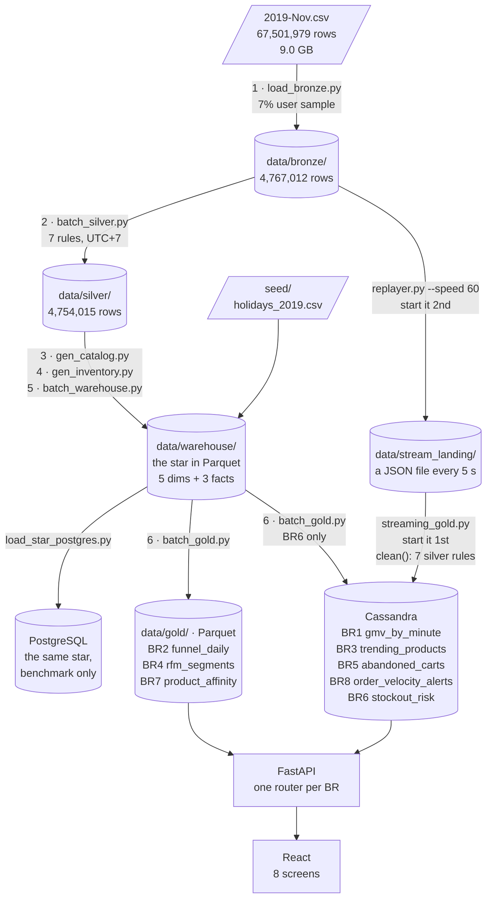
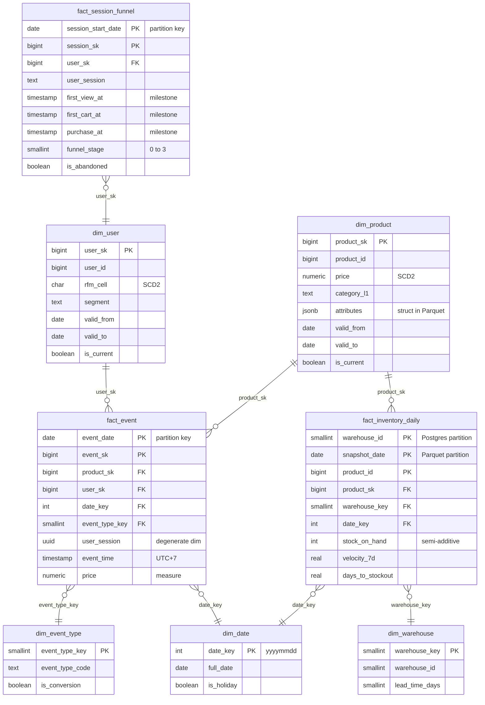
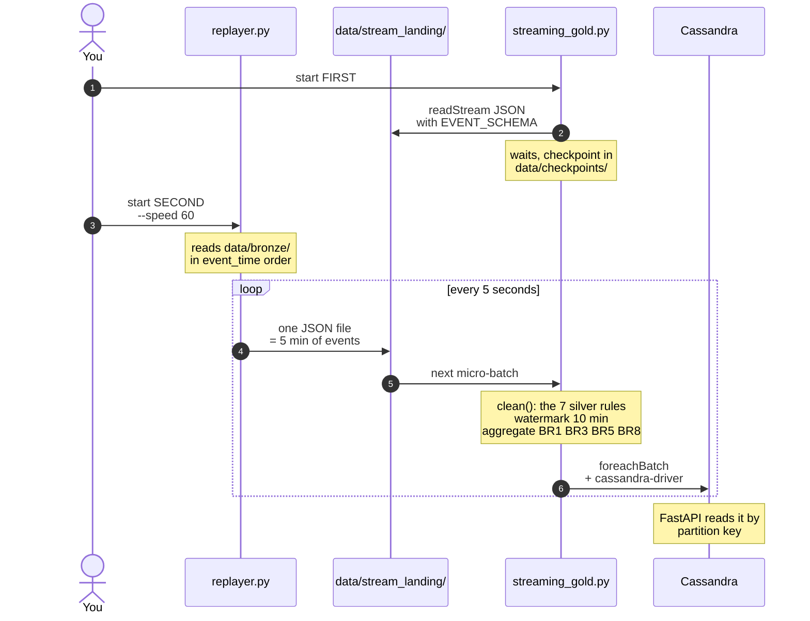

# ShopInsight — CO5173 Data Engineering, Group 15

`2019-Nov.csv` — 67,501,979 rows, 9.0 GB of behaviour events (view / cart / purchase; no `remove_from_cart` in this
file) — sampled by a deterministic 7% user hash to 4,767,012 rows (CLAUDE.md rule 5 caps the *working* dataset at 5 million; the cap is not
a property of the file) becomes a dimensional warehouse, then pre-aggregated tables, then a dashboard of 8 screens,
each answering one business question in under 2 seconds. That middle part is what the course requires to be **measured
and proven**, not asserted. HCMUT, Semester 1 2026-2027. Group 15: Dat, Khang, Nguyen, Tin. Submit ISO W46 (9-15 Nov).

## Status

> **2026-09-28 — ISO W40 of W38-W46.** Three things in this file go stale: this block, the `[x]`/`[ ]` marks under
> Repository layout, and the `(not written yet)` markers under Getting started. Fix whichever one your change makes
> false, and the date on this line.

| | |
|---|---|
| What exists | The Spark setup: [docs/SETUP_SPARK.md](docs/SETUP_SPARK.md) (Vietnamese, with explanations: [docs/SPARK_GUIDE_VI.md](docs/SPARK_GUIDE_VI.md)), [requirements.txt](requirements.txt), [conf/spark-defaults.conf](conf/spark-defaults.conf), [processing/schema.py](processing/schema.py), [processing/kata.py](processing/kata.py); bronze: [ingestion/load_bronze.py](ingestion/load_bronze.py); silver: [processing/batch_silver.py](processing/batch_silver.py); infrastructure: [docker-compose.yml](docker-compose.yml), [.env.example](.env.example), [serving/check_infra.py](serving/check_infra.py). Plus [CLAUDE.md](CLAUDE.md), [SYSTEM_DESIGN.md](SYSTEM_DESIGN.md), [PLAN.md](PLAN.md), [docs/AI_USAGE.md](docs/AI_USAGE.md), [docs/BR_SCOPE.md](docs/BR_SCOPE.md) (the 8 BRs: scope, owners, done criteria), [.gitignore](.gitignore), a `data/` skeleton, `.claude/`. The app skeleton: the frozen contract [docs/API_CONTRACT.md](docs/API_CONTRACT.md), its 8 fixture bundles in `web/fixtures/` and [tests/test_fixtures.py](tests/test_fixtures.py); FastAPI in `serving/api/`, 8 routers, where BR2, BR4 and BR6 return their fixture and the other five no rows, all with `meta.warehouse` `"Fixture"`; React in `web/`, 8 tabs, the BR2 screen on fixture data. The Postgres star: [warehouse/ddl.sql](warehouse/ddl.sql), [serving/load_star_postgres.py](serving/load_star_postgres.py) (`dim_date`, `dim_event_type`, `dim_warehouse`), [seed/holidays_2019.csv](seed/holidays_2019.csv), `docs/evidence/`. The warehouse layer: [processing/batch_warehouse.py](processing/batch_warehouse.py) (the SYSTEM_DESIGN 5.6 order; builds `dim_event_type`, `dim_product`, `stg_rfm_snapshot`, `dim_user` and `fact_event`, the other four tables are still stubs, so it prints `WAREHOUSE PARTIAL: 5 of 9 tables built`). It imports [processing/dim_product.py](processing/dim_product.py) (`dim_product` SCD2 + `product_sk`) and [processing/dim_user.py](processing/dim_user.py) (`stg_rfm_snapshot` + `dim_user` SCD2 + `user_sk`). Also [ingestion/gen_catalog.py](ingestion/gen_catalog.py) (`data/catalog/products.json`, run before batch_warehouse), [ingestion/gen_inventory.py](ingestion/gen_inventory.py), [checks/scd2_integrity.py](checks/scd2_integrity.py), [checks/fact_event_spot.py](checks/fact_event_spot.py). Cassandra: [serving/cassandra_schema.cql](serving/cassandra_schema.cql) + [serving/apply_schema.py](serving/apply_schema.py). No BR reads real data yet |
| W38-W39 tasks | Done: `docs/SETUP_SPARK.md` + `processing/kata.py`, so all four install Spark unattended — **everyone runs it and posts `KATA OK`**; `ingestion/load_bronze.py` — **in W39 everyone runs it and posts the `BRONZE OK` numbers**; `processing/batch_silver.py` — **run right after it, post the `SILVER OK` numbers**; `docker-compose.yml` + `serving/check_infra.py`, so all four install Docker unattended — **everyone runs it and posts `INFRA OK`**. W39: the `batch_warehouse.py` skeleton (PR #12) and `dim_product` + the catalogue + the Cassandra schema (PR #11) are in, and `batch_warehouse.py` now builds `dim_event_type`, `dim_product`, `stg_rfm_snapshot`, `dim_user` and `fact_event`: `WAREHOUSE PARTIAL: 5 of 9 tables built`. Still stubs: `dim_date`, `dim_warehouse` and Postgres step 6 (Tin), `fact_session_funnel` and `fact_inventory_daily` (W40). Each owner replaces the body of their own `build_*` stub, keeps its signature and writes through `write_dim`/`write_fact`. Next: the W40 streaming foundation + BR1 for Gate 1 |
| Next hard gate | Gate 1, W40 (28 Sep - 4 Oct): BR1 running on Structured Streaming, evidenced by a screenshot of the micro-batch log and rows in `gmv_by_minute` |

Every path in SYSTEM_DESIGN section 10 is a plan, not a fact, until Repository layout below marks it `[x]` or `[~]`.
**Live status comes from the repo, not from this table** —
the SessionStart hook prints it each session ([.claude/README.md](.claude/README.md)).

## Architecture



Cylinders hold data and each arrow is the script that writes the next tier, numbered in the run order of Getting
started (c). It is the finished design: Repository layout below marks which of these scripts exist today.

Alongside, benchmark only and serving nothing: DuckDB on the Parquet star, Postgres on the same star, Postgres on flat
silver. **The one load-bearing exception:** the streaming BRs (BR1, BR3, BR5, BR8) read silver-shaped events, not the
star — a micro-batch cannot range-join a Type 2 dimension a nightly batch rebuilds. `fact_event` is the *analytical*
re-materialisation of those same events: what the benchmark and the report query, and what proves the streaming numbers
right (SYSTEM_DESIGN 1, 8).

**Silver has exactly one writer, `batch_silver.py`** (SYSTEM_DESIGN sections 4 and 8): a Parquet stream sink would
create `data/silver/_spark_metadata/`, after which Spark reads only the files in that log while DuckDB and the Postgres
loader glob the whole directory, and the correctness gate is void.

### The star schema



Three facts, one per Kimball type, share five conformed dimensions: `fact_event` is a transaction fact (one row per
event), `fact_session_funnel` an accumulating snapshot (one row per session, a timestamp per funnel milestone),
`fact_inventory_daily` a periodic snapshot (one row per SKU, warehouse and day). `dim_product` and `dim_user` are SCD
Type 2, and their surrogate keys are put on the event rows in the same pass that detects each change, so no fact is
ever range-joined to a dimension (SYSTEM_DESIGN 5.4). The ninth table, `stg_rfm_snapshot`, is the staging step
`dim_user` is built from. Only keys and the columns worth knowing are drawn; [warehouse/ddl.sql](warehouse/ddl.sql)
has every column.

Star row counts come from SYSTEM_DESIGN 5.2, 5.4 and 5.5, which labels them measured. **The Spark build reproduces
five tables so far**: `batch_warehouse.py` builds `dim_event_type`, `dim_product`, `stg_rfm_snapshot`, `dim_user` and
`fact_event`, while `dim_date`, `dim_warehouse` and the other two facts are still stubs, and only the three small dims
exist in Postgres, from `serving/load_star_postgres.py`. Measured on Spark's sample: `fact_event` 4,754,015 (1:1 with
silver). Still to confirm: `fact_session_funnel` 954,686 · `fact_inventory_daily` 1,898,850 (arithmetic: 12,659 purchased SKUs x 5 warehouses x 30
days) · `dim_product` 127,693 -> 244,025 SCD2 versions · `dim_date` 92 · `dim_event_type`, `dim_warehouse` 5 each.
These were measured on an **earlier sample drawn with a different hash** (4,694,166 rows); Spark's own sample has
4,767,012 rows and 129,899 products (SYSTEM_DESIGN 3.1), so expect every count above to move slightly.

## The nine business requirements

One owner per BR, writing all three layers of it — Spark query, API endpoint, React screen. Everyone writes Spark; that
is deliberate. **PLAN.md is the schedule of record**; a week column in a README cannot be kept true, so there is none.

| BR | Question it answers | Layer | Sink | Owner |
|---|---|---|---|---|
| BR1 | GMV and order count per minute, split by category | streaming | Cassandra | Dat |
| BR2 | Conversion funnel view -> cart -> purchase, per session | batch | Parquet | Dat |
| BR3 | Top-N trending products, 15-minute sliding window | streaming | Cassandra | Khang |
| BR4 | RFM customer segmentation | batch | Parquet | Khang |
| BR5 | Abandoned cart detection | streaming | Cassandra | Nguyen |
| BR6 | Stock-out risk per SKU and warehouse | **batch** | Cassandra | Tin |
| BR7 | Frequently bought together, co-occurrence matrix | batch | Parquet | Nguyen |
| BR8 | Order velocity anomaly detection | streaming | Cassandra | Tin |
| BR9 | (bonus) Ad-hoc product lookup, combined filters | batch | Parquet | **cut** |

**BR6 is batch only**, although it sinks to Cassandra. It is *not* the only star-derived BR: `batch_gold.py` reads the
star for BR2, BR4, BR6 and BR7 (SYSTEM_DESIGN 8 step 4), `funnel_daily` aggregates `fact_session_funnel` and
`rfm_segments` projects `dim_user` (section 7). Unique to BR6 is that of the five **Cassandra** tables, only
`stockout_risk` is star-derived. **BR9 is cut** — PLAN.md dropped it to pay for the warehouse layer, and the rubric counts
8.

## API contract & fixtures

**The eight BR contracts are frozen.** See [`docs/API_CONTRACT.md`](docs/API_CONTRACT.md)
for the complete specification of every endpoint, field, type, and nullability rule.

**There is no BR9.** BR9 was removed from project scope. The table above reflects this.
No fixture, tab, endpoint, or type for BR9 exists.

### Where things live

| Artefact | Path |
|---|---|
| Contract specification | `docs/API_CONTRACT.md` |
| Fixture bundles (8) | `web/fixtures/br1-gmv-by-minute.json` … `br8-order-velocity-alerts.json` |
| Python row models | `serving/api/models.py` |
| TypeScript row types | `web/src/types/api.ts` |
| Fixture validation | `tests/test_fixtures.py` |

### Run fixture validation

```bash
# From the repo root, no extra dependencies needed
python tests/test_fixtures.py
```

Expected output: `✅  All 8 fixture bundles passed validation.`

### Adding a new BR screen (copy pattern from BR2)

1. Read the BR's section in `docs/API_CONTRACT.md` for the endpoint path,
   query parameters, and exact row field names.
2. Import the TypeScript type from `web/src/types/api.ts`
   (e.g. `import type { ApiResponse, GmvRow } from '../types/api'`).
3. Load `web/fixtures/<br>-*.json -> "default"` for local development.
4. In the FastAPI router, return `ApiResponse(data=..., meta=QueryMeta(...))`. A router that serves its fixture
   or no rows returns `warehouse="Fixture", partitions=0` until it reads its section-2 store (`docs/API_CONTRACT.md` 1.2).
5. Run `python tests/test_fixtures.py` then `cd web && npx tsc -b`. Plain `tsc --noEmit` checks nothing:
   `web/tsconfig.json` has `"files": []` and only references.

### Contract change rule

Any field rename, type change, or addition requires **simultaneous** updates to
all five artefacts above plus the relevant Spark schema or Cassandra DDL.
Changes must be agreed by all team members before merging.

## Stack

Locked, and CLAUDE.md holds the table of record: PySpark local mode (`local[*]`) with Structured Streaming and Spark
SQL; Cassandra single node in Docker for the hot gold tables; Parquet on the local filesystem for everything analytical;
a JSON file source for ingestion, Kafka only behind a gate; PostgreSQL (Docker) as the second physical realisation of the star schema and a benchmark configuration, DuckDB as the other baseline — neither serves the application;
FastAPI; React + TypeScript. **This list is closed.** No Airflow, dbt, Flink, Iceberg, Delta, Redis or Docker-for-Spark,
and no Spark-Cassandra connector — Cassandra is written through `foreachBatch` plus the plain `cassandra-driver`.

## Getting started

Blocks (b) to (e) are verbatim from SYSTEM_DESIGN section 11. Block (a) is not: the install steps appear nowhere in
section 11 and are this README's addition; [docs/SETUP_SPARK.md](docs/SETUP_SPARK.md) carries the unattended install
(Vietnamese walkthrough that also explains each file: [docs/SPARK_GUIDE_VI.md](docs/SPARK_GUIDE_VI.md))
in full, with a troubleshooting table for Linux and WSL. **(not written yet)** marks a file that does not exist yet.
**(a) Once per machine:** pin all three exactly, reasons in SYSTEM_DESIGN 11.1 — Python **3.14.x** (the only
interpreter Ubuntu 26.04 ships), **`pyspark==4.1.3`** (3.5.x segfaults on Python 3.14: its vendored cloudpickle 2.x
calls a `pickle._getattribute` that changed in 3.14, and cloudpickle serialises every UDF and RDD lambda Spark ships to
a worker), **OpenJDK 21** (Spark 4.x needs 17 or newer; the
team pins 21).

```bash
sudo apt install -y openjdk-21-jdk-headless python3.14-venv   # then set JAVA_HOME: SETUP_SPARK.md step 3
python3.14 -m venv .venv && source .venv/bin/activate
pip install -r requirements.txt
python processing/kata.py         # prints four event counts, then KATA OK
```

Spark settings live in the committed [conf/spark-defaults.conf](conf/spark-defaults.conf): `spark.driver.memory 6g`
and `spark.sql.session.timeZone UTC`. Every script sets `SPARK_CONF_DIR` to `conf/` in its first lines, **before** the
SparkSession is built. On `SparkSession.builder.config(...)` the driver memory takes effect only if that builder starts
the JVM; with a JVM already running (pyspark shell, notebook, a session stopped earlier in the process) it is ignored,
silently after a `stop()`. `spark.executor.memory` does nothing in `local[*]`, where the driver *is* the executor. The
UTC time zone keeps a laptop set to UTC+7 from filing late-30-Nov events under 1 Dec. `kata.py` prints the real heap and
time zone, so a conf that was not read shows up at once.
Then download the event log yourself — REES46 "eCommerce behavior data from multi category store",
<https://www.kaggle.com/datasets/mkechinov/ecommerce-behavior-data-from-multi-category-store> — into `data/raw/`:

```bash
kaggle datasets download -d mkechinov/ecommerce-behavior-data-from-multi-category-store -f 2019-Nov.csv -p data/raw/
unzip -o data/raw/2019-Nov.csv.zip -d data/raw/   # the CLI delivers it zipped; needs ~/.kaggle/kaggle.json
wc -c data/raw/2019-Nov.csv                       # must print 9006762395; less means a partial download
```

```bash
# (b) infrastructure
docker compose up -d --wait          # Cassandra 4.1.12 + Postgres 16.15; --wait returns when both are healthy
python serving/check_infra.py        # both drivers connect; prints INFRA OK
python serving/apply_schema.py       # Cassandra keyspace + tables; prints APPLY_SCHEMA OK
docker compose exec -T postgres psql -U shopinsight -d shopinsight -v ON_ERROR_STOP=1 < warehouse/ddl.sql
#   Applies once, to an empty database; the header of warehouse/ddl.sql has the reset for starting again.
#   Runs psql INSIDE the container: no client to install on the host and no password prompt. From the host
#   instead, if you have psql:
#   PGPASSWORD=local_dev_only psql -h 127.0.0.1 -p 5432 -U shopinsight -d shopinsight -v ON_ERROR_STOP=1 -f warehouse/ddl.sql
#   All four values are decided in .env.example and docker-compose.yml (W38).
# (c) build the data — steps 1-6 in this order; steps 1-2 run once, 15-25 minutes
python ingestion/load_bronze.py      # 1. 7% user sample, rule hard-coded; prints BRONZE OK
python processing/batch_silver.py    # 2. bronze -> silver, 7 cleaning rules; prints SILVER OK. Batch needs this
python ingestion/gen_catalog.py      # 3. product attributes JSON -> data/catalog/; prints CATALOG OK
python ingestion/gen_inventory.py    # 4. daily inventory series; prints INVENTORY OK
python processing/batch_warehouse.py # 5. silver -> star (Parquet + Postgres); W39: 5 of 9 tables, prints WAREHOUSE PARTIAL
python serving/load_star_postgres.py #    optional, Postgres only, until step 6 of batch_warehouse calls it; W39: the three small dims; prints POSTGRES STAR OK
python processing/batch_gold.py      # 6. (not written yet — per-BR owners, W40-W41) reads the star
# (d) run the stream — two terminals, IN THIS ORDER
python processing/streaming_gold.py       # start FIRST, wait for READY; W40: BR1 only. --fresh forgets earlier runs
python ingestion/replayer.py --speed 60   # 1 hour of data per minute; --start "2019-11-17 08:00:00" for a busy demo
# (e) the app
uvicorn serving.api.main:app --reload --port 8000   # from the repo root; web/ calls :8000
cd web && npm ci && npm run dev           # 2nd terminal; Node ^20.19 or >=22.12 (vite 8.3); :5173, CORS allows 5173-5175
```

**The order in (d) matters.** Start the streaming job after the replayer and the files already sitting in
`data/stream_landing/` collapse into one huge micro-batch, which looks nothing like real time during a demo. Started
in order, each new file lands in the next micro-batch:



`load_bronze.py` takes no `--rows` flag: the sample size is whatever the deterministic hash rule yields — 4,767,012 rows,
258,390 users, 129,899 products (SYSTEM_DESIGN 3.1) — and a row count would break byte-identical output across the four
machines. Never take the first 5M rows: two days of November leaves BR4's recency meaningless and BR6's `velocity_7d`
with fewer than seven days to average over.

## Data never travels through git

`.gitignore` excludes every child of `data/`, so nothing in the lake moves between machines: each person downloads
`2019-Nov.csv` and runs `load_bronze.py` + `batch_silver.py` locally. That works only because the sampling rule is
**deterministic** — `pmod(hash(user_id), 100) < 7`, hard-coded in `load_bronze.py`, never a random seed; a seed means
four machines with four datasets and a correctness gate nobody can pass. Cross-check bronze in W39 and post the three
numbers in the group chat, rather than discovering a mismatch in W44. `load_bronze.py` prints them itself, read back
from disk, and must end in `BRONZE OK`:

```
rows               4,767,012
users                258,390
products             129,899
date directories          30   (expect 30: event_date=2019-11-01 .. event_date=2019-11-30)
null event_time            0   (expect 0)
BRONZE OK
```

Then `python processing/batch_silver.py`, which must end in `SILVER OK` with 4,754,015 rows and **31** date
directories, 2019-11-01 .. 2019-12-01: silver is in Vietnam time, so the last seven UTC hours of 30 Nov belong to
1 Dec. Its docstring lists every number it prints.

The same check without Spark, once DuckDB is installed:
`duckdb -c "select count(*), count(distinct user_id), count(distinct product_id) from 'data/bronze/**/*.parquet'"`.

The script refuses to start unless `data/raw/2019-Nov.csv` is the complete 9,006,762,395 bytes, so a truncated download
is caught first. With the right file, any other number means the sampling rule, `processing/schema.py` (`user_id` read
as INT picks other users) or `conf/` (no UTC pin gives 31 directories) was changed: check `git status`. **One authored
file must go through git:
`seed/holidays_2019.csv`**. It feeds `dim_date.is_holiday`, no rule regenerates it, and it
lives in `seed/`, **not** under `data/` — `data/raw/holidays_2019.csv` is silently ignored and reaches nobody else.

## Repository layout

`[x]` exists today, `[ ]` is planned, `[~]` partly exists. SYSTEM_DESIGN section 10 has the finished tree.

```
[x] README.md CLAUDE.md SYSTEM_DESIGN.md PLAN.md .gitignore
[x] .claude/         skills, agents, hooks — see "Working with Claude Code" below
[~] data/            gitignored except the .gitkeep skeleton; nothing here travels between machines
    [x] raw/ bronze/ silver/ gold/ stream_landing/ checkpoints/ warehouse/ catalog/ inventory/
        each tracked only through its .gitkeep; a new data/ directory needs its own .gitignore negation
[~] docs/            [x] AI_USAGE.md API_CONTRACT.md BR_SCOPE.md SETUP_SPARK.md SPARK_GUIDE_VI.md STREAMING_PATTERN.md evidence/  [ ] DATA_MODEL.md
[x] requirements.txt    [x] conf/spark-defaults.conf  driver memory + UTC, read by every script
[x] docker-compose.yml  Cassandra 4.1.12 + Postgres 16.15   [x] .env.example  ports, db, user, password
[~] web/  React + TypeScript: 8 tabs, BR2 screen on fixture data; fixtures/ holds the 8 contract bundles
[x] seed/holidays_2019.csv  Committed, feeds dim_date.is_holiday
[x] ingestion/       [x] load_bronze.py gen_catalog.py gen_inventory.py replayer.py
[~] processing/      [x] schema.py kata.py batch_silver.py dim_product.py dim_user.py source.py
                     [~] batch_warehouse.py (5 of 9 tables; dim_date, dim_warehouse, 2 facts and step 6 still stubs)
                     [~] streaming_gold.py (BR1 done; BR3, BR5, BR8 stubs for W41)  [ ] batch_gold.py
[x] warehouse/ddl.sql  Postgres star schema DDL   [ ] benchmark/  queries.sql run_benchmark.py results/
[~] serving/         [x] check_infra.py cassandra_schema.cql apply_schema.py  [~] api/ (fixtures only) load_star_postgres.py (3 small dims)
[x] tests/test_fixtures.py  API contract check: fixtures and routers vs docs/API_CONTRACT.md
[x] checks/          scd2_integrity.py   SCD2 check: no overlap or gap, exactly one current row per key
                     fact_event_spot.py  fact_event has the right price at event time, on 5 pinned events
```

## Four traps that bite on day one

| Trap | Consequence |
|---|---|
| `readStream` without an explicit `.schema(EVENT_SCHEMA)`, or `writeStream` without `checkpointLocation` | Structured Streaming cannot infer schema, so the query never starts; and without a checkpoint all state is lost on restart and the job reprocesses from zero |
| `event_time` shifted to UTC+7 but `event_date` not recomputed from the shifted time | Every event between 17:00 and 24:00 UTC is misfiled and BR1, BR2 and BR6 skew. The streaming path applies the same seven rules (it imports `clean()` from `batch_silver.py`), or the executive and funnel screens disagree about which day an event belongs to |
| `category_l1` left null | Half the partition key of `gmv_by_minute`, and Cassandra rejects a null partition-key component. 32.4% of source rows have an empty `category_code`, so one BR1 insert in three fails and GMV understates by about a third |
| `replayer.py` pointed at `data/raw/2019-Nov.csv` instead of `data/bronze/` | Raw holds 3,696,117 users, bronze only the 258,390 in the 7% bucket — a 14x mismatch that puts the >= 99% correctness gate out of reach for BR1/BR3/BR5/BR8 by construction |

The rest live once each, not four times: the three Cassandra staleness rules in CLAUDE.md "Details that are easy to
get wrong" and SYSTEM_DESIGN 6.1; the `days_to_stockout` sentinel in SYSTEM_DESIGN 6.1; naive SCD2 in SYSTEM_DESIGN
5.4; the silver writer in 8.

## Branches and pull requests

`main` is protected on GitHub: every change arrives through a pull request, force-push and branch deletion are
refused, and the rule binds the repo admin too. Branch, push, open a PR — PLAN.md asks for small PRs merged within the
week and no branch older than seven days.

```bash
git switch -c br2-funnel            # one branch per slice
git push -u origin HEAD             # then open the PR on GitHub
```

Required approvals are still **0**. Khang, Nguyen and Tin are now collaborators with write access, so a teammate's
approval can count (GitHub never counts the author's own). Raise it to 1 to match PLAN.md's review rule:

```bash
gh api -X PATCH repos/Dat-TG/shop-insight/branches/main/protection/required_pull_request_reviews \
  -F required_approving_review_count=1
```

## Working with Claude Code in this repo

[.claude/README.md](.claude/README.md) is the index — what each skill covers, what each hook checks. It reaches the
other three machines only through git, so `.claude/` must be committed like any other code (`settings.local.json`
excepted). Skills: `/br-slice` (one BR end to end), `/spark-job`, `/streaming-job`, `/cassandra-table`,
`/checkpoint` (Wednesday post draft), `/ai-usage-log` — a slash name is a directory name, so `ls .claude/skills/` is
the current list.

| Hook | Event | What it actually does |
|---|---|---|
| `session_status.py` | SessionStart | Prints the ISO week, what PLAN.md says that week is for, days to the deadline, which data tiers hold files and which section-10 scripts exist. It names a gate only in the week that gate closes; the next gate is in PLAN.md |
| `check_python.py` | PostToolUse on Write/Edit | Compiles the `.py` file and prints at most five one-line trap warnings, all advisory. A syntax error exits 2 and is reported, but the write has already happened |
| `guard_data.py` | PreToolUse on Bash | Refuses a Bash command that deletes under `data/` (`rm`, or `find -delete` / `-exec rm`), `git add`s or `git commit`s a path under `data/`, force-pushes, commits while on `main`, or pushes to `main`. It does **not** cover writes under `data/` — those are denied by `permissions.deny` `Write(data/**)` and `Edit(data/**)` in `.claude/settings.json`, a different mechanism |

Standing convention from `docs/AI_USAGE.md`: AI-drafted code is not committed until a human has run it.

## Documents

[CLAUDE.md](CLAUDE.md) the hard rules, conventions and traps, read first · [SYSTEM_DESIGN.md](SYSTEM_DESIGN.md) how it
is built: tiers, the model at three levels, Cassandra keys, life of an event, layout, run order, comparison tier ·
[PLAN.md](PLAN.md) who does what in which week and which gate stops it (Vietnamese, internal) ·
[docs/AI_USAGE.md](docs/AI_USAGE.md) what was AI-drafted and how it was verified. Where they disagree: PLAN.md wins on
schedule and scope, SYSTEM_DESIGN on design; CLAUDE.md is the summary and the most likely to be stale.

## Evaluation evidence

The target is **under 2 seconds per screen**, and every screen renders its own footer — `Query: 43 ms · Cassandra · 1
partition · 60 rows`. Query time and partitions read, on screen, on every BR: evidence a grader sees without opening the
report. Three measurement sets run in W44, and Gate 4 accepts 2 of 3.

| Measurement | How it is measured | Threshold | Owner |
|---|---|---|---|
| Data correctness, plus SCD2 interval integrity | Same logic run in DuckDB and compared per BR; SCD2 intervals must not overlap, exactly one row per key is `is_current` | >= 99% match | Khang |
| Performance, p95 per query | Benchmark harness, **>= 20 runs per query** — fewer and p95 means nothing | Relative comparison across the three configurations (PLAN.md, W44 table) | Tin |
| Effectiveness | Per-screen response time on the UI, plus a survey of 5 people | < 2 s per screen | Tin |

Every gate condition is a viewable artefact — a screenshot, a file, a table of numbers — posted to the group chat, and
nobody may claim "it works" without one. Benchmark numbers come from `benchmark/queries.sql` (planned, W41), which runs
identically against all three configurations.
