# ShopInsight: báo cáo đồ án

Nhóm 15 · Data Engineering (CO5173) · HCMUT, học kỳ 1 năm học 2026–2027

## 1. Bối cảnh và các bên liên quan

### 1.1 Bối cảnh

Đồ án đặt trong bối cảnh một sàn thương mại điện tử đa ngành, bán từ điện thoại, máy tính, đồ gia dụng tới nội thất và phụ tùng ô tô. Mỗi thao tác của khách trên sàn được ghi lại thành một sự kiện gồm thời điểm, loại thao tác, sản phẩm, ngành hàng, thương hiệu, giá, mã khách và mã phiên truy cập. Có ba loại thao tác: xem sản phẩm, thêm vào giỏ và mua.

Nguồn dữ liệu là bộ "eCommerce behavior data from multi category store" do REES46 công bố trên Kaggle [1], dùng tệp tháng 11 năm 2019. Tệp này có 67,501,979 sự kiện, dung lượng 9.0 GB ở dạng CSV. Lượng mua trong tháng không đều. Tính theo ngày UTC, đỉnh lớn nhất rơi vào 16–17/11: riêng ngày 17/11 có 185,195 lượt mua, gấp khoảng 5.8 lần ngày Black Friday 29/11, vốn chỉ đứng thứ ba với 32,107 lượt. Vì vậy dữ liệu có cả giai đoạn bình thường lẫn giai đoạn tăng đột biến.

Nhật ký sự kiện là nguồn duy nhất cho biết khách đang làm gì trên sàn, nhưng nó chỉ là một danh sách thao tác xếp theo thời gian. Không câu hỏi kinh doanh nào đọc được trực tiếp từ đó. Muốn biết doanh thu đang tăng hay giảm, khách rời đi ở bước nào hay sản phẩm nào sắp hết hàng, đều phải lọc, làm sạch, gom nhóm và tính toán trên hàng chục triệu dòng.

ShopInsight là hệ thống biến nhật ký thô đó thành một dashboard gồm 8 màn hình. Mỗi màn hình trả lời một câu hỏi kinh doanh và phải phản hồi trong dưới 2 giây. Phần giá trị của đồ án nằm ở khoảng giữa: dữ liệu được làm sạch, tổ chức thành kho dữ liệu dạng mô hình chiều, rồi tổng hợp sẵn theo đúng câu hỏi mà từng màn hình đặt ra, sao cho mỗi truy vấn chỉ đọc phần dữ liệu nó cần. Nguồn dữ liệu được mô tả chi tiết ở mục 3.

### 1.2 Các bên liên quan

Người dùng của ShopInsight là bốn nhóm nội bộ của sàn. Mỗi nhóm hỏi những câu khác nhau và cần dữ liệu tươi ở mức khác nhau.

| Nhóm người dùng | Câu hỏi hằng ngày | Độ tươi cần có | Yêu cầu nghiệp vụ |
|---|---|---|---|
| Ban điều hành | Doanh thu đang đi thế nào so với một giờ trước? Ngành hàng nào đang kéo doanh thu? | Theo từng phút, màn hình tự làm mới mỗi 10 giây | BR1 |
| Tăng trưởng và marketing | Khách rời đi ở bước nào: xem, thêm giỏ hay mua? Phân khúc khách nào nên được đầu tư quảng cáo? Khách nào bỏ quên giỏ hàng? | Theo lô cho phễu và phân khúc; trong vòng 30 phút cho giỏ bỏ quên | BR2, BR4, BR5 |
| Hàng hoá | Sản phẩm nào đang tăng mạnh? Khách mua sản phẩm A thường mua kèm gì? | Cửa sổ 15 phút trượt mỗi phút cho sản phẩm đang tăng; theo lô cho mua kèm | BR3, BR7 |
| Vận hành và rủi ro | Sản phẩm nào sắp hết hàng, ở kho nào? Tài khoản nào đặt đơn bất thường? | Theo lô cho tồn kho; cửa sổ 5 phút cho đơn bất thường | BR6, BR8 |

Bảng trên cho thấy hai nhịp ra quyết định khác nhau. Một nhóm câu hỏi cần câu trả lời gần như ngay lúc sự kiện xảy ra: doanh thu theo phút, sản phẩm đang tăng, giỏ bị bỏ quên và đơn bất thường. Nhóm còn lại chấp nhận số liệu tính theo lô nhưng cần tính trên toàn bộ lịch sử: phễu chuyển đổi, phân khúc khách hàng, sản phẩm mua kèm và nguy cơ hết hàng. Hai nhịp này dẫn tới hai luồng xử lý riêng trong kiến trúc, trình bày ở mục 4. Từng yêu cầu nghiệp vụ được mô tả ở mục 2.

### 1.3 Vì sao không truy vấn thẳng nhật ký thô

Cách đơn giản nhất là để mỗi màn hình đọc thẳng tệp CSV. Cách này không đáp ứng được yêu cầu vì bốn lý do.

Thứ nhất, mọi câu hỏi đều phải quét toàn bộ tệp. Tệp CSV không có chỉ mục và không chia phân vùng, nên một câu hỏi chỉ liên quan tới một ngày hay một loại sự kiện vẫn phải đọc hết 9.0 GB. Đo trên máy của nhóm, chỉ riêng việc đọc tệp một lượt đã mất 25 giây. Câu hỏi "doanh thu theo ngành hàng trong tháng" mất 50 giây, gấp 25 lần ngưỡng 2 giây, dù câu trả lời chỉ dựa trên 916,939 lượt mua, tức khoảng 1.4% số dòng.

Thứ hai, dữ liệu thô chưa sạch. 32.4% sự kiện không có mã ngành hàng, 188,088 sự kiện có giá bằng 0, và thời điểm được lưu theo giờ UTC trong khi hệ thống báo cáo theo giờ Việt Nam, nên các sự kiện từ 17:00 tới 24:00 UTC thuộc về ngày hôm sau. Trong phép đo trên, nhóm doanh thu lớn thứ hai chính là các lượt mua không có ngành hàng. Nếu mỗi truy vấn tự làm sạch theo cách riêng, các màn hình sẽ cho ra số liệu không khớp nhau.

Thứ ba, nhiều câu hỏi cần tính trên toàn bộ lịch sử chứ không chỉ lọc vài dòng. Phân khúc khách hàng cần gom mọi lượt mua của từng khách, phễu chuyển đổi cần gom sự kiện theo phiên, còn sản phẩm mua kèm cần ghép từng cặp sản phẩm trong cùng một phiên. Tính lại những phép này cho mỗi lần mở màn hình là không khả thi.

Thứ tư, các câu hỏi thời gian thực không chờ được. Màn hình điều hành làm mới mỗi 10 giây, trong khi riêng việc đọc tệp đã mất 25 giây.

Vì vậy ShopInsight xử lý trước một lần những việc tốn kém: làm sạch, dựng kho dữ liệu, tổng hợp sẵn cho từng câu hỏi và lưu theo đúng khoá mà màn hình sẽ lọc. Màn hình chỉ còn đọc phần dữ liệu nhỏ nó cần. Việc rút từ 50 giây xuống dưới 2 giây là điều đồ án phải đo và chứng minh ở mục 6, chứ không chỉ khẳng định.

### Nguồn số liệu của mục 1

Các số dưới đây đo trên tệp `data/raw/2019-Nov.csv`, trên máy 12 nhân, 15 GB RAM chạy Ubuntu trong WSL2.

| Số liệu | Lệnh |
|---|---|
| 67,501,979 sự kiện (67,501,980 dòng trừ dòng tiêu đề) | `wc -l data/raw/2019-Nov.csv` |
| 9.0 GB (9,006,762,395 byte) | `ls -l data/raw/2019-Nov.csv` |
| Đọc tệp một lượt: 25 giây | `time wc -l data/raw/2019-Nov.csv` |
| Doanh thu theo ngành hàng: 50 giây | `time awk -F, 'NR>1 && $2=="purchase" {split($5,c,"."); g[c[1]]+=$7} END {for (k in g) print k, g[k]}' data/raw/2019-Nov.csv` |
| 916,939 lượt mua | `awk -F, 'NR>1 && $2=="purchase" {n++} END {print n}' data/raw/2019-Nov.csv` |
| Lượt mua theo ngày UTC: 17/11 có 185,195, 16/11 có 68,247, 29/11 đứng thứ ba với 32,107 | `awk -F, 'NR>1 && $2=="purchase" {d[substr($1,1,10)]++} END {for (k in d) print k, d[k]}' data/raw/2019-Nov.csv \| sort -k2 -n -r \| head -3` |
| 32.4% sự kiện không có mã ngành hàng (21,898,171 dòng) | `awk -F, 'NR>1 {n++; if ($5=="") c++} END {print c, 100*c/n}' data/raw/2019-Nov.csv` |
| 188,088 sự kiện có giá bằng 0, không có giá âm | `awk -F, 'NR>1 {if ($7+0==0) z++; if ($7+0<0) n++} END {print z, n+0}' data/raw/2019-Nov.csv` |

## 2. Tám yêu cầu nghiệp vụ

Đề bài yêu cầu ít nhất 2n yêu cầu nghiệp vụ với n là số thành viên. Nhóm có bốn người nên chọn tám yêu cầu, ký hiệu từ BR1 tới BR8. Mỗi yêu cầu trả lời một câu hỏi của một nhóm người dùng ở mục 1.2 và có một màn hình riêng trên dashboard. Mỗi thành viên phụ trách trọn hai yêu cầu, gồm phần xử lý dữ liệu, API và màn hình: một yêu cầu xử lý theo lô và một yêu cầu xử lý thời gian thực.

| BR | Câu hỏi nghiệp vụ | Nhóm người dùng | Cách xử lý | Nơi lưu kết quả |
|---|---|---|---|---|
| BR1 | Doanh thu và số đơn từng phút ra sao, ngành hàng nào đang dẫn? | Ban điều hành | Thời gian thực | Cassandra |
| BR2 | Khách rời đi ở bước nào: xem, thêm giỏ hay mua? | Tăng trưởng và marketing | Theo lô | Parquet |
| BR3 | Sản phẩm nào đang tăng mạnh trong 15 phút gần nhất? | Hàng hoá | Thời gian thực | Cassandra |
| BR4 | Phân khúc khách hàng nào nên được đầu tư quảng cáo? | Tăng trưởng và marketing | Theo lô | Parquet |
| BR5 | Khách nào bỏ quên giỏ hàng? | Tăng trưởng và marketing | Thời gian thực | Cassandra |
| BR6 | Sản phẩm nào sắp hết hàng, ở kho nào? | Vận hành và rủi ro | Theo lô | Cassandra |
| BR7 | Khách mua sản phẩm A thường mua kèm gì? | Hàng hoá | Theo lô | Parquet |
| BR8 | Tài khoản nào đặt đơn bất thường? | Vận hành và rủi ro | Thời gian thực | Cassandra |

Bốn yêu cầu thời gian thực (BR1, BR3, BR5, BR8) đọc luồng sự kiện đang tới và ghi kết quả vào Cassandra. Mỗi bảng trong Cassandra được thiết kế ngược từ đúng câu hỏi mà màn hình đặt ra. Bốn yêu cầu theo lô (BR2, BR4, BR6, BR7) đọc từ kho dữ liệu dạng mô hình chiều và ghi kết quả ra tệp Parquet, riêng BR6 ghi vào Cassandra vì màn hình tra cứu theo từng kho. Cách tổ chức hai luồng này được trình bày ở mục 4. Các phần dưới đây mô tả từng yêu cầu: câu hỏi, người dùng dùng câu trả lời để làm gì, và vì sao nhật ký thô không trả lời được.

### 2.1 BR1: Doanh thu theo từng phút

Ban điều hành cần biết doanh thu và số đơn trong từng phút của 60 phút gần nhất, chia theo ngành hàng cấp một, để thấy doanh thu đang tăng hay giảm so với một giờ trước và ngành nào đang kéo doanh thu. Màn hình gồm bốn thẻ số và biểu đồ doanh thu 60 phút, tự làm mới mỗi 10 giây, lọc theo ngày và ngành hàng.

Câu trả lời thay đổi từng phút, trong khi chỉ riêng việc đọc lại tệp thô đã mất 25 giây, dài hơn một chu kỳ làm mới. Doanh thu vì vậy phải được cộng dồn liên tục theo cửa sổ một phút ngay khi sự kiện tới. Ngoài ra, khoảng một phần ba sự kiện không có ngành hàng (mục 1.3). Các lượt mua trong số đó chiếm 10.2% doanh thu, đứng thứ hai sau ngành điện tử, nên chúng được giữ dưới ngành hàng `unknown`: vẫn được cộng vào doanh thu của mọi ngành và chọn riêng được trong bộ lọc.

### 2.2 BR2: Phễu chuyển đổi

Nhóm marketing cần biết trong các phiên truy cập có bao nhiêu phiên xem sản phẩm, bao nhiêu phiên thêm vào giỏ và bao nhiêu phiên mua, cùng tỉ lệ chuyển đổi của từng bước theo ngành hàng. Câu trả lời cho biết khách rời đi ở đâu, để sửa đúng chỗ: trang sản phẩm chưa đủ thuyết phục hay quá trình thanh toán có vướng mắc. Màn hình là phễu ba bước và bảng tỉ lệ chuyển đổi theo ngành, lọc theo khoảng ngày và ngành hàng.

Nhật ký ghi từng sự kiện riêng lẻ, không có bản ghi nào cho biết một phiên đã đi tới bước nào. Muốn có phễu, phải gom toàn bộ sự kiện theo phiên rồi mới xác định bước xa nhất của mỗi phiên. Đây là phép gom trên toàn bộ 4,754,015 sự kiện của tập dữ liệu làm việc (mục 3), không thể làm lại mỗi lần mở màn hình.

### 2.3 BR3: Sản phẩm đang tăng mạnh

Nhóm hàng hoá cần danh sách 20 sản phẩm được xem nhiều nhất trong 15 phút gần nhất, cập nhật mỗi phút, kèm mũi tên cho biết sản phẩm lên hay xuống hạng so với cửa sổ trước. Câu trả lời giúp đẩy hàng và bổ sung hàng kịp lúc sản phẩm đang được quan tâm. Màn hình là bảng 20 sản phẩm, lọc theo cửa sổ thời gian.

Bảng xếp hạng phải được tính lại mỗi phút trên một cửa sổ mới và so với hạng của cửa sổ trước. Nhật ký thô không lưu thứ hạng cũ, và quét lại tệp mỗi phút thì không kịp.

### 2.4 BR4: Phân khúc khách hàng theo RFM

Mỗi khách đã mua ít nhất một lần tính tới ngày chấm được chấm ba điểm RFM [9] từ 1 tới 5: độ gần đây của lần mua cuối (R), số lần mua (F) và tổng chi tiêu (M). Hai điểm R và F quyết định phân khúc của khách: champion, loyal, promising, needs_attention, at_risk hoặc hibernating. Khách chưa mua lần nào tính tới ngày chấm không có điểm (để trống, không phải 0) và thuộc phân khúc no_purchase. Nhóm marketing dùng phân khúc để chọn nhóm khách nên đầu tư quảng cáo, ví dụ giữ chân nhóm at_risk trước khi họ rời đi. Màn hình là heatmap 5x5 theo R và F, mỗi ô ghi số khách, bấm vào một ô thì hiện danh sách khách của ô đó.

Điểm RFM là thứ hạng tương đối giữa các khách, nên phải gom toàn bộ lịch sử mua của mọi khách rồi xếp hạng cùng lúc. Tập dữ liệu làm việc có 258,330 khách, trong đó 31,005 khách đã mua tính tới ngày 30/11. Phân khúc của một khách còn thay đổi theo thời gian, nên hệ thống chấm lại mỗi tuần và lưu lịch sử phân khúc, để mỗi sự kiện được gắn phân khúc của lần chấm hằng tuần ứng với ngày sự kiện xảy ra (mục 4.1). Nhật ký thô không có khái niệm này.

### 2.5 BR5: Giỏ hàng bị bỏ quên

Nhóm marketing cần danh sách các phiên đã thêm sản phẩm vào giỏ nhưng 30 phút sau vẫn chưa mua, xếp theo giá trị giỏ giảm dần, để nhắc khách quay lại. Màn hình là danh sách giỏ bỏ quên kèm nút "tạo chiến dịch" mô phỏng, lọc theo ngày và giá trị giỏ tối thiểu.

Điều kiện "30 phút sau vẫn chưa mua" nói về một sự kiện không xảy ra. Hệ thống phải nhớ trạng thái của từng phiên và chờ đủ 30 phút mới kết luận được. Một lần quét nhật ký tại một thời điểm không phân biệt được giỏ bị bỏ quên với giỏ sắp được thanh toán.

### 2.6 BR6: Nguy cơ hết hàng

Nhóm vận hành cần biết ở từng kho, sản phẩm nào sắp hết hàng. Số ngày còn hàng bằng tồn kho chia cho tốc độ bán trung bình của 7 ngày gần nhất, và sản phẩm còn dưới 3 ngày được tô đỏ để ưu tiên điều hàng hoặc đặt thêm. Sản phẩm không bán được trong 7 ngày có tốc độ bán bằng 0, được ghi 9999 ngày và xếp cuối bảng. Màn hình là bảng sản phẩm theo số ngày còn hàng, lọc theo kho và ngưỡng số ngày.

Nhật ký sự kiện không có thông tin tồn kho. Nhóm phải sinh riêng một chuỗi tồn kho theo ngày cho từng sản phẩm ở từng kho (mục 3), rồi ghép với lượt mua thật để tính tốc độ bán.

### 2.7 BR7: Sản phẩm thường được mua kèm

Nhóm hàng hoá nhập một mã sản phẩm và nhận về 10 sản phẩm thường được mua trong cùng một phiên với nó, xếp theo chỉ số lift. Đây là bài toán luật kết hợp trên giỏ hàng [10]: support là tỉ lệ phiên có cả hai sản phẩm, còn lift [11] so số lần hai sản phẩm được mua cùng nhau với số lần kỳ vọng nếu chúng được mua độc lập. Câu trả lời dùng để gợi ý bán kèm và sắp xếp hàng. Màn hình là ô tìm sản phẩm và danh sách kết quả.

Muốn có lift, phải ghép từng cặp sản phẩm trong mọi phiên có mua, đếm số lần mỗi cặp cùng xuất hiện, rồi chia cho tần suất riêng của từng sản phẩm. Số cặp tăng theo bình phương số sản phẩm trong phiên, nên bảng cặp phải được tính trước trên toàn tập dữ liệu thay vì tính khi người dùng tìm kiếm.

### 2.8 BR8: Tài khoản đặt đơn bất thường

Nhóm vận hành cần phát hiện các tài khoản đặt nhiều đơn bất thường trong thời gian ngắn, dấu hiệu của gian lận hoặc mua bằng công cụ tự động. Hệ thống đếm số đơn của mỗi tài khoản trong cửa sổ 5 phút và gắn mức độ cảnh báo. Màn hình là danh sách cảnh báo theo mức độ, lọc theo ngày và mức độ. Mở một cảnh báo ra tổng của cửa sổ 5 phút: số đơn trong cửa sổ, tổng giá trị, giá trị trung bình mỗi đơn và mức độ. Bảng cảnh báo chỉ lưu tổng của từng cửa sổ cho mỗi tài khoản, không lưu từng đơn.

Cảnh báo chỉ có giá trị khi được phát hiện ngay lúc sự việc xảy ra. Hệ thống phải đếm liên tục theo từng tài khoản trên luồng sự kiện, việc quét lại nhật ký sau đó chỉ cho biết điều đã xảy ra.

### Nguồn số liệu của mục 2

| Số liệu | Lệnh |
|---|---|
| 4,754,015 sự kiện trong tập dữ liệu làm việc | `python processing/batch_silver.py`, dòng `rows` |
| 258,330 khách | `python processing/batch_silver.py`, dòng `users` |
| 31,005 khách đã mua tính tới 30/11 | `python processing/batch_gold.py`, dòng `buyers` |
| Ngành `unknown`: 10.2% doanh thu, thứ hai sau điện tử | Xem nguồn số liệu của mục 3 |

## 3. Bốn nguồn dữ liệu

Hệ thống dùng bốn nguồn dữ liệu. Một nguồn tải về từ Kaggle, một nguồn viết tay và commit vào git, hai nguồn do nhóm tự sinh. Hai nguồn tự sinh là dữ liệu giả lập, vì bộ dữ liệu gốc không có thông tin thuộc tính sản phẩm và tồn kho. Việc nói rõ điều này giúp người đọc biết kết luận nào dựa trên dữ liệu thật và kết luận nào dựa trên dữ liệu minh hoạ.

| Nguồn | Cách có được | Định dạng | Số dòng | Dữ liệu thật hay giả lập |
|---|---|---|---|---|
| Nhật ký sự kiện tháng 11/2019 | Tải từ Kaggle | CSV, 9.0 GB | 67,501,979 sự kiện, lấy mẫu còn 4,767,012 | Thật |
| Lịch ngày lễ và sự kiện bán lẻ | Viết tay, commit vào git | CSV | 3 | Thật |
| Catalogue thuộc tính sản phẩm | Sinh tất định từ mã sản phẩm | JSON | 128,972 | Giả lập |
| Tồn kho theo ngày | Sinh từ lượt mua thật | Parquet | 1,909,650 | Giả lập, bám theo lượt mua thật |

### 3.1 Nhật ký sự kiện

Nguồn chính là tệp `2019-Nov.csv` của bộ "eCommerce behavior data from multi category store" do REES46 công bố trên Kaggle [1]. Tệp có 67,501,979 sự kiện của 3,696,117 khách trong tháng 11/2019, mỗi sự kiện có 9 cột:

| Cột | Ý nghĩa |
|---|---|
| `event_time` | Thời điểm xảy ra sự kiện, theo giờ UTC |
| `event_type` | Loại thao tác: `view` (xem), `cart` (thêm giỏ), `purchase` (mua) |
| `product_id` | Mã sản phẩm |
| `category_id` | Mã ngành hàng |
| `category_code` | Tên ngành hàng dạng phân cấp, ví dụ `electronics.smartphone` |
| `brand` | Thương hiệu |
| `price` | Giá sản phẩm |
| `user_id` | Mã khách |
| `user_session` | Mã phiên truy cập |

**Lấy mẫu.** Nhóm giới hạn tập dữ liệu làm việc ở tối đa 5 triệu dòng, để mỗi lần thử nghiệm chạy đủ nhanh trên máy cá nhân mà không làm thay đổi kết luận nào. Nhóm không lấy 5 triệu dòng đầu tệp, vì tệp xếp theo thời gian: dòng thứ 5 triệu đã là sự kiện lúc 07:09 UTC ngày 4/11, nên 5 triệu dòng đầu chỉ phủ khoảng ba ngày đầu tháng. Với chừng đó dữ liệu, độ gần đây của BR4 mất ý nghĩa và tốc độ bán 7 ngày của BR6 không đủ ngày để tính. Thay vào đó, nhóm giữ lại khoảng 7% số khách trên trọn tháng theo quy tắc `pmod(hash(user_id), 100) < 7`, và giữ mọi sự kiện của những khách đó. Tập mẫu có 4,767,012 sự kiện của 258,390 khách và 129,899 sản phẩm, trải đủ 30 ngày.

Quy tắc lấy mẫu dựa trên giá trị băm của mã khách chứ không dùng số ngẫu nhiên. Nhờ vậy bốn máy của bốn thành viên, khi tự tải tệp gốc và chạy cùng một script, đều ra cùng một tập dữ liệu, và số liệu của mọi người đối chiếu được với nhau.

**Chất lượng dữ liệu.** Tệp gốc có ba vấn đề phải xử lý trước khi dùng:
- 32.4% sự kiện không có tên ngành hàng và 13.7% sự kiện không có thương hiệu.
- 188,088 sự kiện có giá bằng 0.
- Thời điểm lưu theo UTC, trong khi hệ thống báo cáo theo giờ Việt Nam.

Bước làm sạch từ tầng bronze sang tầng silver áp dụng bảy quy tắc:
1. Bỏ sự kiện có giá không dương.
2. Bỏ sự kiện thiếu mã khách.
3. Tách tên ngành hàng thành ba cấp.
4. Điền `unknown` cho ngành hàng bị thiếu.
5. Điền `unknown` cho thương hiệu bị thiếu.
6. Đổi thời điểm sang giờ Việt Nam và tính lại ngày của sự kiện.
7. Bỏ sự kiện thiếu mã phiên.

Sau bước này, tập làm việc còn 4,754,015 sự kiện của 258,330 khách và 128,972 sản phẩm. Vì đổi sang giờ Việt Nam, dữ liệu trải trên 31 ngày: các sự kiện từ 17:00 tới 24:00 UTC ngày 30/11 thuộc về ngày 1/12 theo giờ Việt Nam.

Ngành hàng bị thiếu được giữ lại dưới nhãn `unknown` chứ không bị bỏ đi. Trong tập làm việc, nhãn này chiếm 25.0% lượt mua và 10.2% doanh thu, nhiều thứ hai sau ngành điện tử. Nếu bỏ, màn hình điều hành sẽ thiếu đúng phần doanh thu đó.

**Khoảng trống trong dữ liệu gốc.** Tệp không có lượt mua nào trong 38.4 giờ liên tục, từ 18:09 ngày 14/11 tới 08:32 ngày 16/11 theo giờ UTC, trong khi lượt xem và thêm giỏ vẫn diễn ra bình thường. Đây là đặc điểm của dữ liệu gốc chứ không phải lỗi của pipeline. Nhóm giữ nguyên khoảng trống này. Hệ quả là phễu chuyển đổi ngày 15/11 gần như bằng 0 và doanh thu đi ngang trong những giờ đó.

### 3.2 Lịch ngày lễ và sự kiện bán lẻ

Tệp `seed/holidays_2019.csv` dùng để đánh dấu ngày đặc biệt trong chiều thời gian của kho dữ liệu, trải từ 1/10 tới 31/12/2019. Tệp ghi ba sự kiện bán lẻ: Singles Day (11/11), Black Friday (29/11) và Cyber Monday (2/12). Hai sự kiện đầu nằm trong tháng của dữ liệu, còn Cyber Monday rơi ngay sau ngày cuối. Trong khoảng từ tháng 10 tới tháng 12 năm 2019 không có ngày lễ nào của Việt Nam, nên tệp không có dòng nào loại này.

Đây là nguồn duy nhất được viết tay, không sinh lại được bằng quy tắc nào. Vì vậy tệp được commit vào git và đặt trong thư mục `seed/`, nằm ngoài `data/`. Thư mục `data/` bị loại khỏi git, nên nếu đặt tệp ở đó thì nó sẽ không bao giờ tới được máy của các thành viên khác, và chiều thời gian trên mỗi máy sẽ khác nhau.

### 3.3 Catalogue thuộc tính sản phẩm

Nhật ký sự kiện chỉ có mã, ngành hàng, thương hiệu và giá của sản phẩm. Để minh hoạ việc lưu trữ dữ liệu lồng nhau, nhóm sinh thêm một catalogue dạng JSON: mỗi sản phẩm trong tập làm việc có một tài liệu thuộc tính gồm màu, khối lượng, thời hạn bảo hành, kích thước, nhãn và thông số. Catalogue có 128,972 sản phẩm, đúng bằng số sản phẩm của tầng silver.

Thuộc tính được suy ra từ mã sản phẩm bằng một hàm băm cố định, nên mọi máy sinh ra cùng một catalogue. Cấu trúc lồng nhau được lưu thành cột `jsonb` có chỉ mục GIN trong PostgreSQL và cột `struct` trong Parquet, tạo ra một phép so sánh trực tiếp giữa hai cách tổ chức vật lý. Đây là dữ liệu giả lập hoàn toàn, chỉ dùng để minh hoạ kỹ thuật lưu trữ, không dùng để rút ra kết luận kinh doanh.

### 3.4 Tồn kho theo ngày

Bộ dữ liệu gốc không có tồn kho, nhưng BR6 cần tồn kho để tính số ngày còn hàng. Nhóm sinh một chuỗi tồn kho theo ngày: mỗi dòng là một sản phẩm tại một kho trong một ngày. Chuỗi chỉ gồm 12,731 sản phẩm từng có lượt mua trong tập mẫu, vì sản phẩm chưa từng bán có tốc độ bán bằng 0 và không bao giờ xuất hiện trên màn hình cảnh báo. Với 5 kho và 30 ngày, chuỗi có 12,731 × 5 × 30 = 1,909,650 dòng.

Chuỗi được sinh sao cho khớp với lượt mua thật:
- Mỗi khách luôn mua ở một kho cố định, chọn theo giá trị băm của mã khách.
- Tồn cuối ngày bằng tồn đầu ngày cộng hàng nhập trừ hàng bán.
- Khi tồn cuối ngày xuống dưới điểm đặt hàng lại, sáng hôm sau có một lô hàng mới. Ngày nào bán vượt số đang có thì phần thiếu được điều gấp từ nơi khác.
- Khoảng 10% cặp sản phẩm và kho được chọn cố định là "đang chờ nhà cung cấp", cả tháng không có lô mới, để màn hình cảnh báo có dữ liệu. Ngày 30/11 có 10.6% cặp nằm dưới điểm đặt hàng lại.

Đây là dữ liệu giả lập, nhưng lượng hàng bán ra là lượt mua thật, nên tốc độ bán trên màn hình BR6 phản ánh đúng nhu cầu trong dữ liệu.

### 3.5 Đặc trưng Big Data

Bốn đặc trưng của Big Data đều đo được trên dữ liệu của đồ án. Về khối lượng (volume), tệp gốc có 67,501,979 sự kiện và 9,006,762,395 byte, tức 9.0 GB theo đơn vị thập phân (10^9 byte) hay 8.4 GiB theo đơn vị nhị phân (2^30 byte); con số 8.4G mà `du -h` in ra là GiB. Tập mẫu 7% khách ở tầng bronze có 4,767,012 sự kiện (7.06% số sự kiện của tệp gốc), chiếm 116,888,680 byte Parquet, và tầng silver còn 4,754,015 sự kiện. Về tốc độ (velocity), replayer ở `--speed 60` ghi một tệp JSON mỗi 5 giây, mỗi tệp chứa 5 phút sự kiện. Trong lần kiểm tính đúng đắn ngày 6/11, 78 tệp chứa 187,468 sự kiện của 6.5 giờ chiều tối ngày 17/11, trung bình 2,403 sự kiện mỗi tệp, tức khoảng 481 sự kiện mỗi giây đồng hồ thực (187,468 / (78 × 5 giây)). Đây là tốc độ của tập mẫu 7% phát nhanh 60 lần, không phải tốc độ thật của sàn. Về tính đa dạng (variety), dữ liệu vào hệ thống ở bốn dạng: CSV phẳng 9 cột cho nhật ký sự kiện, CSV viết tay 3 dòng cho lịch ngày lễ, Parquet chia theo ngày cho 1,909,650 dòng tồn kho, và JSON cho hai nguồn còn lại. Catalogue là JSON lồng nhau thật: mỗi tài liệu trong 128,972 tài liệu có đối tượng `attributes` chứa hai đối tượng con (`dimensions`, `specs`) và một mảng (`tags`), nhưng đây là dữ liệu giả lập (mục 3.3). Các tệp JSON mà replayer ghi cho nhánh thời gian thực thì phẳng, mỗi dòng một sự kiện, và trường rỗng bị bỏ hẳn khỏi dòng chứ không ghi `null`, nên hai dòng liền nhau có thể có số trường khác nhau. Về độ tin cậy (veracity), 32.44% sự kiện của tệp gốc (21,898,171 / 67,501,979) không có `category_code`; trong tập mẫu ở tầng bronze tỉ lệ này là 32.32% (1,540,735 / 4,767,012), và ở tầng silver 32.27% sự kiện (1,534,249 / 4,754,015) mang nhãn `unknown`. Con số 32.4% ở mục 1.3 và 3.1 là của tệp gốc. Tệp gốc còn có 188,088 sự kiện giá không dương và 10 sự kiện thiếu mã phiên, không sự kiện nào thiếu mã khách. Trong tập mẫu, `clean()` của `batch_silver.py` bỏ 12,997 sự kiện: 12,996 vì giá không dương và 1 vì thiếu mã phiên, đúng bằng chênh lệch 4,767,012 − 4,754,015.

### Nguồn số liệu của mục 3

| Số liệu | Lệnh |
|---|---|
| 67,501,979 sự kiện, 9 cột, 9.0 GB | `wc -l data/raw/2019-Nov.csv`, `head -1 data/raw/2019-Nov.csv`, `ls -l data/raw/2019-Nov.csv` |
| 3,696,117 khách trong tệp gốc | `awk -F, 'NR>1 {u[$8]} END {print length(u)}' data/raw/2019-Nov.csv` |
| Dòng thứ 5,000,000 là sự kiện lúc 2019-11-04 07:09:03 UTC | `awk -F, 'NR==5000001 {print $1; exit}' data/raw/2019-Nov.csv` |
| 32.4% không có ngành hàng (21,898,171), 13.7% không có thương hiệu (9,218,235) | `awk -F, 'NR>1 {n++; if ($5=="") c++; if ($6=="") b++} END {print c, 100*c/n, b, 100*b/n}' data/raw/2019-Nov.csv` |
| 188,088 sự kiện có giá bằng 0 | Xem nguồn số liệu của mục 1 |
| Tập mẫu: 4,767,012 sự kiện, 258,390 khách, 129,899 sản phẩm, 30 ngày | `python ingestion/load_bronze.py`, các dòng `rows`, `users`, `products`, `date directories` |
| Tập làm việc: 4,754,015 sự kiện, 258,330 khách, 128,972 sản phẩm, 31 ngày | `python processing/batch_silver.py`, các dòng `rows`, `users`, `products`, `directories` |
| Ngành `unknown`: 25.0% lượt mua, 10.2% doanh thu, thứ hai sau điện tử | `python -c "import duckdb; print(duckdb.sql(\"SELECT category_l1, count(*), sum(price) FROM read_parquet('data/silver/*/*/*.parquet', hive_partitioning = true) WHERE event_type = 'purchase' GROUP BY 1 ORDER BY 3 DESC\").fetchall())"` |
| 38.4 giờ không có lượt mua, 14/11 18:09:37 tới 16/11 08:32:34 UTC | `awk -F, 'NR>1 && $2=="purchase" {print $1}' data/raw/2019-Nov.csv \| sort \| awk '{t=$1" "$2; gsub(/[-:]/," ",t); s=mktime(t); if (p && s-p>m) {m=s-p; a=l; b=$1" "$2} p=s; l=$1" "$2} END {print m/3600, a, b}'` |
| 3 dòng lịch | `cat seed/holidays_2019.csv` |
| Catalogue 128,972 sản phẩm | `python ingestion/gen_catalog.py`, dòng `products` |
| Tồn kho: 12,731 sản phẩm, 1,909,650 dòng, 10.6% dưới điểm đặt hàng lại | `python ingestion/gen_inventory.py`, các dòng `products`, `rows`, `below reorder 2019-11-30` |

Các số của mục 3.5 đo ngày 10/11/2026 trên máy của Đắt (20 nhân, Ubuntu trong WSL2, DuckDB 1.5.5), trừ số của replayer lấy từ tệp bằng chứng.

| Số liệu | Lệnh |
|---|---|
| 9,006,762,395 byte; 8.4G theo `du -h` (GiB) | `ls -l data/raw/2019-Nov.csv`, `du -h data/raw/2019-Nov.csv`; 9,006,762,395 / 10^9 = 9.0 GB, / 2^30 = 8.39 GiB |
| Tệp gốc: 67,501,979 sự kiện, 21,898,171 (32.44%) thiếu `category_code`, 9,218,235 thiếu `brand`, 188,088 giá không dương, 0 thiếu mã khách, 10 thiếu mã phiên | `python -c "import duckdb; print(duckdb.sql(\"SELECT count(*), count(*) FILTER (WHERE category_code IS NULL), count(*) FILTER (WHERE brand IS NULL), count(*) FILTER (WHERE price <= 0), count(*) FILTER (WHERE user_id IS NULL), count(*) FILTER (WHERE user_session IS NULL) FROM read_csv('data/raw/2019-Nov.csv')\").fetchall())"` |
| Bronze: 4,767,012 sự kiện (7.06% tệp gốc), 1,540,735 (32.32%) thiếu `category_code`, 12,996 giá không dương, 1 thiếu mã phiên, 12,997 dòng bị `clean()` bỏ | `python -c "import duckdb; print(duckdb.sql(\"SELECT count(*), count(*) FILTER (WHERE category_code IS NULL), count(*) FILTER (WHERE price <= 0), count(*) FILTER (WHERE user_session IS NULL), count(*) FILTER (WHERE price <= 0 OR user_id IS NULL OR user_session IS NULL) FROM read_parquet('data/bronze/*/*.parquet', hive_partitioning = true)\").fetchall())"` |
| Bronze: 116,888,680 byte | `du -sb data/bronze` |
| Silver: 4,754,015 sự kiện, 1,534,249 (32.27%) mang `category_l1 = 'unknown'` | `python -c "import duckdb; print(duckdb.sql(\"SELECT count(*), count(*) FILTER (WHERE category_l1 = 'unknown') FROM read_parquet('data/silver/*/*/*.parquet', hive_partitioning = true)\").fetchall())"` |
| Một tệp mỗi 5 giây, mỗi tệp 5 phút sự kiện ở `--speed 60` | `FILE_EVERY_SECONDS = 5` và docstring trong `ingestion/replayer.py` |
| 78 tệp, 187,468 sự kiện, 15:00–21:30 giờ Việt Nam ngày 17/11; 2,403 sự kiện mỗi tệp, 481 sự kiện mỗi giây | `docs/evidence/correctness_8br.txt`, mục "How the system side was built"; 187,468 / 78 = 2,403.4 và 187,468 / (78 × 5) = 480.7. Trên máy của Đắt, 78 tệp của một lần phát lại cùng tham số ngày 8/11 còn nằm trong `data/stream_landing/`: `python -c "import duckdb; print(duckdb.sql(\"SELECT count(*), count(DISTINCT filename), min(event_time), max(event_time) FROM read_json('data/stream_landing/*.json', filename = true)\").fetchall())"` ra 187,468 dòng, 78 tệp, 08:00:00 tới 14:29:59 UTC |
| Dòng JSON của replayer bỏ trường rỗng | `head -2 data/stream_landing/20261108-162312-000001.json`: dòng đầu không có `brand`, dòng thứ hai không có `category_code` và `brand` |
| Catalogue: 128,972 tài liệu, `attributes` lồng `dimensions`, `specs` và mảng `tags` | `python -c "import duckdb; print(duckdb.sql(\"DESCRIBE SELECT * FROM read_json('data/catalog/products.json')\").fetchall())"`; đếm bằng `SELECT count(*)` trên cùng tệp |
| Tồn kho: 1,909,650 dòng, 30 thư mục ngày | `python -c "import duckdb; print(duckdb.sql(\"SELECT count(*), count(DISTINCT snapshot_date) FROM read_parquet('data/inventory/*/*.parquet', hive_partitioning = true)\").fetchall())"` |

## 4. Kiến trúc và công nghệ

### 4.1 Kiến trúc hệ thống

ShopInsight gồm năm tầng: thu nhận, xử lý, lưu trữ, phục vụ và ứng dụng. Dữ liệu đi qua các tầng theo hai nhánh chạy song song. Nhánh theo lô dựng kho dữ liệu và các bảng tổng hợp cho BR2, BR4, BR6, BR7. Nhánh thời gian thực tính kết quả ngay khi sự kiện tới cho BR1, BR3, BR5, BR8. Sơ đồ dưới đây ghi tên các script thực hiện từng bước.

```text
 NGUỒN     2019-Nov.csv    seed/holidays_2019.csv: vào thẳng batch_warehouse.py
                |
                v
 THU NHẬN  load_bronze.py: lấy mẫu 7% khách, ghi bronze (Parquet, chia theo ngày)
                |
                +--------- NHÁNH THEO LÔ ----------+------ NHÁNH THỜI GIAN THỰC ------+
                |                                  |                                  |
                v                                  |                                  v
 XỬ LÝ     batch_silver.py: làm sạch, ra silver    |   replayer.py: phát lại bronze thành
           gen_catalog.py, gen_inventory.py: sinh  |   luồng tệp JSON theo thời gian
             catalogue và tồn kho từ silver        |   streaming_gold.py: Structured Streaming
           batch_warehouse.py: kho dữ liệu dạng    |     tính BR1, BR3, BR5, BR8
             mô hình chiều, đọc silver, lịch ngày  |                                  |
             lễ, catalogue và tồn kho              |                                  |
           batch_gold.py: tổng hợp BR2, BR4, BR6   |                                  |
           gold_br7.py: tổng hợp BR7               |                                  |
                |                                  |                                  |
                v                                  |                                  v
 LƯU TRỮ   Parquet: silver, kho dữ liệu, gold      |   Cassandra: bảng gold của
             của BR2, BR4, BR7                     |     BR1, BR3, BR5, BR8
           PostgreSQL: bản thứ hai của kho dữ liệu |
           Cassandra: bảng gold của BR6            |
                |                                  |                                  |
                +----------------------------------+----------------------------------+
                                                   |
                                                   v
 PHỤC VỤ   FastAPI: mỗi BR một endpoint. BR2, BR4, BR7 đọc Parquet bằng DuckDB;
           BR1, BR3, BR5, BR6, BR8 đọc Cassandra theo khoá phân vùng
                                                   |
                                                   v
 ỨNG DỤNG  React: 8 màn hình, mỗi màn hình ghi thời gian truy vấn và số phân vùng đã đọc
```

**Tầng thu nhận.** `load_bronze.py` đọc tệp CSV gốc, giữ lại khoảng 7% số khách (mục 3.1) và ghi ra tầng bronze dạng Parquet, chia thư mục theo ngày. Bronze giữ nguyên dữ liệu, không sửa gì, và là bản gốc để đối chiếu mỗi khi một con số trông bất thường. Ba nguồn còn lại đi vào hệ thống theo cách riêng: lịch ngày lễ được commit vào git, còn catalogue và tồn kho do hai script sinh ra từ silver. Cả ba không được nạp vào bronze hay silver; `batch_warehouse.py` đọc thẳng chúng khi dựng các bảng chiều và bảng tồn kho. Với nhánh thời gian thực, `replayer.py` đọc bronze theo thứ tự thời gian và ghi từng đợt sự kiện thành tệp JSON vào một thư mục chờ, có thể tăng tốc để một giờ dữ liệu phát lại trong một phút khi demo. Replayer đọc bronze chứ không đọc tệp CSV gốc, để hai nhánh làm việc trên cùng một tập khách. Phần đọc nguồn luồng được tách riêng trong `processing/source.py`, nên khi cần thay thư mục tệp bằng một hàng đợi thông điệp như Kafka thì chỉ phải sửa một tệp.

**Tầng xử lý.** Ở nhánh theo lô:
- `batch_silver.py` áp bảy quy tắc làm sạch để ra tầng silver. Tầng này chia thư mục theo ngày rồi theo loại sự kiện, nên truy vấn chỉ cần một loại sự kiện sẽ bỏ qua được cả thư mục của các loại khác.
- `batch_warehouse.py` dựng kho dữ liệu theo mô hình chiều: năm bảng chiều dùng chung và ba bảng sự kiện, mỗi bảng ứng với một kiểu bảng sự kiện của Kimball [2].
  - Bảng giao dịch ghi từng sự kiện.
  - Bảng ảnh chụp tích luỹ ghi từng phiên đi qua các bước của phễu, mỗi bước một mốc thời gian được điền khi phiên đi tới bước đó. Parquet không cho sửa một dòng đã ghi, nên mỗi lần chạy, bảng này được dựng lại toàn bộ rồi ghi đè, không cập nhật tăng dần.
  - Bảng ảnh chụp định kỳ ghi tồn kho của từng sản phẩm tại từng kho mỗi ngày.
  - Hai bảng chiều khách hàng và sản phẩm lưu lịch sử thay đổi theo kiểu SCD loại 2. Mỗi sự kiện được gắn phiên bản có hiệu lực vào ngày xảy ra, không lẫn với giá trị hiện tại. Chiều sản phẩm có tối đa một phiên bản mỗi ngày, nên sự kiện mang giá cuối ngày của sản phẩm vào hôm đó. Chiều khách hàng chỉ có thể đổi phiên bản sau mỗi lần chấm RFM hằng tuần (7, 14, 21, 28 và 30/11), nên sự kiện mang phân khúc của lần chấm gần nhất trước ngày đó; các sự kiện từ 1 tới 7/11 mang phân khúc của lần chấm ngày 7/11.
- `batch_gold.py` đọc kho dữ liệu và tính sẵn bảng kết quả của BR2, BR4 và BR6. Bảng sản phẩm mua kèm của BR7 do một script riêng, `gold_br7.py`, tính từ `fact_event` và `dim_product` của kho dữ liệu.

Ở nhánh thời gian thực, `streaming_gold.py` dùng Spark Structured Streaming đọc thư mục chờ theo từng lô nhỏ. Nó áp đúng bảy quy tắc làm sạch của silver bằng cách gọi lại cùng một hàm, rồi tính bốn phép tổng hợp theo cửa sổ thời gian và ghi thẳng kết quả vào Cassandra. Job này không ghi vào tầng silver: silver chỉ có đúng một nơi ghi là `batch_silver.py`, để dữ liệu không bị nhân đôi khi phát lại.

**Tầng lưu trữ.** Mỗi kho lưu trữ được chọn theo kiểu truy cập:
- Parquet [6] là nơi lưu chính cho silver, kho dữ liệu và các bảng gold phân tích. Dữ liệu chia thư mục theo ngày, nên truy vấn theo khoảng ngày chỉ đọc các thư mục liên quan.
- PostgreSQL chứa một bản thứ hai của cùng mô hình logic của kho dữ liệu, dùng chỉ mục B-tree, BRIN và GIN [8]. Bản này không phục vụ màn hình nào. Nó tồn tại để so sánh công bằng hai cách hiện thực vật lý của cùng một mô hình ở phần đánh giá.
- Cassandra giữ các bảng gold cần đọc nhanh. Mỗi bảng được thiết kế ngược từ câu hỏi của màn hình, và mọi truy vấn đi qua khoá phân vùng.

**Tầng phục vụ.** FastAPI cung cấp mỗi BR một endpoint, trả về cùng một khuôn gồm dữ liệu và thông tin truy vấn: thời gian, kho lưu trữ đã đọc, số phân vùng và số dòng. Các BR theo lô có kết quả ở Parquet được đọc bằng DuckDB [7], một engine phân tích chạy ngay trong tiến trình của API. Các BR có kết quả ở Cassandra được đọc bằng một truy vấn theo đúng khoá phân vùng.

**Tầng ứng dụng.** Giao diện React có 8 màn hình, mỗi màn hình một BR. Chân mỗi màn hình hiện thời gian truy vấn và số phân vùng đã đọc, nên người dùng thấy ngay hiệu quả của cách tổ chức dữ liệu mà không cần mở báo cáo.

**Một ngoại lệ của nhánh thời gian thực.** Nguyên tắc chung là các bảng gold được sinh từ kho dữ liệu chứ không sinh thẳng từ silver. Bốn BR thời gian thực là ngoại lệ: chúng vẫn đọc sự kiện ở dạng silver, không đọc kho dữ liệu. Lý do là chiều khách hàng và chiều sản phẩm lưu lịch sử theo kiểu SCD loại 2 và được dựng lại theo lô. Muốn gắn đúng phiên bản của chiều cho từng sự kiện trong một lô nhỏ của luồng, hoặc phải đưa toàn bộ bảng chiều vào mỗi lô, hoặc phải viết lại nhánh thời gian thực, và cả hai cách đều vượt quá thời gian của nhóm. Vì vậy, trong năm bảng gold ở Cassandra, chỉ bảng nguy cơ hết hàng của BR6 thật sự được sinh từ kho dữ liệu, vì BR6 là BR theo lô. Bảng sự kiện trong kho dữ liệu vẫn chứa đúng các sự kiện đó. Nó là bản phân tích dùng cho phần đánh giá hiệu năng và để kiểm chứng rằng số liệu của nhánh thời gian thực là đúng.

### 4.2 Cassandra: thiết kế khoá ngược từ câu hỏi

Cassandra giữ năm bảng gold cần đọc nhanh: bốn bảng của nhánh thời gian thực (BR1, BR3, BR5, BR8) và bảng nguy cơ hết hàng của BR6. Hệ thống chạy Cassandra [5] 4.1.12, một node trong Docker. Mục này giải thích cách Cassandra tổ chức dữ liệu theo khoá, vì sao khoá phải được thiết kế từ câu hỏi của màn hình, và chỗ dễ sai nhất khi ghi lại kết quả: dòng rác.

**Khoá phân vùng và khoá sắp xếp.** Khoá chính của một bảng Cassandra gồm hai phần:
- Khoá phân vùng (partition key) quyết định dòng nằm ở phân vùng nào. Cassandra băm khoá này để chọn node lưu, và mọi dòng cùng khoá phân vùng được lưu liền nhau. Truy vấn nêu đủ khoá phân vùng chỉ đọc đúng một phân vùng, dù bảng lớn bao nhiêu.
- Khoá sắp xếp (clustering key) quyết định thứ tự các dòng bên trong một phân vùng. Thứ tự này có sẵn trên đĩa, nên đọc "N dòng đầu" không cần bước sắp xếp.

Cassandra không có phép nối. Lọc theo một cột không thuộc khoá thì phải quét cả bảng, và Cassandra chỉ chịu chạy khi thêm `ALLOW FILTERING`, trừ khi tạo chỉ mục phụ cho cột đó, mà nhóm không dùng. Vì vậy câu hỏi mà màn hình sẽ hỏi phải được trả lời bằng chính khoá.

**Hai bảng thật.** Hai ảnh dưới đây là kết quả `DESCRIBE TABLE` trên Cassandra đang chạy.

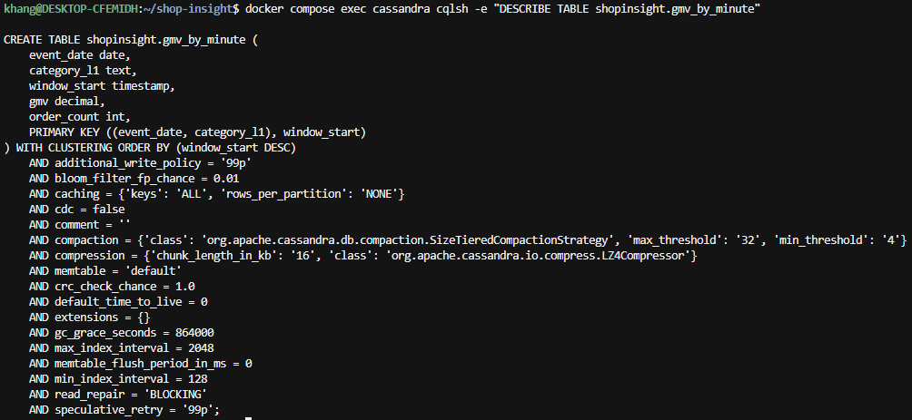

Màn hình BR1 luôn hỏi: "doanh thu từng phút của ngành X trong ngày D, 60 phút gần nhất". Hai bộ lọc ngày và ngành hàng trở thành khoá phân vùng `(event_date, category_l1)`. Khoá sắp xếp `window_start` theo chiều giảm dần đặt phút mới nhất lên đầu phân vùng. Màn hình cần 120 phút (60 phút gần nhất và 60 phút trước đó để so sánh), tức 120 dòng liền nhau ở đầu một phân vùng. Lựa chọn "tất cả ngành hàng" cũng là một phân vùng riêng: luồng ghi thêm một dòng `category_l1 = 'all'` cho mỗi phút, nên màn hình mặc định đọc 1 phân vùng thay vì 14. Đo trên API: 1 phân vùng, 120 dòng, 5.7 ms.


Màn hình BR3 hỏi: "top 20 sản phẩm của cửa sổ 15 phút W". Mỗi cửa sổ là một phân vùng (`window_start`), các dòng trong đó xếp theo hạng tăng dần (`rank ASC`, chiều mặc định). Top 20 của một cửa sổ là 20 dòng đầu của một phân vùng: 1 phân vùng, 20 dòng, 2.3 ms.

**Thiết kế ngược từ câu hỏi, và cái giá của nó.** Kho dữ liệu dạng mô hình chiều ở mục 4.1 đi theo hướng ngược lại. Bảng được tổ chức quanh mức chi tiết của nghiệp vụ, và một bảng `fact_event` trả lời nhiều câu hỏi bằng cách nối với những bảng chiều mà câu hỏi cần. Ở Cassandra, mỗi câu hỏi có một bảng riêng: cách mô hình hoá đi từ truy vấn, thường gặp ở các cơ sở dữ liệu NoSQL phân tán [12]. `gmv_by_minute` không trả lời được câu hỏi của BR3, `trending_products` không trả lời được câu hỏi của BR1, vì khoá của bảng này không hỗ trợ bộ lọc của bảng kia. Thêm một câu hỏi mới nghĩa là thêm một bảng và một đường ghi mới.

BR3 cho thấy cái giá này bằng số đo. Khi mở màn hình, người dùng chưa chọn cửa sổ nào, nên câu hỏi thật là "cửa sổ mới nhất là cửa sổ nào". Không khoá nào trả lời được câu này, vì Cassandra chỉ sắp xếp các dòng trong một phân vùng, không sắp xếp các phân vùng với nhau. Nhóm chọn giữ nguyên bảng: API đọc danh sách khoá bằng `SELECT DISTINCT window_start` (chỉ đọc khoá, không đọc dòng), lấy khoá lớn nhất rồi đọc phân vùng đó. Chân màn hình ghi đúng số phân vùng đã quét. Thời gian tăng theo số cửa sổ trong bảng:

| Số cửa sổ trong bảng | Thời gian |
|---|---|
| 394 (6.5 giờ phát lại) | 7.5 ms |
| 1,440 (một ngày) | 13.8 ms |
| 19,669 (gần 14 ngày phát lại) | 159 ms |
| 43,200 (cả tháng) | 346 ms |

Kể cả với cả tháng, thời gian vẫn dưới 2 giây. Nhưng trong các truy vấn của năm bảng, đây là truy vấn duy nhất có thời gian tăng theo kích thước bảng. Khi màn hình hỏi một cửa sổ cụ thể, ví dụ cửa sổ một phút trước để vẽ mũi tên đổi hạng, nó chỉ đọc 1 phân vùng, dù bảng lớn bao nhiêu.

**Ba bảng để lại dòng rác, ba cách dọn khác nhau.** Trong Cassandra, `INSERT` ghi đè theo khoá chính: cùng khoá thì dòng cũ bị thay, khác khoá thì thành dòng mới. Nếu một cột của khoá sắp xếp mang giá trị thay đổi giữa các lần ghi, lần ghi sau tạo dòng mới và dòng cũ vẫn nằm đó, thành dòng rác. BR1 và BR8 không gặp chuyện này: khoá của chúng chỉ gồm ngày, mốc cửa sổ, ngành hàng hoặc tài khoản, không bao giờ đổi, nên ghi lại chỉ ghi đè đúng dòng cũ. Ba bảng còn lại gặp chuyện này, và mỗi bảng cần một cách dọn khác:
- `stockout_risk` (BR6) có khoá `((warehouse_id), days_to_stockout, product_id)`. Số ngày còn hàng đổi sau mỗi lần chạy, nên không dọn thì một sản phẩm hiện hai lần trong cùng một kho. Job theo lô ghi lại trọn vẹn từng kho, nên cách đúng là xoá cả phân vùng, `DELETE FROM stockout_risk WHERE warehouse_id = ?`, rồi ghi lại.
- `trending_products` (BR3) có hạng trong khoá. Hạng của một sản phẩm đổi khi cửa sổ được tính lại, nên sản phẩm hạng 3 ở lần ghi trước và hạng 5 ở lần ghi sau sẽ hiện hai lần trong top 20. Mỗi lần ghi, luồng tính lại trọn top 20 của cửa sổ, nên cách đúng là xoá đúng phân vùng của cửa sổ đó, `DELETE FROM trending_products WHERE window_start = ?`, rồi ghi 20 dòng mới. Lệnh xoá phải chạy riêng, trước lô ghi. Đặt chung một lô thì mọi lệnh nhận cùng một mốc thời gian, mà khi trùng mốc thì lệnh xoá thắng: đo thử, bảng còn 0 dòng. Chạy riêng thì còn đủ 3 dòng, chạy lại vẫn 3.
- `abandoned_carts` (BR5) **không được xoá gì**. Bảng này tích luỹ suốt ngày, mỗi lô nhỏ tìm thêm vài giỏ bị bỏ quên. Xoá phân vùng của ngày trong mỗi lô sẽ xoá sạch các giỏ tìm được trước đó, và màn hình BR5 tự rỗng giữa lúc demo. Với khoá ban đầu `((event_date), cart_value, user_session)`, nhóm cũng không xoá riêng được dòng cũ của một phiên: Cassandra xoá theo phần đầu của khoá sắp xếp, nên phải biết `cart_value` cũ, đúng giá trị vừa thay đổi. Nhóm đổi khoá thành `((event_date), user_session)`. Giá trị giỏ không còn nằm trong khoá, nên cùng một phiên luôn ghi đè cùng một dòng và không cần xoá. Cái giá là các dòng không còn xếp sẵn theo giá trị giỏ, nên API phải tự sắp xếp các giỏ của một ngày trước khi trả về. Đo khi kiểm Gate 2a, ngày 17/11 sau 6.5 giờ phát lại: 1 phân vùng, 2,600 giỏ, sắp xếp xong và trả về trong 13.6 ms.

Ba bảng, ba cách: chép cách dọn của bảng này sang bảng kia sẽ làm hỏng bảng kia. Với BR3, cách dọn đã được kiểm khi chạy thật: dừng job giữa chừng rồi chạy lại từ checkpoint, không cửa sổ nào có dòng trùng, và 7,600 / 7,600 dòng của 380 cửa sổ khớp với cách đếm lại trên silver.

### 4.3 Spark: một engine cho cả nhánh theo lô và nhánh thời gian thực

Mọi bước xử lý của ShopInsight chạy trên Apache Spark [3] 4.1.3, viết bằng PySpark. Spark chạy ở chế độ `local[*]`: một tiến trình Java trên một máy, dùng mọi nhân CPU của máy đó. Ở chế độ này driver, tức tiến trình điều phối công việc, cũng là executor duy nhất làm việc tính toán. Với tập làm việc khoảng 4.75 triệu sự kiện, một máy là đủ, và cả bốn thành viên chạy được cùng một pipeline trên máy của mình. Mục này trình bày khác biệt giữa hai cách chạy của Spark, năm khái niệm của Structured Streaming mà nhánh thời gian thực dùng, hai bẫy cấu hình, và một chỗ dễ sai khi dựng chiều SCD loại 2.

**Theo lô và theo luồng.** Hai nhánh dùng chung API DataFrame nhưng chạy theo hai cách khác nhau:
- Job theo lô (`batch_silver.py`, `batch_warehouse.py`, `batch_gold.py`, `gold_br7.py`) đọc bằng `spark.read` một tập tệp đã có sẵn, tính một lần, ghi ra Parquet rồi kết thúc.
- Job theo luồng (`streaming_gold.py`) đọc bằng `spark.readStream`. Spark coi thư mục chờ như một bảng không có điểm kết thúc và chạy lại cùng một câu truy vấn theo từng lô nhỏ (micro-batch), cứ 5 giây một lần. Mỗi lô nhỏ chỉ đọc các tệp mới tới, và giữa các lô Spark giữ trạng thái của những cửa sổ thời gian chưa đóng.

Hai nhánh làm sạch dữ liệu bằng cùng một hàm `clean()` của `batch_silver.py`. Job theo luồng nhập hàm này chứ không chép lại, nên bảy quy tắc làm sạch luôn giống nhau ở cả hai nhánh. Một số phép tính không được phép trên DataFrame luồng, ví dụ xếp hạng bằng hàm cửa sổ hay đếm số giá trị phân biệt. BR3 vì thế xếp hạng bên trong `foreachBatch`, còn BR5 đếm số sản phẩm trong giỏ bằng `collect_set` thay cho `count(distinct)`.

**Năm khái niệm của Structured Streaming.** Structured Streaming [4] coi luồng sự kiện như một bảng được nối thêm dòng liên tục, và chạy cùng một câu truy vấn DataFrame trên phần mới tới. Cả bốn job thời gian thực đọc nguồn qua cùng một hàm trong `processing/source.py`:

```python
    return (
        spark.readStream
        .format("json")
        .schema(EVENT_SCHEMA)          # never inferred: see the docstring above
        .option("mode", "FAILFAST")    # a bad line stops the query, never becomes nulls
        .load(str(LANDING_DIR))
    )
```

1. `readStream` với schema tường minh. Theo mặc định, nguồn tệp của Structured Streaming không tự suy ra schema; thiếu `.schema(...)` thì truy vấn từ chối khởi động. `EVENT_SCHEMA` được khai báo một lần trong `processing/schema.py` và dùng chung cho mọi nơi đọc sự kiện. Chế độ `FAILFAST` dừng truy vấn ngay ở tệp hỏng, thay vì biến dòng hỏng thành giá trị rỗng rồi gây lỗi ở một chỗ xa nguyên nhân.
2. `withWatermark`. Luồng được tạo bằng `clean(read_events(spark)).withWatermark("event_time", WATERMARK)` với `WATERMARK = "10 minutes"`. Spark lấy thời điểm sự kiện lớn nhất đã thấy, lùi lại 10 phút, gọi là mốc nước. Sự kiện cũ hơn mốc nước bị bỏ, và cửa sổ nào kết thúc trước mốc nước thì không thể thay đổi nữa, nên Spark xoá trạng thái của nó. Không có mốc nước, trạng thái của mọi cửa sổ từ lúc khởi động nằm lại trong bộ nhớ cho tới khi JVM hết bộ nhớ. Mốc nước đặt trên `event_time` sau khi `clean()` đã đổi sang giờ Việt Nam, nên nó cũng tính theo giờ Việt Nam.
3. `window`. BR1 dùng cửa sổ 1 phút không chồng nhau, BR8 cửa sổ 5 phút. BR3 dùng cửa sổ 15 phút trượt mỗi phút, `F.window("event_time", "15 minutes", "1 minute")`, nên mỗi sự kiện thuộc 15 cửa sổ. BR5 dùng `session_window` 30 phút: cửa sổ của một phiên chỉ đóng khi phiên không có sự kiện nào trong 30 phút, đúng định nghĩa giỏ hàng bị bỏ quên.
4. `checkpointLocation`. Mỗi truy vấn có một thư mục checkpoint riêng, ghi các tệp đã đọc, trạng thái của những cửa sổ đang mở và mốc nước. Khởi động lại mà không xoá checkpoint thì truy vấn chạy tiếp đúng chỗ đã dừng. Khi chạy thật BR3, job bị dừng bằng Ctrl-C sau lô 11 (cửa sổ cuối 15:29); lúc chạy lại, lô 12 bắt đầu từ cửa sổ 15:30, không mất và không ghi lại cửa sổ nào. Mặt trái là checkpoint của câu truy vấn cũ vẫn được dùng mà không báo gì sau khi sửa code, nên mỗi lần đổi câu truy vấn phải chạy lại với `--fresh` để xoá checkpoint.
5. `foreachBatch`. Spark trao mỗi lô nhỏ cho một hàm Python dưới dạng một DataFrame tĩnh, chạy trên driver. Trong hàm này dùng được mọi phép của Spark theo lô và ghi kết quả ra bất kỳ đâu. Đoạn khởi động truy vấn BR3 trong `processing/streaming_gold.py`:

```python
    return (
        trending.writeStream
        .queryName("br3_trending_products")
        # append, not BR1's update: update hands write_batch only the products
        # whose counts changed in this micro-batch, and a top 20 ranked from those
        # silently misses every product that did not. append hands over each
        # window once, complete, when the watermark closes it: 10 minutes of
        # event time after the window ends.
        .outputMode("append")
        .foreachBatch(write_batch)
        .option("checkpointLocation", str(CHECKPOINT_DIR / "br3_trending_products"))
        .trigger(processingTime=TRIGGER)
        .start()
    )
```

Chế độ đầu ra (output mode) quyết định mỗi lô nhỏ trao những dòng nào. BR1 và BR8 dùng `update`: mỗi lô trao các cửa sổ có tổng vừa thay đổi, kèm tổng tính tới lúc đó, nên màn hình thấy phút hiện tại tăng dần. BR3 phải dùng `append`, như chú thích trong code giải thích: top 20 cần toàn bộ sản phẩm của cửa sổ, không chỉ những sản phẩm vừa đổi số đếm. BR5 cũng dùng `append`, vì chỉ khi mốc nước đóng cửa sổ phiên mới biết chắc phiên đó không mua.

**Ghi Cassandra bằng cassandra-driver.** Nhóm không dùng Spark Cassandra Connector. Connector là một gói jar phải khớp đúng phiên bản Spark và Scala; ghi bằng thư viện Python `cassandra-driver` bên trong `foreachBatch` tránh hẳn việc đó. Hàm ghi gom kết quả của lô nhỏ về driver bằng `collect()`, nên kết quả phải được thu gọn trong Spark trước. Đây là phần đầu hàm ghi của BR3:

```python
        # Rank and cut in Spark, then collect() at most 20 rows per window: a
        # closed window holds about 850 products (the month's median), up to 3,767.
        rows = (
            batch.withColumn("window_start", F.col("window.start"))
            .withColumn("rank", F.row_number().over(by_window))
            .where(F.col("rank") <= TRENDING_TOP)
            .select("window_start", "rank", "product_id", "brand", "category_l1", "view_count", "cart_count")
            .collect()
        )
```

`batch` ở đây là DataFrame tĩnh, nên `row_number()` xếp hạng được, điều truy vấn luồng không cho phép. Sau đó hàm chạy một câu lệnh đã chuẩn bị sẵn (prepared statement) cho từng dòng, gom các dòng của cùng một phân vùng vào một lệnh `BatchStatement`; lý do lệnh xoá cửa sổ chạy riêng đã trình bày ở mục 4.2. Ở chế độ `local[*]`, hàm truyền cho `foreachBatch` chạy ngay trong tiến trình Python của driver, nên một kết nối Cassandra mở một lần lúc khởi động được dùng cho mọi lô nhỏ.

**Một tham số đã đo: số phân vùng shuffle.** Theo mặc định Spark chia mỗi bước shuffle thành 200 phân vùng, và ở truy vấn có trạng thái, mỗi phân vùng là một tác vụ của kho trạng thái phải chạy trong mọi lô nhỏ. Ở lần chạy thử BR1 trong W40, với 200 phân vùng mỗi lô nhỏ mất từ 3.5 tới 6.7 giây cho khoảng 50 sự kiện, lâu hơn chu kỳ 5 giây, nên job tụt lại sau replayer. Với 4 phân vùng, mỗi lô mất từ 1.0 tới 1.7 giây cho khoảng 2,000 sự kiện. `streaming_gold.py` vì thế đặt `spark.sql.shuffle.partitions` bằng 4. Khi BR1 và BR3 chạy chung một JVM, lô nhỏ của BR1 có trung vị 476 ms, của BR3 có trung vị 719 ms (p95 1,120 ms), đều dưới chu kỳ 5 giây. Giá trị này được ghi vào checkpoint ở lần chạy đầu, nên đổi nó cũng phải chạy lại với `--fresh`.

**Hai bẫy cấu hình bộ nhớ.** Cấu hình Spark của nhóm nằm trong `conf/spark-defaults.conf`, gồm hai dòng cấu hình (không kể chú thích):

```text
spark.driver.memory 6g
spark.sql.session.timeZone UTC
```

Spark chỉ đọc tệp này nếu biến môi trường `SPARK_CONF_DIR` trỏ tới thư mục `conf/` trước khi JVM khởi động, nên mọi script đặt biến này ở những dòng đầu tiên, trước khi tạo SparkSession. Hai bẫy về bộ nhớ:
- Đặt `spark.driver.memory` bằng `SparkSession.builder.config(...)`, như nhiều tài liệu hướng dẫn, chỉ có tác dụng khi chính builder đó khởi động JVM. Kích thước heap của JVM cố định từ lúc khởi động, và PySpark chỉ khởi động JVM một lần trong mỗi tiến trình Python. Nếu JVM đã chạy, như trong shell `pyspark`, trong notebook sau phiên đầu tiên, hay trong script đã tạo rồi dừng một phiên trước đó, giá trị này bị bỏ qua mà không báo lỗi. Trường hợp nguy hiểm nhất đo được trên PySpark 4.1.3: sau `spark.stop()`, một phiên mới tạo bằng builder đặt `6g` trong cùng tiến trình có `getConf()` báo `6g`, trong khi heap thật vẫn là 1.0 GiB của JVM cũ. Đặt trong `spark-defaults.conf` thì đúng trong mọi trường hợp, và `kata.py` in ra heap thật của JVM để mỗi máy tự kiểm.
- `spark.executor.memory` không có tác dụng trong `local[*]`, vì driver chính là executor. Chỉ `spark.driver.memory` có nghĩa.

Dòng múi giờ cũng phải nằm ở đây. Thiếu nó, một máy đặt giờ Việt Nam xếp các sự kiện sau 17:00 UTC ngày 30/11 vào ngày 1/12, bronze có 31 thư mục ngày thay vì 30, và bốn máy cho bốn kết quả khác nhau.

**So sánh an toàn với NULL khi dựng SCD loại 2.** Chiều khách hàng mở phiên bản mới mỗi khi ô RFM của khách (`rfm_cell`, ví dụ `545`) đổi giữa hai lần chấm liền nhau. Đoạn quyết định nằm trong `processing/dim_user.py`:

```python
    by_user = Window.partitionBy("user_id").orderBy("snapshot_date")
    cell_changed = F.lag("snapshot_date").over(by_user).isNull() | ~F.col("rfm_cell").eqNullSafe(
        F.lag("rfm_cell").over(by_user)
    )
```

Số thứ tự phiên bản là tổng cộng dồn của `cell_changed` theo từng khách. Khách chưa mua lần nào tính tới ngày chấm thì không có điểm RFM, nên `rfm_cell` là NULL: 97.3% khách ở lần chấm 7/11 và 88.0% ở lần chấm 30/11. Trong SQL cũng như trong Spark, so sánh với NULL không ra đúng hay sai mà ra NULL: `NULL <> NULL` là NULL, `'545' <> NULL` cũng là NULL. `~eqNullSafe(...)` là bản DataFrame của `IS DISTINCT FROM` trong SQL, luôn ra đúng hoặc sai. Thay nó bằng `!=` rồi dựng lại trên cùng dữ liệu, Spark vẫn chạy và không báo lỗi nào:
- 23,974 lần ô RFM đổi từ NULL sang một giá trị, tức lần mua đầu tiên của một khách, không mở phiên bản mới. Chiều khách hàng còn 295,452 phiên bản thay vì 319,426.
- 5,529 khách đã mua tính tới lần chấm 30/11 vẫn mang phân khúc "chưa mua" ở phiên bản hiện hành.
- Cả sáu phép kiểm toàn vẹn của `checks/scd2_integrity.py` vẫn ra 0, và số phiên bản vẫn nằm trong khoảng kỳ vọng mà `dim_user.py` kiểm. Các khoảng hiệu lực được dựng từ chính số thứ tự phiên bản nên vẫn liền nhau; cái sai là thiếu phiên bản, không phải khoảng bị chồng hay bị hở.

Vì vậy phép so sánh giữa hai lần chấm phải an toàn với NULL ngay từ đầu: các phép kiểm toàn vẹn hiện có không bắt được lỗi này, chỉ đối chiếu phân khúc hiện hành với lần chấm cuối trong `stg_rfm_snapshot` mới thấy.

### 4.4 Mô hình dữ liệu ba mức (khái niệm, logic, vật lý)

Kho dữ liệu của ShopInsight được mô tả ở ba mức. Mức khái niệm nói nghiệp vụ có những thực thể nào và chúng liên hệ với nhau ra sao, chưa nói tới bảng. Mức logic biến các thực thể đó thành một star schema gồm bảng chiều (dimension) và bảng sự kiện (fact), rồi đặt nó cạnh năm bảng gold của Cassandra, vốn được thiết kế theo một nguyên tắc ngược lại. Mức vật lý là cách cùng một mô hình logic nằm trên đĩa: thư mục Parquet, partition và index của PostgreSQL, khoá phân vùng của Cassandra, kèm số đo cho thấy mỗi lựa chọn giúp được gì và không giúp được gì. Số dòng của các bảng trong mục này được đếm lại ngày 10/11/2026 trên máy của Đắt; nguồn của từng số, kể cả các số lấy từ tài liệu cũ hơn, ghi ở bảng nguồn cuối mục 4.

**Mức khái niệm.** Nghiệp vụ có mười một thực thể:

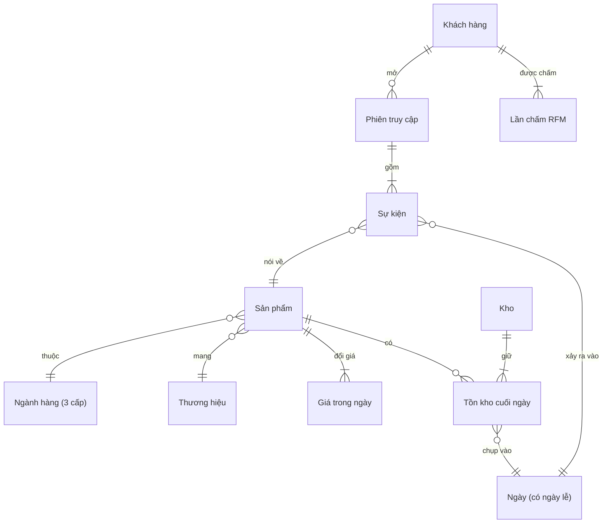
<!-- PDF (T28): figures/report_4_4_erd.png is this block rendered with Mermaid 11.17.2. -->

*Hình 4.4a. Mô hình khái niệm.*

Khách hàng mở nhiều phiên truy cập, mỗi phiên gồm ít nhất một sự kiện, và mỗi sự kiện nói về đúng một sản phẩm và xảy ra vào một ngày. Loại thao tác (xem, thêm giỏ, mua) là thuộc tính của sự kiện. Sản phẩm thuộc một ngành hàng ba cấp, ví dụ `electronics.smartphone`, và mang một thương hiệu. Tồn kho cuối ngày là quan hệ của ba thực thể: một sản phẩm, tại một kho, vào một ngày. Hai thực thể đổi theo thời gian, và đó là chỗ khó nhất của mô hình: giá của sản phẩm đổi nhiều lần trong tháng, còn phân khúc của khách đổi sau mỗi lần chấm RFM hằng tuần. Một sự kiện ngày 10/11 phải mang giá và phân khúc của ngày 10/11, không phải giá trị hiện tại.

**Mức logic: star schema.** Mỗi thực thể khái niệm trở thành một bảng, hoặc được gộp vào một bảng khác:

| Thực thể khái niệm | Ở mức logic |
|---|---|
| Sự kiện | `fact_event`, mỗi sự kiện một dòng |
| Phiên truy cập | Không có bảng dimension riêng. `user_session` nằm ngay trên `fact_event` (degenerate dimension) và là grain của `fact_session_funnel` |
| Khách hàng, Lần chấm RFM | `dim_user`, SCD Type 2 theo ô RFM, dựng từ bảng trung gian `stg_rfm_snapshot` |
| Sản phẩm, Ngành hàng, Thương hiệu, Giá trong ngày | Gộp vào một bảng `dim_product`, SCD Type 2 theo giá |
| Ngày | `dim_date` |
| Kho | `dim_warehouse` |
| Tồn kho cuối ngày | `fact_inventory_daily` |
| Loại thao tác (thuộc tính của Sự kiện) | `dim_event_type`, giữ thứ tự các bước phễu và định nghĩa thế nào là một đơn |

Ngành hàng và thương hiệu không thành bảng riêng mà được gộp (denormalise) vào `dim_product`, nên mô hình là star chứ không phải snowflake: một câu hỏi theo ngành hàng chỉ cần một phép nối từ fact sang `dim_product`. `dim_date`, `dim_product` và `dim_user` được nhiều fact dùng chung với cùng một nghĩa: `dim_product` được cả `fact_event` lẫn `fact_inventory_daily` trỏ tới, `dim_user` được `fact_event` lẫn `fact_session_funnel` trỏ tới. Cả năm dimension được dựng một lần và dùng lại với một nghĩa duy nhất, nên `SYSTEM_DESIGN.md` gọi chúng là conformed dimension, dù `dim_event_type` hiện chỉ có `fact_event` dùng và `dim_warehouse` chỉ có `fact_inventory_daily` dùng. Vì vậy một câu hỏi ghép hai fact so được hai con số trên cùng một sản phẩm hay một khách.

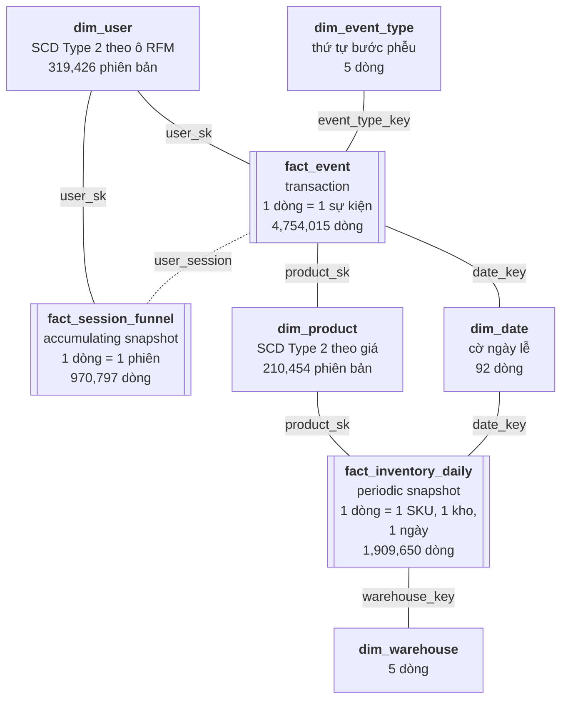
<!-- PDF (T28): figures/report_4_4_star.png is now rendered from figures/report_4_4_star.mmd (an erDiagram with PK/FK and 1:N), not from this block. -->

*Hình 4.4b. Star schema: ba fact (khung đôi), năm dimension, và khoá nối ghi trên cạnh. Đường chấm là `user_session`, khoá đi từ một phiên sang các sự kiện của phiên đó; phiên không có bảng dimension riêng.*

Ba fact ứng với ba kiểu bảng fact của Kimball. Grain, tức một dòng biểu diễn điều gì, được chốt trước mọi cột khác:

| | `fact_event` | `fact_session_funnel` | `fact_inventory_daily` |
|---|---|---|---|
| Kiểu fact | Transaction | Accumulating snapshot | Periodic snapshot |
| Grain: một dòng là | một sự kiện đã làm sạch | một phiên truy cập | một sản phẩm tại một kho trong một ngày |
| Số dòng | 4,754,015 | 970,797 | 1,909,650 = 12,731 × 5 × 30 |
| Thư mục Parquet | 31 thư mục `event_date` | 31 thư mục `session_start_date` | 30 thư mục `snapshot_date` |
| Measure | `price` | mốc thời gian của từng bước, độ trễ giữa các bước, số sự kiện, giá trị giỏ và giá trị mua | `stock_on_hand` (semi-additive), `units_sold_that_day` (additive), `velocity_7d` và `days_to_stockout` (non-additive) |
| Dimension | `dim_date`, `dim_event_type`, `dim_user`, `dim_product`; `user_session` là degenerate dimension | `dim_user` | `dim_date`, `dim_warehouse`, `dim_product` |
| Được đọc bởi | BR2 (tách phễu theo ngành hàng), BR7, và đáp án đối chứng của `checks/ground_truth.py` | BR2 | BR6 |

- `fact_event` khớp một-một với silver: 4,754,015 dòng, đúng bằng số sự kiện của silver. Measure `price` là giá của chính sự kiện. Phiên bản của `dim_product` giữ giá cuối ngày, nên 677,255 sự kiện (14.2%) có giá khác giá của phiên bản mà chúng trỏ tới; đó là hai giá trị khác nhau theo định nghĩa, không phải lỗi.
- `fact_session_funnel` có đúng một dòng cho mỗi giá trị `user_session` phân biệt (970,797). Ba cột mốc `first_view_at`, `first_cart_at`, `purchase_at` để NULL cho tới khi phiên đi tới bước đó, và `funnel_stage` là bước xa nhất. Hai ràng buộc `ck_fsf_stage` và `ck_fsf_lags` giữ cho bước xa nhất và các độ trễ khớp với các mốc; lần dựng ngày 3/11 có 0 dòng vi phạm. Theo bước xa nhất, 838,795 phiên dừng ở bước xem, 77,098 ở bước thêm giỏ và 54,904 phiên mua.
- `fact_inventory_daily` là bảng dày: mỗi sản phẩm, mỗi kho, mỗi ngày đều có một dòng, kể cả khi không có gì thay đổi. Nhóm chỉ lấy 12,731 sản phẩm từng được mua trong tập mẫu (mục 3.4). Lấy cả 128,972 sản phẩm thì bảng có 128,972 × 5 × 30 = 19,345,800 dòng, vượt giới hạn 5 triệu dòng, chỉ để phục vụ một BR, mà sản phẩm chưa từng bán không bao giờ hiện trên màn hình cảnh báo. `stock_on_hand` là semi-additive: cộng qua các kho trong một ngày thì ra tồn kho, cộng qua nhiều ngày thì vô nghĩa. Vì vậy `batch_gold.py` chỉ đọc ngày cuối của bảng khi tính BR6, không cộng một khoảng ngày.

**Hai dimension SCD Type 2 và `stg_rfm_snapshot`.** `dim_product` có 210,454 phiên bản của 128,972 sản phẩm. Giá là thuộc tính Type 2 (đổi giá thì mở phiên bản mới), còn ngành hàng, thương hiệu và catalogue là Type 1. Mỗi sản phẩm có tối đa một phiên bản mỗi ngày. `dim_user` có 319,426 phiên bản của 258,330 khách, mỗi khách đúng một phiên bản hiện hành. Khoá thay thế (`product_sk`, `user_sk`) trỏ tới phiên bản có hiệu lực vào ngày của sự kiện và được gắn lên dòng sự kiện ngay khi dựng, nên phép nối giữa fact và dimension là phép nối bằng trên một cột, không phải phép nối theo khoảng `valid_from`, `valid_to`. Lần kiểm ngày 10/11 cho kết quả 0 ở cả sáu phép kiểm toàn vẹn SCD2 trên hai dimension, và cả năm sự kiện kiểm tay của `checks/fact_event_spot.py` đều trỏ đúng phiên bản.

`stg_rfm_snapshot` có 1,291,650 dòng, tức 258,330 khách × 5 lần chấm (7, 14, 21, 28 và 30/11). Bảng này tồn tại để cắt một vòng phụ thuộc. `dim_user` lưu lịch sử theo phân khúc RFM, nhưng RFM lại là kết quả của BR4, và bảng gold được dựng từ star schema: dimension cần RFM, RFM cần gold, gold cần dimension. Nhóm coi RFM đúng với bản chất của nó, một thuộc tính của khách. `batch_warehouse.py` tính điểm RFM của mọi khách ở mỗi lần chấm thẳng từ silver, trên mã khách tự nhiên, trước khi dựng bất kỳ fact nào, rồi `dim_user` mở phiên bản mới mỗi khi ô RFM đổi giữa hai lần chấm (mục 4.3). Bảng gold của BR4 chỉ còn lấy các phiên bản hiện hành của `dim_user`. Không fact nào trỏ tới `stg_rfm_snapshot`, nên nó mang tiền tố `stg_` và không thuộc star schema.

**Đặt cạnh mô hình phục vụ của Cassandra.** Năm bảng gold ở Cassandra (mục 4.2) không theo star schema:

| Bảng | BR | Partition key | Clustering key | Ghi bởi |
|---|---|---|---|---|
| `gmv_by_minute` | BR1 | `(event_date, category_l1)` | `window_start` giảm dần | `streaming_gold.py` |
| `trending_products` | BR3 | `(window_start)` | `rank` | `streaming_gold.py` |
| `abandoned_carts` | BR5 | `(event_date)` | `user_session` | `streaming_gold.py` |
| `order_velocity_alerts` | BR8 | `(event_date)` | `window_start` giảm dần, `user_id` | `streaming_gold.py` |
| `stockout_risk` | BR6 | `(warehouse_id)` | `days_to_stockout`, `product_id` | `batch_gold.py`, từ ngày cuối của `fact_inventory_daily` |

| | Star schema (Parquet, PostgreSQL) | Bảng gold ở Cassandra |
|---|---|---|
| Thiết kế xuất phát từ | grain của quy trình nghiệp vụ | câu hỏi mà màn hình đặt ra |
| Một bảng trả lời | nhiều câu hỏi, bằng cách nối với các dimension cần thiết | đúng một câu hỏi |
| Thêm một câu hỏi | thêm một câu truy vấn | thêm một bảng và một đường ghi |
| Phép nối | có, đó là cách dùng star schema | không có |
| Bộ lọc | bất kỳ cột nào | phải đi qua partition key |

Mô hình phục vụ là query-first và denormalise vì hai lý do của Cassandra: không có phép nối, và lọc ngoài partition key thì phải quét cả bảng. Mỗi dòng vì thế mang sẵn mọi thứ màn hình in ra. `trending_products` lưu `brand` và `category_l1` ngay cạnh `product_id` thay vì một khoá thay thế để nối sang `dim_product`, và mỗi câu hỏi có một bảng riêng mà khoá chính là bộ lọc của câu hỏi đó. Chỉ `stockout_risk` được sinh từ star schema; bốn bảng của nhánh thời gian thực đọc sự kiện ở dạng silver (mục 4.1). Một điểm hai mô hình gặp nhau: `warehouse_id` là partition key của `stockout_risk` ở Cassandra và cũng là khoá chia partition của `fact_inventory_daily` ở PostgreSQL, vì cả hai phục vụ cùng một đường truy cập của BR6 là theo từng kho. Bản Parquet của cùng bảng lại chia thư mục theo `snapshot_date`, vì người đọc nó là `batch_gold.py`, và job này chỉ cần ngày cuối. Khoá đúng phụ thuộc vào ai đọc bảng, không phụ thuộc vào bảng.

**Mức vật lý.** Cùng một mô hình logic được hiện thực hai lần, Parquet là nơi lưu chính và PostgreSQL là bản thứ hai. Tám bảng của star schema có số dòng bằng nhau ở hai nơi. Cassandra chỉ giữ năm bảng gold.

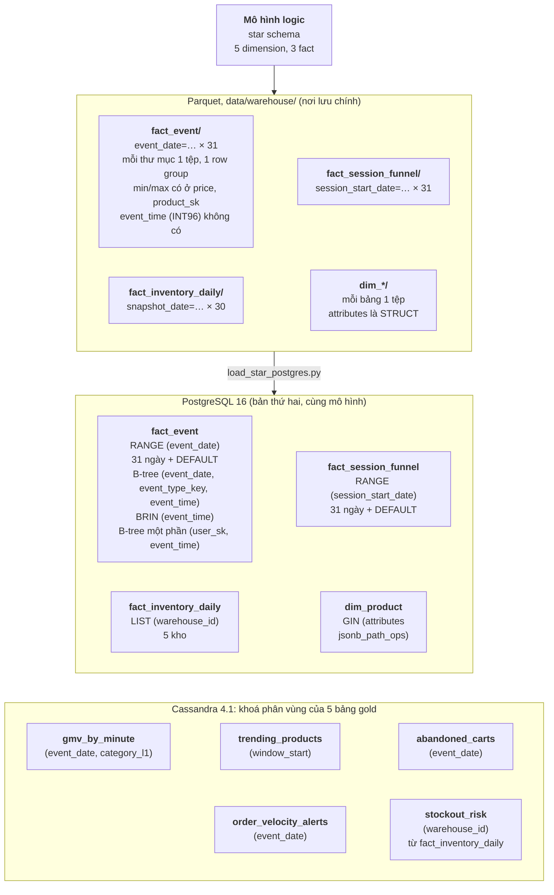
<!-- PDF (T28): figures/report_4_4_physical.png is this block rendered with Mermaid 11.17.2. -->

*Hình 4.4c. Bố cục vật lý: thư mục Parquet, partition và index của PostgreSQL, partition key của Cassandra.*

*Parquet.* Mỗi fact được ghi thành một thư mục con cho mỗi giá trị của cột chia (`event_date=2019-11-29/`), mỗi thư mục một tệp, các dòng trong tệp được sắp theo một cột (`event_time` với `fact_event`, `session_start_at` với `fact_session_funnel`, `product_id` với `fact_inventory_daily`). Mỗi dimension là một tệp. Có hai cơ chế để bỏ qua dữ liệu. Cơ chế thứ nhất là bỏ cả thư mục: bộ lọc trên cột chia cho phép bỏ qua thư mục mà không mở tệp nào. Cơ chế thứ hai là min/max của từng row group, lưu trong footer của tệp, cho phép bỏ một row group khi khoảng giá trị của nó không giao với bộ lọc. Đọc footer của 31 tệp `fact_event` cho thấy cơ chế thứ hai gần như không dùng được ở đây:
- Mỗi tệp chỉ có đúng 1 row group, từ 25,859 tới 482,049 dòng, tức cả một ngày. Min/max của row group vì thế trùng với min/max của cả ngày, mà thư mục ngày đã bỏ qua được rồi.
- `event_time` được Spark ghi theo kiểu INT96 cũ, và kiểu này không có min/max: 0 trên 31 column chunk có thống kê, trong khi `price` và `product_sk` có ở cả 31. Lọc một giờ theo `event_time` vì thế phải đọc cả 31 tệp. E1 cho thấy điều tương tự với Spark trên silver ngày 20/10: lọc một giờ đọc 93/93 tệp và trả về đủ 4,754,015 dòng cho bước lọc. Cách sửa đã biết là ghi `TIMESTAMP_MICROS`, nhưng nhóm chưa áp dụng, vì không màn hình nào lọc fact theo giờ.
- Với `price` thì có min/max nhưng vẫn không bỏ được gì. Theo footer của 93 row group silver (E5, ngày 26/10), max giá của mọi row group nằm trong khoảng 1,644.59 tới 2,574.07, nên bộ lọc giá trên 1,000 không bỏ được row group nào dù chỉ 4.97% số dòng khớp.

Cơ chế thứ nhất thì có tác dụng rõ. Với Spark trên silver (E1), lọc một ngày và một loại sự kiện chỉ đọc 1/93 tệp (14.8 KiB) thay vì 93 tệp (133.9 MiB). Với phép nối mà bộ lọc nằm ở bảng ngày, dynamic partition pruning chỉ đọc 9/93 tệp. Trên cùng mẫu 7%, câu doanh thu theo ngành hàng chạy trên tệp CSV mất 177.0 ms, còn trên Parquet chia thư mục chỉ mất 9.0 ms, đọc 31/93 tệp (E4, DuckDB, trung vị 5 lần chạy). Mức chênh khoảng 20 lần này không phải của riêng việc bỏ thư mục: nó gộp định dạng cột của Parquet, việc chỉ đọc các cột cần dùng, và việc bỏ 62/93 tệp, mà E4 không tách riêng từng phần. Phần của riêng việc bỏ thư mục được benchmark ngày 10/11 đo: đếm sự kiện một ngày bằng DuckDB mất 1.565 ms khi lọc trên cột chia thư mục, so với 3.342 ms khi lọc trên cột thường `date_key` của cùng các tệp Parquet, tức khoảng 2 lần (bảng dưới). Cột `attributes` lồng nhau được Spark ghi thành STRUCT, nên DuckDB chỉ đọc lá `attributes.color` mà không cần index.

*PostgreSQL.* `warehouse/ddl.sql` chép nguyên văn DDL của mục 5.4 và 5.5 trong `SYSTEM_DESIGN.md`, trừ hai chỗ ghi ở đầu tệp (năm dòng của `dim_event_type` do script nạp ghi, và các lệnh tạo partition được viết ra đủ). `fact_event` và `fact_session_funnel` được chia theo khoảng (`PARTITION BY RANGE`), mỗi ngày một partition, cộng một partition DEFAULT. `fact_inventory_daily` được chia theo danh sách `warehouse_id` (`PARTITION BY LIST`), năm partition và không có DEFAULT, để một dòng của kho thứ sáu báo lỗi ngay thay vì lẳng lặng nằm đó. Trên `fact_event` có ba index: B-tree ghép `(event_date, event_type_key, event_time)`, BRIN trên `event_time` với `pages_per_range = 32`, và B-tree một phần `(user_sk, event_time)` chỉ cho các lượt mua. `dim_product.attributes` là `jsonb` với index GIN dùng `jsonb_path_ops`, loại chỉ hỗ trợ phép chứa `@>` nhưng nhỏ hơn loại mặc định.

*Số đo.* Bảng dưới lấy từ lần benchmark ngày 10/11/2026 trên máy của Đắt: mỗi biến thể chạy 3 lần khởi động rồi 20 lần đo, thời gian tính phía client gồm cả lấy hết kết quả. Ngày được hỏi là 29/11. Với mỗi biến thể, script kiểm plan của truy vấn để chắc biến thể đó chạy đúng đường truy cập được ép.

| Câu hỏi | Biến thể | p50 (ms) | p95 (ms) | Plan hoặc trace cho thấy |
|---|---|---|---|---|
| Đếm sự kiện một ngày, PostgreSQL | partition pruning bật | 6.911 | 7.648 | chỉ `fact_event_20191129`, 1,628 buffer |
| | partition pruning tắt | 8.760 | 9.156 | mọi partition, 1,747 buffer |
| Đếm sự kiện một ngày, DuckDB | lọc trên cột chia thư mục | 1.565 | 2.779 | 1/31 tệp |
| | lọc trên `date_key`, cột thường | 3.342 | 5.277 | 31 tệp |
| Một giờ theo `event_time`, PostgreSQL | seq scan | 88.218 | 90.534 | 58,709 buffer |
| | BRIN | 4.125 | 4.937 | 723 buffer |
| | B-tree | 1.512 | 1.598 | 171 buffer |
| Một giờ theo `event_time`, DuckDB | không index; INT96 không có min/max | 5.891 | 6.365 | 31 tệp |
| Sản phẩm màu `space_grey`, PostgreSQL | GIN | 10.311 | 11.974 | Bitmap Index Scan, 7,711 heap block |
| | không dùng GIN | 32.835 | 34.393 | Seq Scan |
| Sản phẩm màu `space_grey`, DuckDB | quét STRUCT | 3.154 | 3.686 | quét `dim_product` |
| Doanh thu theo ngành, PostgreSQL | 1 / 7 / 31 ngày | 6.718 / 21.460 / 74.983 | 7.382 / 23.046 / 76.967 | chỉ các partition trong khoảng |
| Doanh thu theo ngành, DuckDB | 1 / 7 / 31 ngày | 7.288 / 9.380 / 24.564 | 8.204 / 9.717 / 31.829 | 1/31, 7/31, 31/31 tệp |
| `gmv_by_minute`, Cassandra | đủ partition key | 1.769 | 2.091 | single-partition, đọc 390 dòng |
| | thiếu `event_date`, `ALLOW FILTERING` | 1.939 | 6.202 | seq scan |
| `stockout_risk`, Cassandra | đủ partition key | 1.113 | 1.365 | single-partition, đọc 100 dòng |
| | lọc theo `product_id`, `ALLOW FILTERING` | 81.089 | 83.525 | seq scan, đọc 63,655 dòng để trả 5 dòng |

Bốn điều phải đọc kèm bảng này, để không đọc ra nhiều hơn những gì đã đo:
- Khoảng cách giữa bật và tắt partition pruning ở PostgreSQL nhỏ (6.911 so với 8.760 ms), và không phải toàn bộ giá trị của việc chia partition. Khi tắt pruning, planner vẫn mở 31 partition còn lại: 30 partition ngày được dò bằng B-tree `(event_date, …)`, khoảng 4 buffer mỗi partition, còn partition DEFAULT rỗng được quét tuần tự, và không lấy được dòng nào từ chúng. Có index đó nên phần thừa mới rẻ như vậy; số đo này không cho biết một bảng không chia partition sẽ chậm bao nhiêu.
- GIN chỉ nhanh hơn khoảng 3 lần vì `space_grey` khớp 21,489 trên 210,454 phiên bản sản phẩm, khoảng 10%. Các dòng khớp rải khắp bảng nên GIN vẫn phải đọc 7,711 heap block. Phép đo cũ của Nguyên (`gin_vs_seqscan.txt`, ngày 10/10, một lần chạy, màu `crimson_red` khớp 21,078 dòng) cho cùng kết luận: 48.9 so với 59.6 ms, 7,646 heap block so với 11,608 buffer của seq scan. GIN có lợi rõ hơn khi bộ lọc hiếm hơn, nhưng nhóm chưa đo trường hợp đó. Ở Parquet, phép so tương đương chỉ là quét một cột lồng nhau, và nó nhanh hơn cả hai.
- Bảng `gmv_by_minute` chỉ chứa một ngày phát lại (4,563 dòng lúc đo), nên lần quét khi thiếu khoá vẫn nhỏ (trace ghi đọc 404 dòng) và p50 gần như không khác. Phép so rõ ràng là `stockout_risk`, bảng có 63,655 dòng: đủ khoá đọc 100 dòng trong một partition, thiếu khoá phải đọc cả bảng, chậm hơn khoảng 73 lần.
- Biến thể B-tree trên `event_time` dùng một index tạm, tạo riêng cho benchmark rồi xoá ngay sau đó; `warehouse/ddl.sql` không có index này. Trong số index có thật trên cột này, BRIN đọc 723 buffer so với 58,709 của seq scan. Con số 723 không chỉ là giờ được hỏi: BRIN vẫn trả vài heap block lossy ở các partition ngày khác (ví dụ 29 block ở `fact_event_20191101`), rồi bỏ chúng khi kiểm lại từng dòng. BRIN chỉ lưu min/max của mỗi 32 trang, nên nó chỉ hiệu quả khi thứ tự vật lý của các dòng bám theo `event_time`; ở đây các dòng được sắp theo `event_time` trước khi ghi.

Câu doanh thu theo ngành nối `fact_event` với `dim_product` qua `product_sk`. Với một ngày, PostgreSQL chọn nested loop: 2,252 lượt mua, mỗi lượt dò `dim_product_pkey` một lần, tổng 9,009 buffer, tức khoảng 4 trang mỗi lần dò. Tệp `explain_star_join.txt` của Nguyên (ngày 10/10) cũng có đúng 2,252 lần dò và 9,009 buffer, nhưng được đo trên một PostgreSQL chỉ nạp 3 ngày 28 tới 30/11 (`explain_fact_event_nofilter.txt` cho thấy các partition khác rỗng). Vì vậy chỉ con số "khoảng 4 trang mỗi lần dò" là còn đúng trên dữ liệu đầy đủ, còn thời gian 31.4 ms của tệp đó không so được với 6.718 ms hôm nay. Từ 1 lên 31 ngày, thời gian của PostgreSQL tăng khoảng 11 lần, của DuckDB khoảng 3.4 lần; cả hai vẫn dưới 0.1 giây.

**Giới hạn: `fact_session_funnel` được tính lại và ghi đè.** Theo Kimball, accumulating snapshot là bảng mà mỗi dòng được cập nhật tại chỗ mỗi khi phiên đi qua thêm một mốc. Parquet không có UPDATE, còn Iceberg hay Delta, hai định dạng bảng cho phép cập nhật dòng trên Parquet, nằm ngoài các công nghệ nhóm được dùng. Vì vậy mỗi lần chạy, `batch_warehouse.py` tính lại toàn bộ 970,797 phiên từ 4,754,015 sự kiện rồi ghi đè cả bảng: ở Parquet bằng chế độ ghi `overwrite`, ở PostgreSQL bằng `TRUNCATE` rồi nạp lại. Cái giá có hai phần:
- Bảng không có lịch sử. Mỗi phiên chỉ còn trạng thái cuối. Một phiên thêm giỏ hôm trước và mua hôm sau chỉ còn là một phiên đã mua, nên không truy vấn nào trả lời được câu "ngày 15/11 có bao nhiêu phiên đang dừng ở bước giỏ hàng" theo đúng những gì hệ thống biết vào ngày đó. Con số 77,098 phiên bỏ giỏ là trên trạng thái cuối. Màn hình BR5 không bị ảnh hưởng vì giỏ bỏ quên được tính trên luồng (mục 4.3); cái mất là khả năng phân tích phễu theo thời gian.
- Chi phí tăng theo tổng dữ liệu chứ không theo dữ liệu mới. Thêm một ngày sự kiện vẫn phải đọc lại cả tháng để dựng lại bảng. Ở quy mô hiện tại điều này chấp nhận được: cả `batch_warehouse.py`, gồm chín bảng và bước nạp PostgreSQL, chạy hết 273 giây. Nhóm không đo riêng thời gian của bảng này.

### 4.5 Phương án thay thế và so sánh

Đề bài yêu cầu so sánh giải pháp chính với ít nhất một giải pháp thay thế. Giải pháp chính của ShopInsight là phục vụ các màn hình cần đọc nhanh bằng bảng gold trong Cassandra, mỗi bảng có khoá thiết kế ngược từ câu hỏi của màn hình (mục 4.2). Theo kế hoạch benchmark trong `PLAN.md`, hai phương án thay thế được đo trên cùng mô hình logic và cùng mẫu 7%: phương án 1 là PostgreSQL, trả lời từ star schema bằng partition và index; phương án 2 là DuckDB đọc thẳng star schema dạng Parquet. Số đo lấy từ benchmark ngày 10/11 ở mục 4.4, cộng một phép đo ngày 8/11 cho riêng câu hỏi của BR1, phép duy nhất cho cả ba hệ trả lời cùng một câu hỏi. Phương án đơn giản nhất, không xây gì và truy vấn thẳng tệp CSV, đã bị loại ở mục 1.3 (50 giây trên tệp gốc) và ở E4 của mục 4.4 (177.0 so với 9.0 ms trên cùng mẫu 7%).

| Tiêu chí | Cassandra, bảng gold (giải pháp chính) | Phương án 1: PostgreSQL trên star schema | Phương án 2: DuckDB trên Parquet star |
|---|---|---|---|
| Tổ chức dữ liệu | Mỗi câu hỏi một bảng, phi chuẩn hoá, khoá theo câu hỏi | Star schema, partition theo ngày, B-tree, BRIN, GIN | Star schema, thư mục theo ngày, lưu theo cột |
| Thêm một câu hỏi mới | Thêm một bảng và một đường ghi | Thêm một câu truy vấn, có thể thêm index | Thêm một câu truy vấn |
| Độ tươi | Luồng ghi sau mỗi lô nhỏ 5 giây | Theo lô: dựng lại kho và nạp PostgreSQL mất 273 giây | Theo lô, như PostgreSQL |
| Đi đúng đường truy cập, p50 | 1.1 ms (`stockout_risk`) và 1.8 ms (`gmv_by_minute`), đọc một phân vùng | 1.5 ms (một giờ qua B-tree) tới 6.7 ms (doanh thu theo ngành một ngày) | 1.6 ms (đếm một ngày) tới 7.3 ms (doanh thu theo ngành một ngày) |
| Câu hỏi lệch thiết kế, p50 | Lọc ngoài partition key: 81.1 ms, đọc 63,655 dòng để trả 5 | Không có index phù hợp: 88.2 ms (quét tuần tự để lấy một giờ) | Không cắt được thư mục: 3.3 ms; lọc theo giờ phải đọc cả 31 tệp vì `event_time` không có min/max |
| Khoảng ngày được hỏi tăng từ 1 lên 31 ngày | Không áp dụng: mỗi màn hình đọc một phân vùng | 6.7 lên 75.0 ms, khoảng 11 lần | 7.3 lên 24.6 ms, khoảng 3.4 lần |
| Dung lượng `fact_event` | Không lưu `fact_event` | 459.7 MB bảng cộng 309.6 MB index | 119.4 MB trong 31 tệp |
| Vận hành | Một dịch vụ chạy liên tục | Một dịch vụ chạy liên tục, thêm bước nạp sau mỗi lần dựng kho | Chỉ là tệp, đọc ngay trong tiến trình của API |

**Cùng một câu hỏi, ba cách trả lời.** Câu hỏi của BR1, doanh thu và số đơn của từng phút trong 120 phút (17/11, 19:30 tới 21:30, mọi ngành hàng), được chạy theo ba cách trên cùng một máy:

| Cách trả lời | p50 / p95 (ms) | Cách đọc |
|---|---|---|
| Cassandra, bảng `gmv_by_minute` | 2.2 / 3.2 | một phân vùng, 120 dòng tính sẵn |
| PostgreSQL, gom nhóm trên `fact_event` | 2.0 / 2.4 | Index Scan trên partition của ngày 17/11 |
| DuckDB, gom nhóm trên Parquet | 12.1 / 16.1 | quét tệp của ngày 17/11 |

PostgreSQL và DuckDB trả về cùng 120 dòng. Ở cỡ dữ liệu này, PostgreSQL trên kho dữ liệu nhanh ngang Cassandra, nên bảng gold không được chọn vì tốc độ. Lý do thật là độ tươi: kho dữ liệu được dựng theo lô, mỗi lần mất vài phút, nên không chứa phút vừa xảy ra, trong khi bảng gold được luồng ghi sau mỗi lô nhỏ 5 giây. Lý do thứ hai là đọc theo khoá chỉ chạm một phân vùng dù bảng chứa bao nhiêu ngày, còn câu gom nhóm trên kho dữ liệu tăng theo khoảng ngày được hỏi (hàng tương ứng ở bảng trên). Nhóm chưa đo khoảng cách này trên toàn bộ 67.5 triệu sự kiện (mục 6.4).

**Vì sao các BR theo lô đọc Parquet qua DuckDB.** BR2, BR4 và BR7 đọc bảng gold dạng Parquet bằng DuckDB chứ không đọc PostgreSQL. Trên các câu hỏi của benchmark, cả hai engine đều dưới 0.1 giây và không bên nào thắng toàn diện: PostgreSQL nhanh hơn khi câu hỏi đi thẳng được qua index (một giờ qua B-tree 1.5 so với 5.9 ms), còn DuckDB nhanh hơn khi quét và gom nhóm nhiều ngày (24.6 so với 75.0 ms cho 31 ngày) và khi lọc trong thuộc tính lồng nhau (3.2 so với 10.3 ms dùng GIN). Nhóm chọn Parquet vì ba lý do không nằm ở tốc độ. Thứ nhất, Spark ghi Parquet trực tiếp, còn PostgreSQL cần thêm một bước nạp sau mỗi lần dựng kho. Thứ hai, `fact_event` ở Parquet nhỏ hơn khoảng 6.4 lần (119.4 MB so với 769.3 MB gồm cả index). Thứ ba, DuckDB chạy ngay trong tiến trình của API, không cần một máy chủ cơ sở dữ liệu. PostgreSQL vẫn được giữ làm bản thứ hai của cùng mô hình logic, để các so sánh ở đây công bằng (mục 4.1).

**BR6: một BR theo lô vẫn phục vụ từ Cassandra.** `stockout_risk` được tính theo lô từ `fact_inventory_daily` nhưng ghi vào Cassandra, vì câu hỏi của màn hình (các sản phẩm gấp nhất của một kho) khớp đúng khoá: phân vùng theo kho, sắp sẵn theo số ngày còn hàng. Đi đúng khoá mất 1.1 ms; hỏi một sản phẩm ở mọi kho, câu hỏi mà khoá không phục vụ, mất 81.1 ms. Đó là cái giá của mô hình query-first: nhanh với câu hỏi đã biết trước, đắt với câu hỏi mới.

**Bốn phương án không đo.**
- *Kafka thay cho thư mục tệp.* Kafka là lựa chọn của một hệ thống thật. Nhóm không đặt giờ cho nó vì tiêu chí chấm điểm không tính việc "có Kafka", và thư mục tệp cho phép phát lại y hệt cùng một đoạn dữ liệu, điều mà phép đối chiếu ở mục 6.1 cần. Hàm đọc nguồn đã được tách riêng trong `processing/source.py` từ W40, để việc thay sau này chỉ đụng một tệp.
- *Spark Cassandra Connector thay cho `cassandra-driver`.* Lý do không dùng đã nêu ở mục 4.3: connector là một gói jar phải khớp đúng phiên bản Spark và Scala.
- *Delta Lake hoặc Apache Iceberg.* Một định dạng bảng cho phép cập nhật dòng trên Parquet, nên `fact_session_funnel` có thể được cập nhật bằng `MERGE` đúng như định nghĩa của bảng accumulating snapshot. Hai định dạng này nằm ngoài các công nghệ nhóm được dùng; cái giá của việc không dùng được ghi ở phần giới hạn cuối mục 4.4 và ở mục 6.4.
- *Cơ sở dữ liệu đồ thị (Neo4j) cho BR7.* "Mua kèm" là bài toán đồ thị theo nghĩa sách giáo khoa: sản phẩm là đỉnh, số lần mua cùng là trọng số cạnh. Nhóm bác bỏ vì chi phí: mỗi công nghệ mới tốn khoảng một tuần mà lịch không có, tiêu chí nội dung công nghệ chấm độ sâu chứ không chấm số công nghệ, và ở cỡ dữ liệu này một phép tự nối trong Spark đã đủ, với bảng cặp của BR7 chỉ có 314 dòng, trong khi màn hình chỉ hỏi một bước từ một sản phẩm (`SYSTEM_DESIGN.md` mục 5.7).

### Nguồn số liệu của mục 4

Số của BR3 đo trên cùng máy với mục 1, số của BR1 và BR5 đo trên máy của Đắt khi kiểm Gate 1a và Gate 2a; cả hai máy chạy Cassandra 4.1.12 một node trong Docker. Các lệnh `curl` cần API đang chạy (`uvicorn serving.api.main:app --port 8000`) và đọc khối `meta` của kết quả.

| Số liệu | Lệnh |
|---|---|
| Khoá của năm bảng | `serving/cassandra_schema.cql`; hai ảnh: `docker compose exec cassandra cqlsh -e "DESCRIBE TABLE shopinsight.gmv_by_minute"` và `docker compose exec cassandra cqlsh -e "DESCRIBE TABLE shopinsight.trending_products"` |
| BR1: 1 phân vùng, 120 dòng, 5.7 ms | `curl -s "localhost:8000/api/br1/realtime?event_date=2019-11-17"`, ghi ở `docs/evidence/gate1a_br1_run.txt` |
| BR3 một cửa sổ: 1 phân vùng, 20 dòng, 2.3 ms | `curl -s "localhost:8000/api/br3/trending?window_start=2019-11-17T21:19:00%2B07:00"`, trung vị 15 lần gọi |
| BR3 mặc định ở 19,669 cửa sổ: 159 ms, 19,670 phân vùng (19,669 khoá và 1 phân vùng đọc) | `curl -s localhost:8000/api/br3/trending`, trung vị 15 lần gọi, ngày 9/10/2026 |
| 394, 1,440 và 43,200 cửa sổ: 7.5, 13.8 và 346 ms | `docs/evidence/gate1b_br3_run.txt`, mục "Listing the keys as the table grows". Cả ba mức đo trên một bảng phụ cùng cấu trúc, xoá sau khi đo |
| Xoá chung lô: 0 dòng; xoá riêng: 3 dòng | `docs/evidence/gate1b_br3_run.txt`, mục "Why the delete runs on its own" |
| 7,600 / 7,600 dòng khớp silver, không dòng trùng sau khi chạy lại | `docs/evidence/gate1b_br3_run.txt`, mục "Correctness: trending_products vs silver" và "Restart without --fresh" |
| BR5 một ngày: 1 phân vùng, 2,600 giỏ, 13.6 ms | `curl -s "localhost:8000/api/br5/carts?event_date=2019-11-17"`, ghi ở `docs/evidence/gate2a_br5_run.txt` |
| Khoá và cách dọn của BR5, BR6 | `serving/cassandra_schema.cql`; BR6: `run_br6` trong `processing/batch_gold.py` (xoá từng kho rồi ghi lại); BR5: `start_br5` trong `processing/streaming_gold.py` (chỉ ghi đè, không xoá), sắp xếp theo `cart_value` trong `serving/api/routers/br5.py` |
| Spark 4.1.3, chế độ `local[*]` | `requirements.txt` (`pyspark==4.1.3`); `master("local[*]")` trong `SparkSession.builder` của mỗi script |
| Dừng sau lô 11, chạy lại bắt đầu từ lô 12 và cửa sổ 15:30 | `docs/evidence/gate1b_br3_run.txt`, mục "Restart without --fresh" |
| 200 phân vùng shuffle: 3.5 tới 6.7 giây mỗi lô; 4 phân vùng: 1.0 tới 1.7 giây | Chú thích trong `main()` của `processing/streaming_gold.py`: lần chạy thử W40 trên máy của Đắt, BR1 chạy một mình |
| BR1 trung vị 476 ms, BR3 trung vị 719 ms (p95 1,120 ms) khi chạy chung | `docs/evidence/gate1b_br3_run.txt`, mục "Micro-batch time, BR1 and BR3 in one JVM" |
| Heap 1.0 GiB trong khi `getConf()` báo `6g` sau `spark.stop()` | `docs/SETUP_SPARK.md` mục 6, đo trên PySpark 4.1.3; `python processing/kata.py` in heap thật của JVM |
| 31 thư mục ngày thay vì 30 khi thiếu múi giờ UTC | `conf/spark-defaults.conf`, `docs/SETUP_SPARK.md` mục 6 |
| `rfm_cell` NULL 97.3% (7/11) và 88.0% (30/11); 319,426 và 295,452 phiên bản; 23,974 lần đổi bị mất; 5,529 khách; sáu phép kiểm ra 0 | `docs/evidence/dim_user_null_compare.txt` (cùng máy với mục 1, ngày 18/10/2026) |

Các số của mục 4.4 đo trên máy của Đắt (20 nhân, 15 GB RAM, Ubuntu trong WSL2; DuckDB 1.5.5; PostgreSQL 16.15 và Cassandra 4.1.12 trong Docker). Các lệnh `python -c` chạy từ thư mục gốc của repo, chỉ đọc `data/warehouse/` do `batch_warehouse.py` dựng ngày 3/11, và được chạy lại ngày 10/11/2026. Benchmark ngày 10/11/2026 chạy bằng `.venv/bin/python benchmark/run_benchmark.py` (3 lần khởi động và 20 lần đo mỗi biến thể; p50 và p95 theo nearest-rank, xem `benchmark/README.md`); môi trường của lần chạy ghi ở `benchmark/results/env_20261110_010557.txt`.

| Số liệu | Lệnh |
|---|---|
| `fact_event`: 4,754,015 dòng, 31 thư mục ngày | `python -c "import duckdb; print(duckdb.sql(\"SELECT count(*), count(DISTINCT event_date) FROM read_parquet('data/warehouse/fact_event/*/*.parquet', hive_partitioning = true)\").fetchall())"` |
| `fact_session_funnel`: 970,797 dòng, bằng số `user_session` phân biệt, 31 thư mục | `python -c "import duckdb; print(duckdb.sql(\"SELECT count(*), count(DISTINCT user_session), count(DISTINCT session_start_date) FROM read_parquet('data/warehouse/fact_session_funnel/*/*.parquet', hive_partitioning = true)\").fetchall())"` |
| `fact_inventory_daily`: 1,909,650 dòng; 12,731 sản phẩm, 5 kho, 30 ngày; 12,731 × 5 × 30 = 1,909,650 | `python -c "import duckdb; print(duckdb.sql(\"SELECT count(*), count(DISTINCT product_id), count(DISTINCT warehouse_id), count(DISTINCT snapshot_date), 12731 * 5 * 30 FROM read_parquet('data/warehouse/fact_inventory_daily/*/*.parquet', hive_partitioning = true)\").fetchall())"` |
| `dim_product`: 210,454 phiên bản, 128,972 sản phẩm, 128,972 phiên bản hiện hành | `python -c "import duckdb; print(duckdb.sql(\"SELECT count(*), count(DISTINCT product_id), count(*) FILTER (WHERE is_current) FROM read_parquet('data/warehouse/dim_product/*.parquet')\").fetchall())"` |
| `dim_user`: 319,426 phiên bản, 258,330 khách, 258,330 phiên bản hiện hành | `python -c "import duckdb; print(duckdb.sql(\"SELECT count(*), count(DISTINCT user_id), count(*) FILTER (WHERE is_current) FROM read_parquet('data/warehouse/dim_user/*.parquet')\").fetchall())"` |
| `stg_rfm_snapshot`: 1,291,650 dòng, 258,330 khách, 5 lần chấm 7, 14, 21, 28 và 30/11 | `python -c "import duckdb; print(duckdb.sql(\"SELECT count(*), count(DISTINCT user_id), list(DISTINCT snapshot_date ORDER BY snapshot_date) FROM read_parquet('data/warehouse/stg_rfm_snapshot/*/*.parquet', hive_partitioning = true)\").fetchall())"` |
| `dim_date` 92 dòng, `dim_event_type` 5, `dim_warehouse` 5 | `python -c "import duckdb; print(duckdb.sql(\"SELECT (SELECT count(*) FROM 'data/warehouse/dim_date/*.parquet'), (SELECT count(*) FROM 'data/warehouse/dim_event_type/*.parquet'), (SELECT count(*) FROM 'data/warehouse/dim_warehouse/*.parquet')\").fetchall())"` |
| 128,972 × 5 × 30 = 19,345,800 dòng nếu lấy mọi sản phẩm | Phép nhân trên số sản phẩm của dòng `dim_product` |
| Tám bảng star có số dòng bằng nhau ở PostgreSQL và Parquet | `docs/evidence/pg_vs_parquet_counts.txt` (ngày 10/11/2026) |
| 677,255 sự kiện (14.2%) có giá khác giá phiên bản; `ck_fsf_stage`, `ck_fsf_lags` 0 vi phạm; bước xa nhất 838,795 / 77,098 / 54,904; 77,098 phiên bỏ giỏ; `batch_warehouse.py` 273 giây | `docs/evidence/batch_timings.txt` (ngày 3/11/2026), mục 1 và phần stdout của `processing/batch_warehouse.py` ở mục 2 |
| Sáu phép kiểm SCD2 ra 0 trên `dim_product` và `dim_user`; 5/5 sự kiện kiểm tay trỏ đúng phiên bản | `docs/evidence/t14_checks.txt`, mục "Run 1: scd2_integrity.py on both SCD2 dimensions, fact_event_spot.py" |
| `fact_event`: 1 row group mỗi tệp, 25,859 tới 482,049 dòng; `event_time` kiểu INT96 có min/max ở 0/31 column chunk, `price` và `product_sk` ở 31/31 | `python -c "import duckdb; print(duckdb.sql(\"SELECT path_in_schema, type, count(*) AS chunks, count(stats_min_value) AS with_min, max(row_group_id) + 1 AS row_groups_per_file, min(row_group_num_rows), max(row_group_num_rows) FROM parquet_metadata('data/warehouse/fact_event/*/*.parquet') WHERE path_in_schema IN ('event_time', 'price', 'product_sk') GROUP BY 1, 2 ORDER BY 1\").fetchall())"`. Cùng kết quả cho `event_time` ở `docs/evidence/presentation_parquet_run.txt` mục 6 (ngày 20/10) |
| E1: lọc một giờ đọc 93/93 tệp, 4,754,015 dòng; một ngày và một loại sự kiện 1/93 tệp (14.8 KiB) so với 93 tệp (133.9 MiB); dynamic partition pruning 9/93 tệp | `docs/evidence/presentation_parquet_run.txt` mục 2 tới 5 (Spark 4.1.3 trên silver, ngày 20/10/2026, một lần chạy) |
| E5: max giá mỗi row group 1,644.59 tới 2,574.07; giá trên 1,000 bỏ được 0/93 row group, 4.97% số dòng khớp | `docs/evidence/presentation_price_zonemap.txt` mục 1 và 2 (footer của silver, ngày 26/10/2026) |
| E4: CSV 177.0 ms, Parquet 9.0 ms, 31/93 tệp; khoảng 20 lần (177.0 / 9.0) | `docs/evidence/presentation_csv_vs_parquet.txt` (cùng mẫu 7%, DuckDB 1.5.5, trung vị 5 lần chạy, ngày 21/10/2026) |
| Mọi p50 và p95 trong bảng số đo | `benchmark/results/summary_20261110_010557.csv`, cột `p50_ms` và `p95_ms`; từng lần đo ở `raw_20261110_010557.csv` |
| Buffer, số tệp, số dòng đọc trong cột "Plan hoặc trace cho thấy"; khoảng 4 buffer mỗi partition khi tắt pruning, 30 Index Only Scan và một Seq Scan trên `fact_event_default` rỗng; 29 heap block lossy ở `fact_event_20191101` trong plan BRIN; `gmv_by_minute` thiếu khoá đọc 404 dòng; 7,711 heap block; 2,252 lần dò và 9,009 buffer | `benchmark/results/plans_20261110_010557.txt`, khối mang tên biến thể (ví dụ `postgres.count_one_day.pruning_off`, `postgres.revenue_by_category.days_1`) |
| `space_grey` khớp 21,489 / 210,454 phiên bản | `python -c "import duckdb; print(duckdb.sql(\"SELECT count(*) FILTER (WHERE attributes.color = 'space_grey'), count(*) FROM read_parquet('data/warehouse/dim_product/*.parquet')\").fetchall())"`; plan `postgres.attributes_containment.gin` cũng ra 21,489 dòng |
| `gmv_by_minute` 4,563 dòng, `stockout_risk` 63,655 dòng lúc đo | `benchmark/results/env_20261110_010557.txt`, dòng `cassandra rows` |
| Chậm hơn khoảng 73, 3 và 11 lần; 3.4 lần; bỏ thư mục ở DuckDB nhanh khoảng 2 lần | Chia các p50 trong `summary_20261110_010557.csv`: 81.089 / 1.113, 32.835 / 10.311, 74.983 / 6.718, 24.564 / 7.288, 3.342 / 1.565 |
| GIN cũ: 48.9 và 59.6 ms, 21,078 dòng, 7,646 heap block, 11,608 buffer | `docs/evidence/gin_vs_seqscan.txt` (Nguyên, ngày 10/10/2026, một lần chạy) |
| Star join cũ: 2,252 lần dò, 9,009 buffer, 31.4 ms, PostgreSQL chỉ có 3 ngày | `docs/evidence/explain_star_join.txt`; `docs/evidence/explain_fact_event_nofilter.txt` cho thấy chỉ `fact_event_20191128`, `_20191129` và `_20191130` có dòng (Nguyên, ngày 10/10/2026) |
| Partition, index, `pages_per_range = 32`, GIN `jsonb_path_ops` | `warehouse/ddl.sql` |
| Một thư mục mỗi giá trị, một tệp mỗi thư mục, cột sắp trong tệp; dimension một tệp; `TRUNCATE` rồi nạp lại ở PostgreSQL | `write_fact`, `write_dim`, `main` và `load_postgres` trong `processing/batch_warehouse.py` |
| Khoá của năm bảng Cassandra | `serving/cassandra_schema.cql` |
| BR6 chỉ đọc ngày cuối của `fact_inventory_daily`; BR4 lấy phiên bản hiện hành của `dim_user` | `processing/batch_gold.py` |

Số của mục 4.5 lấy từ benchmark ngày 10/11 ở trên, trừ phép so BR1 ba cách và dung lượng `fact_event`, đo trên máy của Khang (12 nhân, 15.6 GB RAM, Ubuntu trong WSL2; DuckDB 1.5.5; PostgreSQL 16.15 và Cassandra 4.1.12 trong Docker) ngày 8/11/2026, `main` tại `f690021`, 3 lần khởi động và 20 lần đo mỗi câu.

| Số liệu | Lệnh |
|---|---|
| Các p50 trong bảng so sánh ba phương án: 1.1, 1.8, 81.1 ms; 1.5, 6.7, 88.2 ms; 1.6, 3.3, 5.9, 7.3 ms; 6.7 lên 75.0 ms và 7.3 lên 24.6 ms; 3.2 và 10.3 ms | `benchmark/results/summary_20261110_010557.csv`, như bảng số đo của mục 4.4 |
| BR1 ba cách: 2.2 / 3.2, 2.0 / 2.4 và 12.1 / 16.1 ms; 120 dòng giống nhau ở PostgreSQL và DuckDB; Index Scan | `docs/evidence/report_engine_compare.txt`, mục 3 và 4, câu Q1 (mã nguồn ở cuối tệp). Các câu Q2 tới Q6 trong tệp này đo trước benchmark ngày 10/11 và không được dùng trong báo cáo |
| `fact_event`: 459.7 MB bảng và 309.6 MB index ở PostgreSQL, 119.4 MB Parquet; khoảng 6.4 lần | `docs/evidence/report_engine_compare.txt`, mục 2; (459.7 + 309.6) / 119.4 = 6.44 |
| Kafka không có giờ đặt trước; hàm đọc nguồn tách ra `processing/source.py` từ W40 | `PLAN.md`, mục "Cổng chặn Kafka" |
| Lý do bác bỏ Neo4j; bảng cặp của BR7 có 314 dòng | `SYSTEM_DESIGN.md` mục 5.7; `docs/evidence/correctness_8br.txt`, dòng BR7 của bảng chín hàng |

## 5. Ứng dụng: API và tám màn hình

Sản phẩm cuối của đồ án là một dashboard React gồm 8 màn hình, mỗi màn hình một BR. Mỗi màn hình gọi endpoint FastAPI của BR đó, và chân màn hình in lại khối `meta` mà endpoint trả về: thời gian truy vấn phía server, kho lưu trữ đã đọc, số phân vùng và số dòng. Người xem vì vậy thấy ngay mỗi câu trả lời tốn bao nhiêu và đọc bao nhiêu dữ liệu, không cần mở báo cáo.

### 5.1 Chạy hệ thống

Toàn bộ hệ thống chạy trên một máy cá nhân. Bước đầu tiên dựng hạ tầng, vì nhánh theo lô cần nó: `load_star_postgres.py` nạp kho dữ liệu vào PostgreSQL, còn `batch_gold.py` ghi bảng của BR6 vào Cassandra.

```bash
./run_demo.sh infra    # Cassandra 4.1.12 và PostgreSQL 16.15 trong Docker, schema, kiểm dữ liệu theo lô
```

Khi chưa có dữ liệu, bước `infra` in ra danh sách lệnh dựng. Dữ liệu theo lô chỉ cần dựng một lần, theo đúng thứ tự sau:

```bash
SPARK_CONF_DIR=conf python ingestion/load_bronze.py
SPARK_CONF_DIR=conf python processing/batch_silver.py
python ingestion/gen_catalog.py
python ingestion/gen_inventory.py
SPARK_CONF_DIR=conf python processing/batch_warehouse.py
python serving/load_star_postgres.py
python processing/batch_gold.py                   # BR2, BR4, BR6
python processing/gold_br7.py                     # BR7
```

Sau đó `run_demo.sh` chạy phần còn lại:

```bash
./run_demo.sh stream   # streaming_gold.py --fresh, rồi replayer.py --speed 60 --start "2019-11-17 08:00:00"
./run_demo.sh app      # FastAPI ở cổng 8000, dashboard ở http://localhost:5173
./run_demo.sh stop     # dừng mọi tiến trình mà script đã mở
```

`--start "2019-11-17 08:00:00"` là giờ UTC, tức 15:00 giờ Việt Nam của ngày có nhiều lượt mua nhất tháng. Với `--speed 60`, một giờ dữ liệu phát lại trong một phút.

### 5.2 Tám màn hình

Các ảnh dưới đây là ảnh Gate 2b, chụp ngày 10/11/2026 trên máy của Đắt, sau lần phát lại ngày 17/11 từ 15:00 tới 21:30 giờ Việt Nam (78 tệp, 187,468 sự kiện). Chân màn hình là một lần tải trang, thường là lần đầu nên còn "lạnh"; thời gian đo lặp lại 20 lần nằm ở mục 6.2.

| BR | Màn hình | Kho đọc | Chân màn hình trên ảnh |
|---|---|---|---|
| BR1 | Real-time Operations | Cassandra | 2.517 ms, 1 phân vùng, 120 dòng |
| BR2 | Conversion Funnel | Parquet qua DuckDB | 354.57 ms, 30 phân vùng, 3 dòng (thẻ phễu); 321.79 ms, 30 phân vùng, 45 dòng (bảng theo ngành) |
| BR3 | Trending Products | Cassandra | 9.1 ms, 381 phân vùng, 40 dòng (cộng hai lần đọc) |
| BR4 | RFM Segments | Parquet qua DuckDB | 72.78 ms, 1 phân vùng, 31,005 dòng (năm lần gọi song song) |
| BR5 | Abandoned Carts | Cassandra | 38.381 ms, 1 phân vùng, 2,600 dòng |
| BR6 | Inventory Alerts | Cassandra | 28.77 ms, 5 phân vùng, 525 dòng |
| BR7 | Bought Together | Parquet qua DuckDB | 10.8 ms, 2 phân vùng, 10 dòng |
| BR8 | Risk Alerts | Cassandra | 45.81 ms, 1 phân vùng, 5,815 dòng |

**BR1, doanh thu theo từng phút.** Bốn thẻ số cho 60 phút gần nhất (20:30 tới 21:29): doanh thu 309K, 1,011 đơn, giá trị trung bình mỗi đơn 305.61, giảm 6.6% so với 330.7K của 60 phút trước. Biểu đồ vẽ doanh thu từng phút và tự làm mới mỗi 10 giây. Ban điều hành đổi ngành hàng ở bộ lọc để xem ngành nào đang kéo doanh thu; mỗi lựa chọn là đúng một phân vùng của `gmv_by_minute`.

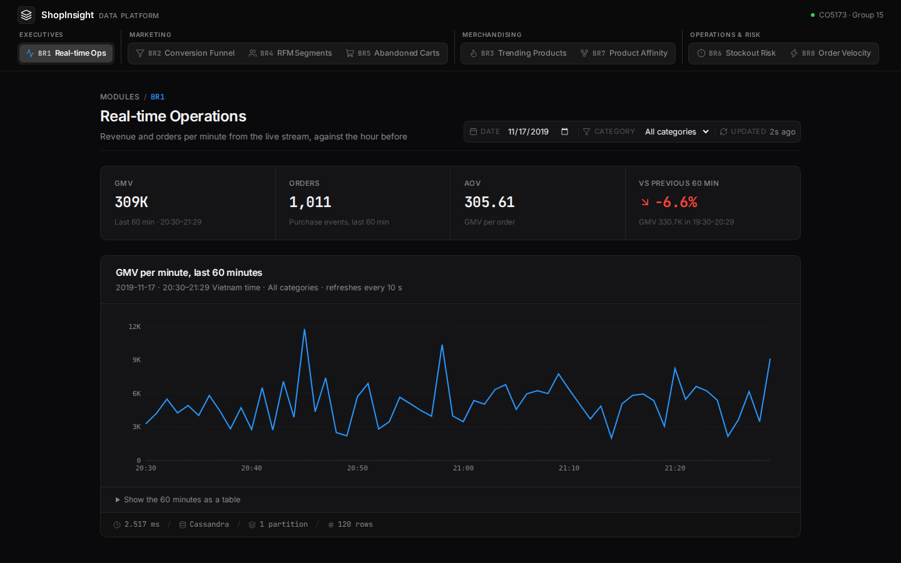

**BR2, phễu chuyển đổi.** Từ 1 tới 30/11 có 966,143 phiên xem sản phẩm, 131,498 phiên tới bước giỏ hàng (13.61%) và 54,676 phiên mua, tức tỉ lệ chuyển đổi chung 5.66%. Cột "drop-off" cho thấy 86.39% phiên rời đi trước bước giỏ hàng, trong khi 41.58% phiên đã tới giỏ thì mua, nên trang sản phẩm là chỗ nhóm marketing nên xem trước. Bảng "Conversion by Category" bên dưới tách phễu theo 14 ngành hàng; trong các ngành lớn, electronics có tỉ lệ từ xem sang giỏ cao nhất (15.88%). Ghi chú dưới phễu nói rõ ngày 15/11 gần như không có lượt mua vì khoảng trống trong dữ liệu gốc (mục 3.1).

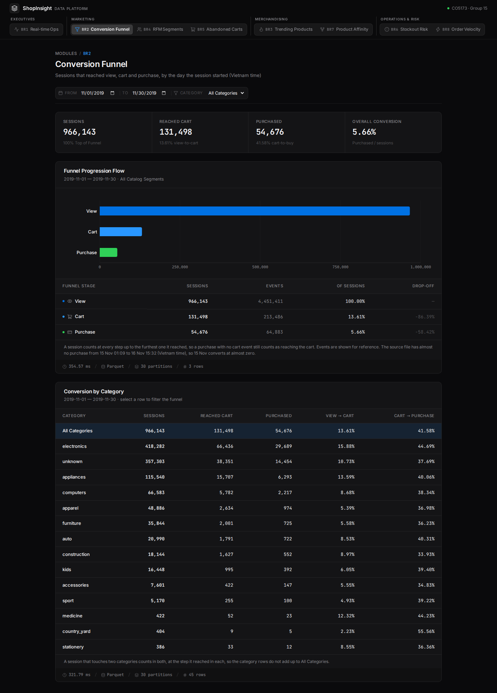

**BR3, sản phẩm đang tăng mạnh.** Màn hình mở ở cửa sổ mới nhất, 21:04 tới 21:19. Sản phẩm 1005115 của Apple dẫn đầu với 80 lượt xem; so với cửa sổ một phút trước, không có sản phẩm mới vào top 20, 6 sản phẩm lên hạng và 7 sản phẩm xuống hạng. Mũi tên đổi hạng cần đọc thêm cửa sổ trước, và chân màn hình cộng cả hai lần đọc.

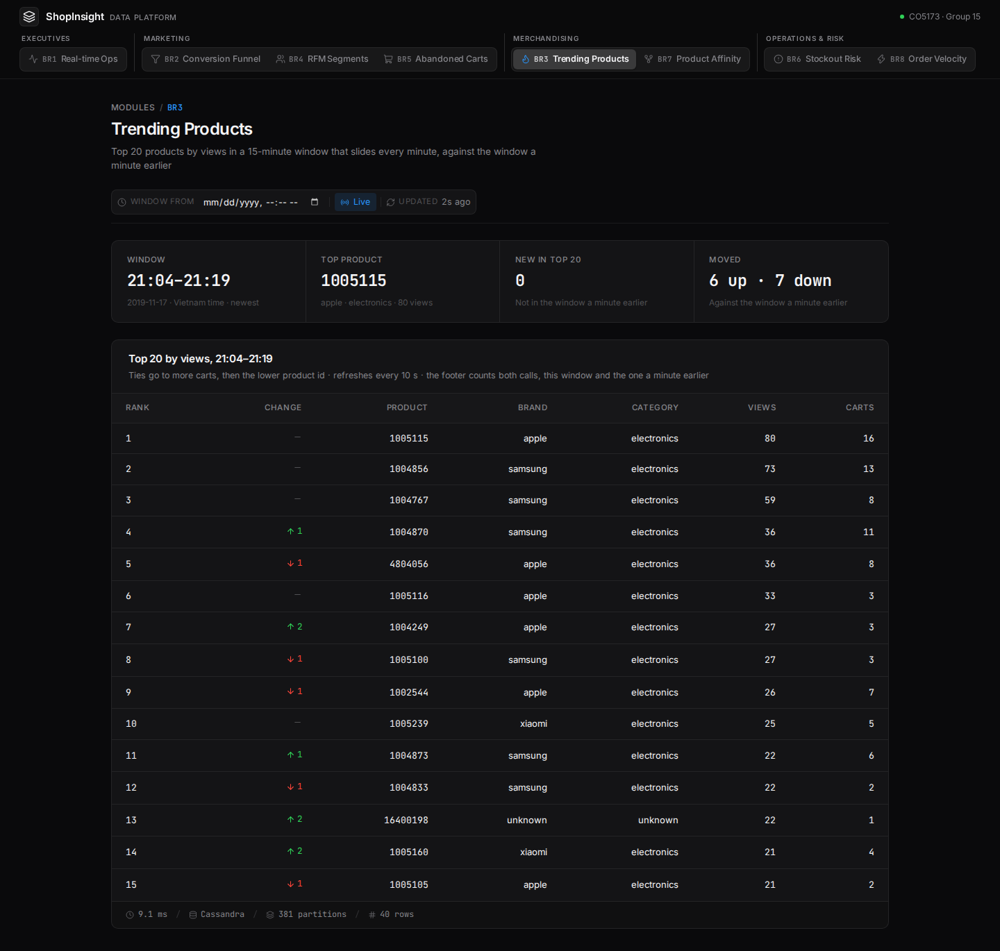

**BR4, phân khúc khách hàng theo RFM.** Heatmap 5x5 theo điểm R và F của 31,005 khách đã mua tính tới 30/11, trong đó 6,477 khách là champion và 6,419 khách là at_risk. Ô R5-F5 có 2,228 khách; bấm vào một ô thì danh sách khách của ô đó hiện bên dưới, xếp theo tổng chi. Dòng chú thích dưới heatmap nói rõ số ngày từ lần mua cuối lấy từ lần chấm đã đặt phân khúc hiện tại của khách, đúng giới hạn ở mục 6.1.

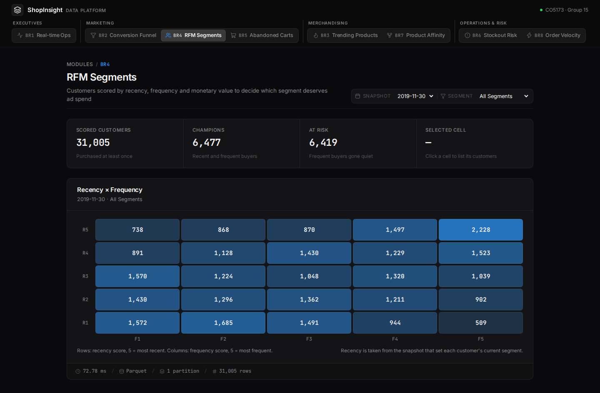

**BR5, giỏ hàng bị bỏ quên.** Ngày 17/11 có 2,600 giỏ bị bỏ quên với tổng giá trị 1.4M; giỏ trung bình 542.91, giỏ lớn nhất 53,157.63. Danh sách xếp theo giá trị giỏ giảm dần và hiện 200 giỏ lớn nhất, còn bốn thẻ số tính trên cả 2,600 giỏ. Người dùng lọc theo giá trị tối thiểu, và nút "Create reminder campaign" mô phỏng việc gửi lời nhắc cho các giỏ đang lọc.

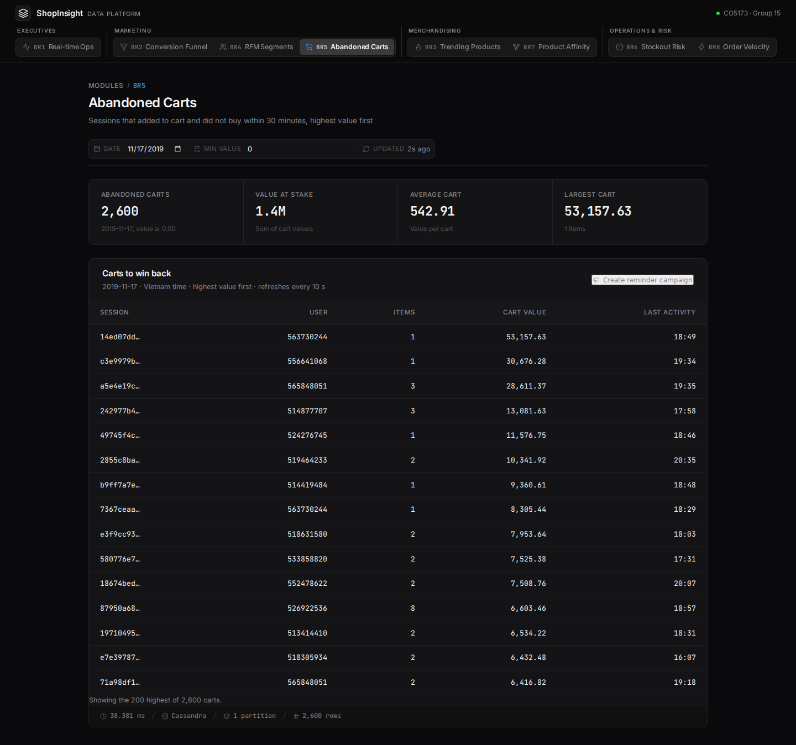

**BR6, nguy cơ hết hàng.** Màn hình liệt kê các sản phẩm gấp nhất trước, tô đỏ khi còn dưới 3 ngày. Với mỗi kho, API đọc 100 sản phẩm gấp nhất, tức đầu phân vùng của `stockout_risk` vì phân vùng đã xếp sẵn theo số ngày còn hàng, rồi thêm tối đa 5 sản phẩm không bán được trong 7 ngày. Khi xem cả năm kho, màn hình có 525 dòng. Bốn thẻ số ở trên (500 critical, 0 low stock, 25 no sales, 525 SKU) đếm trên chính 525 dòng đó, không phải trên toàn bộ 63,655 cặp sản phẩm và kho.

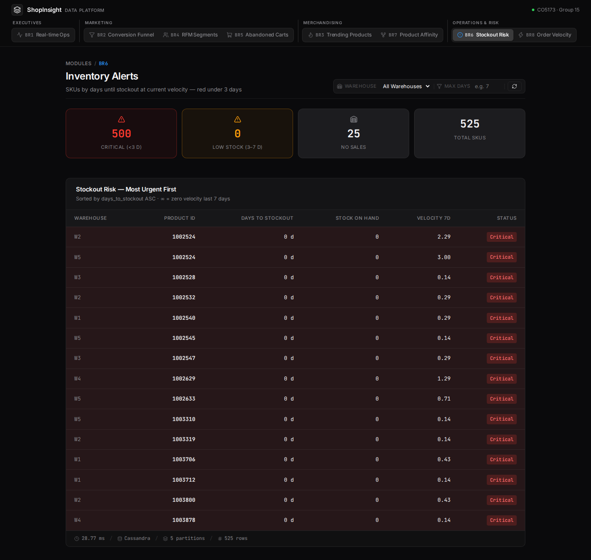

**BR7, sản phẩm thường được mua kèm.** Người dùng chọn một sản phẩm gợi ý hoặc nhập mã. Với sản phẩm 1005115, mười sản phẩm hay được mua cùng phiên đều thuộc ngành điện tử, 8 của Apple và 2 của Samsung. Danh sách xếp theo lift: đứng đầu là 1005230 với lift 4.07 nhưng chỉ mua cùng trong 3 phiên, còn 1004249 được mua cùng nhiều nhất (26 phiên) với lift 1.72. Cột số phiên đặt cạnh lift để người dùng không đọc một lift cao trên rất ít phiên thành một quy luật chắc chắn.

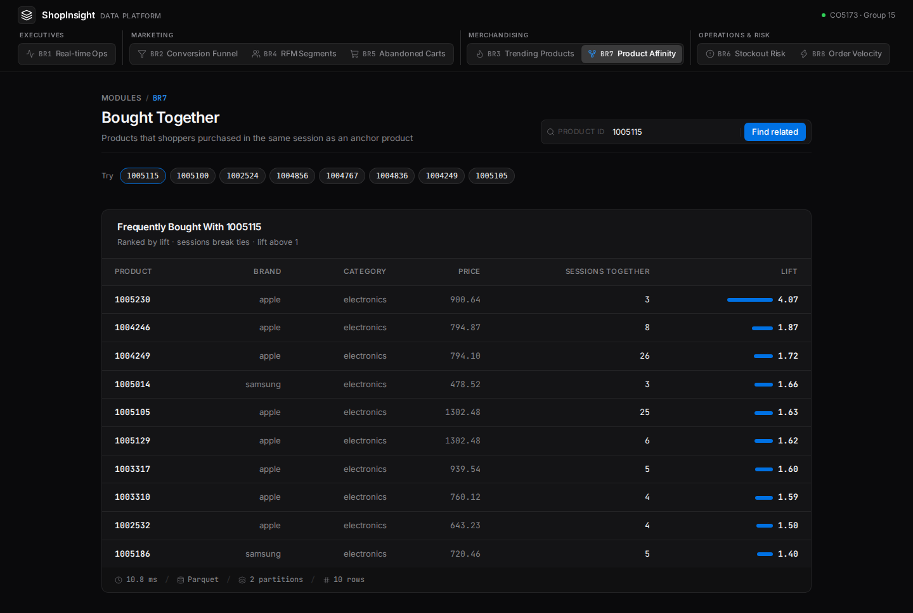

**BR8, tài khoản đặt đơn bất thường.** Ngày 17/11 có 5,815 cảnh báo: 3 high, 337 medium và 5,475 low, theo ngưỡng 1 đơn là low, 2 tới 3 đơn là medium và từ 4 đơn trở lên là high trong một cửa sổ 5 phút. Dòng thời gian hiện 200 cảnh báo mới nhất, còn bốn thẻ số đếm trên cả 5,815. Ảnh chụp khi đã mở một cảnh báo: khách 512379060, cửa sổ 21:25 tới 21:30, 1 đơn trị giá 218.54, mức low.

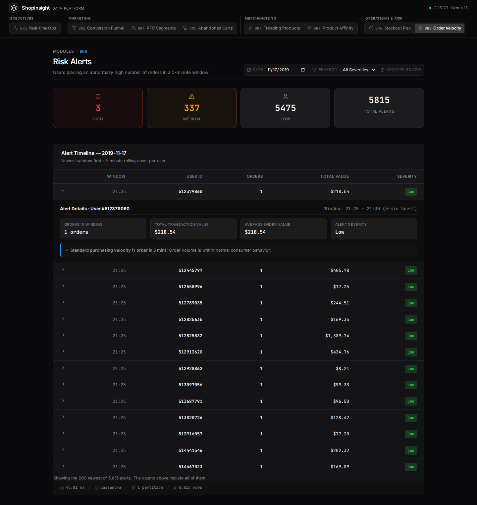

## 6. Đánh giá và kết luận

Hệ thống được đánh giá theo ba tiêu chí: tính đúng đắn (con số trên màn hình có đúng không), hiệu năng (có trả lời dưới 2 giây không) và tính hữu dụng (có trả lời đúng câu hỏi của người dùng không). Mục 6.4 ghi các giới hạn của những kết luận này. Số đo chính thức của mục này là lần đo ngày 10/11/2026 trên máy của Đắt (20 nhân logic, 15 GB RAM, Ubuntu 26.04.1 trong WSL2), `main` tại `02b22f1`, trừ thời gian dựng nhánh theo lô đo ngày 3/11.

### 6.1 Tính đúng đắn

**Phương pháp.** Một con số trên màn hình chỉ có giá trị khi nó đúng. Nhóm kiểm tính đúng đắn bằng cách viết lại đáp án của cả tám câu hỏi theo một đường độc lập, rồi so từng dòng với đúng bảng mà màn hình đọc. Đáp án nằm trong `checks/correctness_8br.py`: SQL thuần chạy bằng DuckDB trên tầng silver (riêng BR6 đọc chuỗi tồn kho), viết từ định nghĩa trong `docs/BR_SCOPE.md` và `docs/API_CONTRACT.md`, không nhập hàm nào từ thư mục `processing/`. Nhờ vậy, một lỗi trong code Spark không thể lặp lại y hệt ở phía đáp án. Một số chỗ đáp án cố ý đi đường khác hẳn: BR6 dựng lại lượng bán mỗi ngày từ chính phương trình cân bằng của tồn kho (tồn hôm nay bằng tồn hôm qua cộng hàng nhập trừ hàng bán) thay vì đọc cột lượng bán, còn BR3 và BR5 tự áp mốc nước để chỉ so những cửa sổ đã đóng.

Một dòng được tính là khớp khi khoá và mọi giá trị được so đều bằng nhau: tiền là số thập phân và phải bằng đúng, số thực khớp trong sai số tương đối 10^-4 vì Cassandra lưu `float` 32 bit. Điểm của một BR bằng số dòng khớp chia cho số dòng của bên nhiều hơn, nên cả dòng thiếu, dòng thừa lẫn dòng bị ghi hai lần đều làm giảm điểm. Ngưỡng đạt là 99%.

**Kết quả.** Bảng dưới là lần chạy ngày 10/11 sau lần phát lại ngày 17/11 từ 15:00 tới 21:30 giờ Việt Nam, mốc nước cuối 21:19:59. Dòng thứ chín là hai bảng chiều SCD loại 2: ở cả `dim_product` và `dim_user`, `checks/scd2_integrity.py` chạy sáu phép kiểm (khoảng hiệu lực chồng nhau, hở, rỗng, số phiên bản hiện hành khác 1, cờ hiện hành sai, cột rỗng) và cả mười hai phép đều ra 0 vi phạm.

| # | Hàng | Giá trị được so | Đáp án | Bảng của màn hình | Khớp | Tỉ lệ |
|---|---|---|---|---|---|---|
| 1 | BR1 | doanh thu và số đơn theo ngày, ngành hàng (kể cả `all`), phút | 4,563 | 4,563 | 4,563 | 100% |
| 2 | BR2 | số phiên và số sự kiện từng bước theo ngày bắt đầu phiên và ngành hàng | 465 | 465 | 465 | 100% |
| 3 | BR3 | sản phẩm, lượt xem, lượt thêm giỏ theo cửa sổ đã đóng và hạng | 7,580 | 7,580 | 7,580 | 100% |
| 4 | BR4 | điểm R, F, M và phân khúc của từng khách | 258,330 | 258,330 | 258,330 | 100% |
| 5 | BR5 | giá trị giỏ, khách, số sản phẩm, sự kiện cuối theo ngày và phiên | 2,600 | 2,600 | 2,600 | 100% |
| 6 | BR6 | số ngày còn hàng, tồn kho, tốc độ bán theo kho và sản phẩm ngày 30/11 | 63,655 | 63,655 | 63,655 | 100% |
| 7 | BR7 | số lần mua cùng, support và lift của từng cặp có thứ tự | 314 | 314 | 314 | 100% |
| 8 | BR8 | số đơn, tổng giá trị, mức cảnh báo theo ngày, cửa sổ 5 phút, khách | 5,815 | 5,815 | 5,815 | 100% |
| 9 | SCD2 | sáu phép kiểm toàn vẹn trên mỗi bảng chiều | 12 phép | | 12 đạt | 100% |

Cả chín hàng đạt 100%, trên ngưỡng 99%. Kết quả lặp lại được: cùng máy, lần phát lại thứ hai ngày 10/11 cho đúng tám hàng BR như trên. Trước đó, lần chạy trên máy của Khang ngày 6/11 và lần chạy lại khi Đắt review ngày 8/11 cũng cho 100% ở cả tám BR; hai lần đó tính BR8 theo ngưỡng cũ (từ 3 đơn là medium, từ 10 đơn là high), trước khi ngưỡng đổi ở PR #37. Một đáp án độc lập thứ hai, `checks/ground_truth.py`, viết riêng bằng DuckDB trên Parquet của kho dữ liệu (riêng BR8 trên silver), cũng cho 100% ở bốn bảng nó kiểm: BR4 (31,005 khách đã mua), BR6 (63,655 dòng), BR7 (314 cặp) và BR8 (5,815 cảnh báo, so số đơn và tổng giá trị).

**Phép kiểm có thể trượt.** Một phép kiểm luôn ra 100% thì chưa chứng minh được gì. Trong lần chạy ngày 6/11, chạy lại cùng lệnh với mốc nước sớm hơn 10 phút, đáp án bỏ đi những cửa sổ mà theo nó chưa đóng: BR3 còn 97.36%, BR5 còn 96.77%, và script trả mã lỗi 1. Trước khi so số thực theo sai số tương đối, BR6 chỉ khớp 63,652 trên 63,655 dòng: ba giá trị như 5.6875 bị Cassandra lưu thành 5.68749. Khi Đắt review, cách so tiền được siết lại thành so đúng: tăng doanh thu của một phút trong Cassandra thêm 1.00 (11,782.53 thành 11,783.53) thì BR1 tụt từ 100% xuống 99.98% và in ra đúng dòng lệch; còn một dòng bị ghi hai lần thì điểm giảm từ 100% xuống 50%. Các lần này cho thấy phép so đủ nhạy để bắt một sai lệch nhỏ.

**Một sai lệch được giữ lại có chủ đích.** Ngoài điểm và phân khúc, danh sách khách trong một ô của BR4 còn hiện số thô: số ngày từ lần mua cuối, số lần mua, tổng chi. So riêng ba số này, chỉ 234,977 trên 258,330 khách (90.96%) khớp với lần chấm ngày 30/11: 23,198 khách lệch số ngày, 590 khách lệch số lần mua hoặc tổng chi. Nguyên nhân nằm ở thiết kế SCD loại 2 của `dim_user`: một phiên bản chỉ mở khi ô RFM đổi (mục 4.3), nên khách giữ nguyên ô qua nhiều lần chấm vẫn mang số thô của lần chấm đã mở phiên bản đó. `checks/ground_truth.py` so số thô của mỗi khách với đúng lần chấm hiện hành của khách đó và ra 100%, nên 90.96% là khoảng cách do thiết kế chứ không phải lỗi tính. Heatmap và bộ lọc chỉ dùng điểm và phân khúc, nên vẫn đúng cho mọi khách. Nhóm chọn giữ thiết kế này, ghi chú ngay trên màn hình BR4, và ghi nó thành giới hạn ở mục 6.4.

### 6.2 Hiệu năng

**Thời gian của tám màn hình.** Mục tiêu của đồ án là mỗi màn hình trả lời dưới 2 giây. Với mỗi màn hình, nhóm gọi endpoint mà màn hình gọi khi vừa mở, 3 lần làm nóng rồi 20 lần đo liên tiếp, và ghi hai thời gian: `meta`, thời gian truy vấn mà API tự báo và in ở chân màn hình, và `curl`, thời gian trọn một lượt HTTP gồm truy vấn, mã hoá JSON và truyền dữ liệu. Thời gian vẽ của React không được tính. p50 và p95 tính theo nearest rank.

| BR | Kho đọc | Phân vùng | meta p50 / p95 (ms) | curl p50 / p95 (ms) | Dưới 2 giây |
|---|---|---|---|---|---|
| BR1 | Cassandra | 1 | 2.6 / 3.1 | 5.2 / 6.1 | có |
| BR2 | Parquet qua DuckDB | 30 | 17.9 / 21.4 | 19.8 / 23.2 | có |
| BR3 | Cassandra | 380 | 5.9 / 7.2 | 7.9 / 9.5 | có |
| BR4 | Parquet qua DuckDB | 1 | 30.2 / 40.0 | 43.7 / 53.4 | có |
| BR5 | Cassandra | 1 | 9.6 / 11.9 | 23.3 / 61.3 | có |
| BR6 | Cassandra | 5 | 14.9 / 17.9 | 18.0 / 22.2 | có |
| BR7 | Parquet qua DuckDB | 2 | 9.6 / 11.7 | 22.8 / 28.3 | có |
| BR8 | Cassandra | 1 | 19.8 / 32.2 | 47.4 / 63.9 | có |

Cả 8 màn hình đạt. Chậm nhất ở p95 phía client là BR8, 63.9 ms, thấp hơn ngưỡng 2 giây khoảng 30 lần. So với 50 giây của câu "doanh thu theo ngành hàng" khi đọc thẳng tệp thô (mục 1.3, đo trên toàn bộ 67.5 triệu dòng; các màn hình đọc mẫu 7%, xem mục 6.4), thời gian chờ dữ liệu giảm hơn hai bậc độ lớn. Ba điều cần đọc kèm bảng:
- Màn hình BR4 bắn song song năm lần gọi, mỗi điểm R một lần, mỗi lần 6,201 khách. Khi đo, năm lần gọi được đo lần lượt, và dòng BR4 ghi giá trị xấu nhất trong năm ở mỗi cột. Chân màn hình trên ảnh, lấy từ một lần tải song song thật, ghi 72.78 ms. Endpoint BR4 không lọc trả cả 258,330 khách, màn hình không gọi kiểu này, có `curl` p95 1,052.0 ms trong khi `meta` p95 chỉ 408.5 ms: phần lớn thời gian là truyền JSON.
- Một số màn hình gọi thêm request ngoài request được đo. BR2 gọi thêm 15 request cho bảng theo ngành (chân bảng ghi 321.79 ms), BR3 đọc thêm cửa sổ một phút trước để vẽ mũi tên đổi hạng, BR7 gọi danh sách sản phẩm gợi ý khi mở. Các request này không được đo lặp; quan sát một lần trên ảnh đều dưới 2 giây.
- Chân màn hình trên ảnh thường là lần tải đầu, nên có thể cao hơn p95 khi đã nóng: BR2 354.57 ms so với p95 21.4 ms, BR8 45.81 ms so với 32.2 ms.

BR8 và BR5 có khoảng cách lớn nhất giữa `meta` và `curl` (19.8 so với 47.4 ms, 9.6 so với 23.3 ms ở p50) vì cùng một lý do với BR4: chúng trả cả ngày, 5,815 cảnh báo và 2,600 giỏ, để bốn thẻ số đếm đủ, dù danh sách chỉ hiện 200 dòng. Ở BR3, 380 phân vùng là danh sách khoá phải đọc trước để tìm cửa sổ mới nhất, đúng cái giá đã phân tích ở mục 4.2. So sánh giữa các cách lưu vật lý (partition pruning, BRIN, GIN, đúng và sai partition key ở Cassandra) nằm ở mục 4.4.

**Nhánh theo lô.** Dựng toàn bộ dữ liệu theo lô từ tệp CSV gốc tới các bảng gold mất 426.5 giây: `load_bronze.py` 34.6, `batch_silver.py` 17.9, `gen_catalog.py` 9.4, `gen_inventory.py` 19.5, `batch_warehouse.py` 273.0, `batch_gold.py` 57.0 và `gold_br7.py` 15.2 giây; cả bảy job thoát với mã 0. Việc này chỉ chạy một lần khi dữ liệu nguồn thay đổi, nên không nằm trên đường chờ của người dùng.

**Nhánh thời gian thực.** Bốn job đọc kịp nguồn: trong lần phát lại, BR1, BR3 và BR5 xử lý 483.0, 466.9 và 483.0 sự kiện mỗi giây, bằng tốc độ replayer cấp (480.7 dòng mỗi giây). BR8 chỉ đọc lượt mua nên là 16.0. Vì vậy đây là tốc độ của nguồn, không phải trần của Spark; nhóm không chạy thử quá tải. Mỗi lô nhỏ phải xong trước khi lô sau tới, tức dưới 5 giây. Thời gian xử lý một lô (`triggerExecution`, kể cả ghi Cassandra) có p50, p95 và max như sau: BR1 616, 877 và 3,201 ms; BR3 852, 1,252 và 3,524 ms; BR5 587, 800 và 3,199 ms; BR8 590, 865 và 3,200 ms. Max rơi vào lô đầu tiên, lúc JVM và câu truy vấn khởi động.

Độ tươi của màn hình phụ thuộc vào chế độ đầu ra. Một sự kiện tới Cassandra chậm nhất sau một chu kỳ 5 giây cộng thời gian xử lý một lô, tính từ lúc tệp của nó vào thư mục nguồn. BR1 và BR8 dùng `update`, nên cửa sổ đang diễn ra (một phút với BR1, năm phút với BR8) hiện lên và tăng dần ngay ở lô nhỏ kế tiếp. BR3 và BR5 dùng `append`, nên một cửa sổ chỉ hiện khi mốc nước đã vượt qua điểm cuối của nó, tức 10 phút thời gian sự kiện sau khi cửa sổ kết thúc. Khi phát lại ở `--speed 60`, 10 phút đó chỉ là 10 giây; trên một sàn thật nó là 10 phút, và đây là cái giá của việc chỉ ghi những cửa sổ đã chắc chắn.

### 6.3 Tính hữu dụng

**Mỗi câu hỏi có một màn hình trả lời.** Bảng dưới đối chiếu câu hỏi của từng nhóm người dùng ở mục 1.2 với màn hình và thao tác trả lời nó, dựa trên các ảnh ở mục 5.2.

| Nhóm người dùng | Câu hỏi | Màn hình và thao tác | Câu trả lời trên dữ liệu demo |
|---|---|---|---|
| Ban điều hành | Doanh thu đang đi thế nào so với một giờ trước? | BR1, mở màn hình | 309K trong 60 phút, giảm 6.6% so với 60 phút trước |
| Tăng trưởng và marketing | Khách rời đi ở bước nào? | BR2, mở màn hình | 86.39% phiên rời đi trước bước giỏ hàng |
| Tăng trưởng và marketing | Phân khúc nào nên được đầu tư? | BR4, chọn một ô | 6,419 khách at_risk; ô R5-F5 có 2,228 khách |
| Tăng trưởng và marketing | Khách nào bỏ quên giỏ hàng? | BR5, lọc theo giá trị | 2,600 giỏ ngày 17/11 (15:00 tới 21:30), tổng 1.4M |
| Hàng hoá | Sản phẩm nào đang tăng mạnh? | BR3, mở màn hình | 1005115 dẫn đầu cửa sổ 21:04 tới 21:19 |
| Hàng hoá | Mua A thì thường mua kèm gì? | BR7, chọn sản phẩm | với 1005115: 1004249 mua cùng trong 26 phiên, lift 1.72 |
| Vận hành và rủi ro | Sản phẩm nào sắp hết hàng, ở kho nào? | BR6, lọc kho và số ngày | danh sách tô đỏ dưới 3 ngày, theo từng kho |
| Vận hành và rủi ro | Tài khoản nào đặt đơn bất thường? | BR8, lọc mức cảnh báo | 3 cảnh báo high và 337 medium ngày 17/11 (15:00 tới 21:30), mở được từng cảnh báo |

**Khảo sát người dùng.** Bảng trên chỉ cho thấy mỗi câu hỏi có một màn hình trả lời, chưa cho thấy người dùng thấy câu trả lời đó dễ đọc và đáng tin. Nhóm lập kế hoạch khảo sát ở `docs/EVALUATION_SURVEY.md`: 5 người tham gia làm bốn tác vụ, mỗi tác vụ ứng với một nhóm người dùng, rồi chấm theo thang 1 tới 5. Ngưỡng thành công đặt trước gồm bốn mức: thời gian ở chân màn hình dưới 2,000 ms trên mọi màn hình, điểm cảm nhận tốc độ trung bình từ 4.0, điểm độ rõ của thông tin trung bình từ 4.2, và 100% tác vụ hoàn thành không lỗi.

Tới ngày nộp báo cáo, nhóm chưa có kết quả của khảo sát này, nên báo cáo không đưa ra điểm hài lòng hay tỉ lệ hoàn thành tác vụ nào. Trong bốn ngưỡng, chỉ ngưỡng thời gian đo được mà không cần người dùng: cả tám màn hình dưới 2 giây, kể cả chân màn hình của lần tải đầu (mục 6.2). Ba ngưỡng còn lại cần người dùng thật và được ghi thành giới hạn ở mục 6.4.

### 6.4 Kết luận, giới hạn và hướng phát triển

**Giới hạn.** Các kết luận ở trên đúng trong phạm vi sau, và nhóm ghi rõ để người đọc không suy rộng quá mức:

- **Không có cụm máy thật.** Spark chạy `local[*]` trên một máy, Cassandra chỉ có một node. Các con số hiệu năng là số đo tương đối giữa các cấu hình trên cùng máy, không phải số của một hệ thống sản xuất.
- **Tập làm việc là mẫu 7% khách.** Mọi số đo chạy trên 4,754,015 sự kiện chứ không phải 67.5 triệu. Mục 4.4 cho thấy ở cỡ này cả PostgreSQL lẫn DuckDB đều trả lời câu doanh thu 31 ngày dưới 0.1 giây; nhóm chưa đo các cách lưu thay đổi thế nào khi dữ liệu lớn hơn.
- **Luồng thời gian thực là luồng phát lại.** Replayer ghi sự kiện theo thứ tự thời gian của tầng bronze, nên luồng gần như không có sự kiện đến trễ. Cách mốc nước 10 phút xử lý sự kiện đến muộn vì vậy chưa được thử trên một luồng thật, và nhánh thời gian thực chưa được thử với tốc độ cao hơn tốc độ replayer cấp.
- **Bốn BR thời gian thực không đọc kho dữ liệu.** Chúng tính thẳng trên sự kiện đã làm sạch, vì gắn phiên bản SCD loại 2 cho từng lô nhỏ vượt quá thời gian của nhóm (mục 4.1). Trong năm bảng gold ở Cassandra, chỉ bảng của BR6 được sinh từ kho dữ liệu.
- **Bảng accumulating snapshot được dựng lại toàn bộ.** Parquet không cho sửa dòng, nên `fact_session_funnel` được tính lại và ghi đè ở mỗi lần chạy theo lô thay vì cập nhật tăng dần, và bảng không giữ lịch sử của phiên (mục 4.4).
- **Số thô trong danh sách khách của BR4 có thể là của lần chấm trước** (mục 6.1). Điểm, phân khúc và heatmap vẫn đúng.
- **Thẻ số của BR6 chỉ đếm các dòng đang hiện** (mục 5.2), không phải toàn bộ 63,655 cặp sản phẩm và kho.
- **Tồn kho và thuộc tính sản phẩm là dữ liệu giả lập** (mục 3.3, 3.4). BR6 và phép so `jsonb` với `struct` chứng minh cơ chế, không phản ánh hành vi thật của kho hàng hay catalogue.
- **Chưa có khảo sát người dùng.** Tính hữu dụng mới được đánh giá bằng phép đối chiếu câu hỏi với màn hình và bằng thời gian phản hồi; mức hài lòng và tỉ lệ hoàn thành tác vụ chưa được đo (mục 6.3).
- **Không có xác thực và phân quyền.** Dashboard giả định chạy trong mạng nội bộ.

**Hướng phát triển.** Theo thứ tự mà nhóm cho là có ích nhất:

1. Thay thư mục tệp bằng Kafka. Phần đọc nguồn đã tách riêng trong `processing/source.py`, nên đây là thay đổi ở một tệp (mục 4.1).
2. Chạy trên toàn bộ 67.5 triệu sự kiện với một cụm Spark và Cassandra nhiều node, để đo xem khoảng cách giữa đọc theo khoá và tính lại từ kho dữ liệu tăng thế nào theo kích thước.
3. Thêm endpoint đếm sẵn cho các thẻ số và heatmap: số khách của từng ô BR4, số cảnh báo theo mức của BR8, số giỏ của BR5, số sản phẩm theo mức của BR6. Màn hình khi đó không phải tải cả ngày dữ liệu chỉ để đếm (mục 6.2), và thẻ số của BR6 đếm đúng trên toàn bảng.
4. Chuyển kho dữ liệu sang Delta Lake hoặc Iceberg, để `fact_session_funnel` được cập nhật bằng `MERGE` đúng như định nghĩa của bảng accumulating snapshot.
5. Cho nhánh thời gian thực đọc chiều sản phẩm và chiều khách hàng, ví dụ bằng một bản chiều hiện hành được làm mới định kỳ và nối trong từng lô nhỏ.

**Kết luận.** ShopInsight biến 9.0 GB nhật ký hành vi thành 8 màn hình, mỗi màn hình trả lời một câu hỏi của một nhóm người dùng. Câu hỏi "doanh thu theo ngành hàng" mất 50 giây khi đọc thẳng toàn bộ tệp thô; trên hệ thống, chạy với mẫu 7% khách, màn hình chậm nhất trả dữ liệu trong 63.9 ms ở p95. Cả tám câu trả lời khớp 100% với một đáp án viết độc lập, và bốn trong số đó khớp thêm với một đáp án độc lập thứ hai. Bài học lớn nhất của nhóm là con số chỉ đáng tin khi đi kèm cách đo lại được. Mọi số trong báo cáo này đều có lệnh hoặc tệp bằng chứng ở bảng nguồn số liệu cuối mỗi mục, và nhiều quyết định thiết kế đã đổi chính vì một phép đo: số phân vùng shuffle của nhánh thời gian thực, cách xoá dòng rác của BR3, ngưỡng cảnh báo của BR8, và cách so tiền trong phép kiểm đúng đắn.

### Nguồn số liệu của mục 5 và 6

Trừ khi ghi khác, các số đo ngày 10/11/2026 trên máy của Đắt, `main` tại `02b22f1`, sau lần phát lại ngày 17/11 từ 15:00 tới 21:30 giờ Việt Nam (78 tệp, 187,468 sự kiện). Danh sách đầy đủ các tệp bằng chứng ở `docs/evidence/README.md`.

| Số liệu | Nguồn |
|---|---|
| Ảnh tám màn hình và số đọc trên ảnh (309K, 966,143 phiên, 21:04 tới 21:19, 31,005 khách, 2,600 giỏ, 525 dòng, lift 4.07, 5,815 cảnh báo, ...) | `docs/evidence/gate2b_br1.png` tới `gate2b_br8.png` |
| Cách chạy hệ thống | `run_demo.sh` (chú thích đầu tệp và danh sách lệnh dựng dữ liệu theo lô mà bước `infra` in ra khi thiếu dữ liệu) |
| API của BR6 đọc 100 sản phẩm gấp nhất và tối đa 5 sản phẩm không bán mỗi kho; thẻ số đếm trên các dòng trả về | `_LIMIT_PER_WAREHOUSE`, `_NO_SALES_PER_WAREHOUSE` trong `serving/api/routers/br6.py`; `criticalCount`, `rows.length` trong `web/src/pages/BR6Page.tsx` |
| Bảng chín hàng: tám BR 100%, SCD2 12 phép đạt; lần phát lại thứ hai; `ground_truth.py` 100% ở BR4, BR6, BR7, BR8; số thô BR4 90.96%, 23,198 và 590 khách | `docs/evidence/correctness_8br.txt`, mục "10 November 2026: the nine-row table (T19)" và "BR4's raw values"; đầu ra gốc ở `docs/evidence/t14_checks.txt` |
| Lần chạy 6/11 (máy của Khang) và 8/11 (Đắt review): 100% ở tám BR; mốc nước sớm 10 phút: 97.36% và 96.77%; 63,652 / 63,655 trước khi đổi cách so số thực; tiền lệch 1.00 cho 99.98%, dòng ghi hai lần cho 50% | `docs/evidence/correctness_8br.txt`, các mục "Result", "The check can fail" và "Reviewer re-run after the exact money comparison" |
| Thời gian tám màn hình: phân vùng, meta và curl p50 / p95; BR4 năm lần gọi; endpoint BR4 không lọc 408.5 và 1,052.0 ms; các request phụ và chân màn hình lần đầu | `docs/evidence/gate2b_screens.txt`; số thô ở `docs/evidence/gate2b_curl_raw.txt`; bảng tổng hợp `docs/evidence/perf_table.md` |
| Dựng nhánh theo lô 426.5 giây và thời gian từng job | `docs/evidence/batch_timings.txt` (máy của Đắt, 3/11/2026, `aa65472`) |
| Thông lượng 483.0, 466.9, 483.0, 16.0 sự kiện mỗi giây; replayer 480.7 dòng mỗi giây; `triggerExecution` p50, p95, max của bốn job | `docs/evidence/streaming_perf.txt`, lần 1; log ở `docs/evidence/t14_logs/` |
| Kế hoạch khảo sát: 5 người, bốn tác vụ, các ngưỡng | `docs/EVALUATION_SURVEY.md` |

## Tài liệu tham khảo

[1] M. Kechinov (REES46), "eCommerce behavior data from multi category store," Kaggle. https://www.kaggle.com/datasets/mkechinov/ecommerce-behavior-data-from-multi-category-store

[2] R. Kimball và M. Ross, *The Data Warehouse Toolkit: The Definitive Guide to Dimensional Modeling*, 3rd ed. Wiley, 2013.

[3] M. Zaharia et al., "Apache Spark: A unified engine for big data processing," *Communications of the ACM*, vol. 59, no. 11, pp. 56–65, 2016.

[4] M. Armbrust et al., "Structured Streaming: A declarative API for real-time applications in Apache Spark," in *Proc. ACM SIGMOD*, 2018, pp. 601–613.

[5] A. Lakshman và P. Malik, "Cassandra: A decentralized structured storage system," *ACM SIGOPS Operating Systems Review*, vol. 44, no. 2, pp. 35–40, 2010.

[6] Apache Software Foundation, "Apache Parquet: File format." https://parquet.apache.org/docs/file-format/

[7] M. Raasveldt và H. Mühleisen, "DuckDB: An embeddable analytical database," in *Proc. ACM SIGMOD*, 2019, pp. 1981–1984.

[8] The PostgreSQL Global Development Group, *PostgreSQL 16 Documentation*, chương 5.11 (Table Partitioning) và chương 11 (Indexes). https://www.postgresql.org/docs/16/

[9] A. M. Hughes, *Strategic Database Marketing*. Probus Publishing, 1994.

[10] R. Agrawal, T. Imieliński và A. Swami, "Mining association rules between sets of items in large databases," in *Proc. ACM SIGMOD*, 1993, pp. 207–216.

[11] S. Brin, R. Motwani, J. D. Ullman và S. Tsur, "Dynamic itemset counting and implication rules for market basket data," in *Proc. ACM SIGMOD*, 1997, pp. 255–264.

[12] M. Kleppmann, *Designing Data-Intensive Applications*. O'Reilly Media, 2017.
