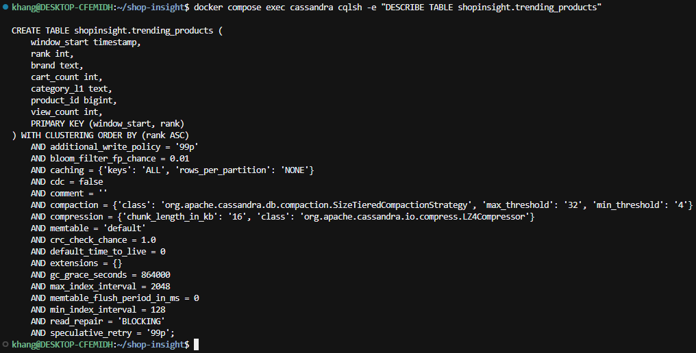

# ShopInsight: báo cáo đồ án

Nhóm 15 · Data Engineering (CO5173) · HCMUT, học kỳ 1 năm học 2026–2027

## 1. Bối cảnh và các bên liên quan

### 1.1 Bối cảnh

Đồ án đặt trong bối cảnh một sàn thương mại điện tử đa ngành, bán từ điện thoại, máy tính, đồ gia dụng tới nội thất và phụ tùng ô tô. Mỗi thao tác của khách trên sàn được ghi lại thành một sự kiện gồm thời điểm, loại thao tác, sản phẩm, ngành hàng, thương hiệu, giá, mã khách và mã phiên truy cập. Có ba loại thao tác: xem sản phẩm, thêm vào giỏ và mua.

Nguồn dữ liệu là bộ "eCommerce behavior data from multi category store" do REES46 công bố trên Kaggle, dùng tệp tháng 11 năm 2019. Tệp này có 67,501,979 sự kiện, dung lượng 9.0 GB ở dạng CSV. Lượng mua trong tháng không đều. Tính theo ngày UTC, đỉnh lớn nhất rơi vào 16–17/11: riêng ngày 17/11 có 185,195 lượt mua, gấp khoảng 5.8 lần ngày Black Friday 29/11, vốn chỉ đứng thứ ba với 32,107 lượt. Vì vậy dữ liệu có cả giai đoạn bình thường lẫn giai đoạn tăng đột biến.

Nhật ký sự kiện là nguồn duy nhất cho biết khách đang làm gì trên sàn, nhưng nó chỉ là một danh sách thao tác xếp theo thời gian. Không câu hỏi kinh doanh nào đọc được trực tiếp từ đó. Muốn biết doanh thu đang tăng hay giảm, khách rời đi ở bước nào hay sản phẩm nào sắp hết hàng, đều phải lọc, làm sạch, gom nhóm và tính toán trên hàng chục triệu dòng.

ShopInsight là hệ thống biến nhật ký thô đó thành một dashboard gồm 8 màn hình. Mỗi màn hình trả lời một câu hỏi kinh doanh và phải phản hồi trong dưới 2 giây. Phần giá trị của đồ án nằm ở khoảng giữa: dữ liệu được làm sạch, tổ chức thành kho dữ liệu dạng mô hình chiều, rồi tổng hợp sẵn theo đúng câu hỏi mà từng màn hình đặt ra, sao cho mỗi truy vấn chỉ đọc phần dữ liệu nó cần. Nguồn dữ liệu được mô tả chi tiết ở mục 3.

### 1.2 Các bên liên quan

Người dùng của ShopInsight là bốn nhóm nội bộ của sàn. Mỗi nhóm hỏi những câu khác nhau và cần dữ liệu tươi ở mức khác nhau.

| Nhóm người dùng | Câu hỏi hằng ngày | Độ tươi cần có | Yêu cầu nghiệp vụ |
|---|---|---|---|
| Ban điều hành | Doanh thu đang đi thế nào so với một giờ trước? Ngành hàng nào đang kéo doanh thu? | Theo từng phút, màn hình tự làm mới mỗi 10 giây | BR1 |
| Tăng trưởng và marketing | Khách rời đi ở bước nào: xem, thêm giỏ hay mua? Phân khúc khách nào nên được đầu tư quảng cáo? Khách nào bỏ quên giỏ hàng? | Theo lô cho phễu và phân khúc; trong vòng 30 phút cho giỏ bỏ quên | BR2, BR4, BR5 |
| Hàng hoá | Sản phẩm nào đang tăng mạnh? Khách mua sản phẩm A thường mua kèm gì? | Cửa sổ 15 phút trượt mỗi phút cho sản phẩm đang tăng; theo lô cho mua kèm | BR3, BR7 |
| Vận hành và rủi ro | Sản phẩm nào sắp hết hàng, ở kho nào? Tài khoản nào đặt đơn bất thường? | Theo lô cho tồn kho; cửa sổ 5 phút cho đơn bất thường | BR6, BR8 |

Bảng trên cho thấy hai nhịp ra quyết định khác nhau. Một nhóm câu hỏi cần câu trả lời gần như ngay lúc sự kiện xảy ra: doanh thu theo phút, sản phẩm đang tăng, giỏ bị bỏ quên và đơn bất thường. Nhóm còn lại chấp nhận số liệu tính theo lô nhưng cần tính trên toàn bộ lịch sử: phễu chuyển đổi, phân khúc khách hàng, sản phẩm mua kèm và nguy cơ hết hàng. Hai nhịp này dẫn tới hai luồng xử lý riêng trong kiến trúc, trình bày ở mục 4. Từng yêu cầu nghiệp vụ được mô tả ở mục 2.

### 1.3 Vì sao không truy vấn thẳng nhật ký thô

Cách đơn giản nhất là để mỗi màn hình đọc thẳng tệp CSV. Cách này không đáp ứng được yêu cầu vì bốn lý do.

Thứ nhất, mọi câu hỏi đều phải quét toàn bộ tệp. Tệp CSV không có chỉ mục và không chia phân vùng, nên một câu hỏi chỉ liên quan tới một ngày hay một loại sự kiện vẫn phải đọc hết 9.0 GB. Đo trên máy của nhóm, chỉ riêng việc đọc tệp một lượt đã mất 25 giây. Câu hỏi "doanh thu theo ngành hàng trong tháng" mất 50 giây, gấp 25 lần ngưỡng 2 giây, dù câu trả lời chỉ dựa trên 916,939 lượt mua, tức khoảng 1.4% số dòng.

Thứ hai, dữ liệu thô chưa sạch. 32.4% sự kiện không có mã ngành hàng, 188,088 sự kiện có giá bằng 0, và thời điểm được lưu theo giờ UTC trong khi hệ thống báo cáo theo giờ Việt Nam, nên các sự kiện từ 17:00 tới 24:00 UTC thuộc về ngày hôm sau. Trong phép đo trên, nhóm doanh thu lớn thứ hai chính là các lượt mua không có ngành hàng. Nếu mỗi truy vấn tự làm sạch theo cách riêng, các màn hình sẽ cho ra số liệu không khớp nhau.

Thứ ba, nhiều câu hỏi cần tính trên toàn bộ lịch sử chứ không chỉ lọc vài dòng. Phân khúc khách hàng cần gom mọi lượt mua của từng khách, phễu chuyển đổi cần gom sự kiện theo phiên, còn sản phẩm mua kèm cần ghép từng cặp sản phẩm trong cùng một phiên. Tính lại những phép này cho mỗi lần mở màn hình là không khả thi.

Thứ tư, các câu hỏi thời gian thực không chờ được. Màn hình điều hành làm mới mỗi 10 giây, trong khi riêng việc đọc tệp đã mất 25 giây.

Vì vậy ShopInsight xử lý trước một lần những việc tốn kém: làm sạch, dựng kho dữ liệu, tổng hợp sẵn cho từng câu hỏi và lưu theo đúng khoá mà màn hình sẽ lọc. Màn hình chỉ còn đọc phần dữ liệu nhỏ nó cần. Việc rút từ 50 giây xuống dưới 2 giây là điều đồ án phải đo và chứng minh ở mục 6, chứ không chỉ khẳng định.

### Nguồn số liệu của mục 1

Các số dưới đây đo trên tệp `data/raw/2019-Nov.csv`, trên máy 12 nhân, 15 GB RAM chạy Ubuntu trong WSL2.

| Số liệu | Lệnh |
|---|---|
| 67,501,979 sự kiện (67,501,980 dòng trừ dòng tiêu đề) | `wc -l data/raw/2019-Nov.csv` |
| 9.0 GB (9,006,762,395 byte) | `ls -l data/raw/2019-Nov.csv` |
| Đọc tệp một lượt: 25 giây | `time wc -l data/raw/2019-Nov.csv` |
| Doanh thu theo ngành hàng: 50 giây | `time awk -F, 'NR>1 && $2=="purchase" {split($5,c,"."); g[c[1]]+=$7} END {for (k in g) print k, g[k]}' data/raw/2019-Nov.csv` |
| 916,939 lượt mua | `awk -F, 'NR>1 && $2=="purchase" {n++} END {print n}' data/raw/2019-Nov.csv` |
| Lượt mua theo ngày UTC: 17/11 có 185,195, 16/11 có 68,247, 29/11 đứng thứ ba với 32,107 | `awk -F, 'NR>1 && $2=="purchase" {d[substr($1,1,10)]++} END {for (k in d) print k, d[k]}' data/raw/2019-Nov.csv \| sort -k2 -n -r \| head -3` |
| 32.4% sự kiện không có mã ngành hàng (21,898,171 dòng) | `awk -F, 'NR>1 {n++; if ($5=="") c++} END {print c, 100*c/n}' data/raw/2019-Nov.csv` |
| 188,088 sự kiện có giá bằng 0, không có giá âm | `awk -F, 'NR>1 {if ($7+0==0) z++; if ($7+0<0) n++} END {print z, n+0}' data/raw/2019-Nov.csv` |

## 2. Tám yêu cầu nghiệp vụ

Đề bài yêu cầu ít nhất 2n yêu cầu nghiệp vụ với n là số thành viên. Nhóm có bốn người nên chọn tám yêu cầu, ký hiệu từ BR1 tới BR8. Mỗi yêu cầu trả lời một câu hỏi của một nhóm người dùng ở mục 1.2 và có một màn hình riêng trên dashboard. Mỗi thành viên phụ trách trọn hai yêu cầu, gồm phần xử lý dữ liệu, API và màn hình: một yêu cầu xử lý theo lô và một yêu cầu xử lý thời gian thực.

| BR | Câu hỏi nghiệp vụ | Nhóm người dùng | Cách xử lý | Nơi lưu kết quả |
|---|---|---|---|---|
| BR1 | Doanh thu và số đơn từng phút ra sao, ngành hàng nào đang dẫn? | Ban điều hành | Thời gian thực | Cassandra |
| BR2 | Khách rời đi ở bước nào: xem, thêm giỏ hay mua? | Tăng trưởng và marketing | Theo lô | Parquet |
| BR3 | Sản phẩm nào đang tăng mạnh trong 15 phút gần nhất? | Hàng hoá | Thời gian thực | Cassandra |
| BR4 | Phân khúc khách hàng nào nên được đầu tư quảng cáo? | Tăng trưởng và marketing | Theo lô | Parquet |
| BR5 | Khách nào bỏ quên giỏ hàng? | Tăng trưởng và marketing | Thời gian thực | Cassandra |
| BR6 | Sản phẩm nào sắp hết hàng, ở kho nào? | Vận hành và rủi ro | Theo lô | Cassandra |
| BR7 | Khách mua sản phẩm A thường mua kèm gì? | Hàng hoá | Theo lô | Parquet |
| BR8 | Tài khoản nào đặt đơn bất thường? | Vận hành và rủi ro | Thời gian thực | Cassandra |

Bốn yêu cầu thời gian thực (BR1, BR3, BR5, BR8) đọc luồng sự kiện đang tới và ghi kết quả vào Cassandra. Mỗi bảng trong Cassandra được thiết kế ngược từ đúng câu hỏi mà màn hình đặt ra. Bốn yêu cầu theo lô (BR2, BR4, BR6, BR7) đọc từ kho dữ liệu dạng mô hình chiều và ghi kết quả ra tệp Parquet, riêng BR6 ghi vào Cassandra vì màn hình tra cứu theo từng kho. Cách tổ chức hai luồng này được trình bày ở mục 4. Các phần dưới đây mô tả từng yêu cầu: câu hỏi, người dùng dùng câu trả lời để làm gì, và vì sao nhật ký thô không trả lời được.

### 2.1 BR1: Doanh thu theo từng phút

Ban điều hành cần biết doanh thu và số đơn trong từng phút của 60 phút gần nhất, chia theo ngành hàng cấp một, để thấy doanh thu đang tăng hay giảm so với một giờ trước và ngành nào đang kéo doanh thu. Màn hình gồm bốn thẻ số và biểu đồ doanh thu 60 phút, tự làm mới mỗi 10 giây, lọc theo ngày và ngành hàng.

Câu trả lời thay đổi từng phút, trong khi chỉ riêng việc đọc lại tệp thô đã mất 25 giây, dài hơn một chu kỳ làm mới. Doanh thu vì vậy phải được cộng dồn liên tục theo cửa sổ một phút ngay khi sự kiện tới. Ngoài ra, khoảng một phần ba sự kiện không có ngành hàng (mục 1.3). Các lượt mua trong số đó chiếm 10.2% doanh thu, đứng thứ hai sau ngành điện tử, nên chúng được giữ dưới ngành hàng `unknown`: vẫn được cộng vào doanh thu của mọi ngành và chọn riêng được trong bộ lọc.

### 2.2 BR2: Phễu chuyển đổi

Nhóm marketing cần biết trong các phiên truy cập có bao nhiêu phiên xem sản phẩm, bao nhiêu phiên thêm vào giỏ và bao nhiêu phiên mua, cùng tỉ lệ chuyển đổi của từng bước theo ngành hàng. Câu trả lời cho biết khách rời đi ở đâu, để sửa đúng chỗ: trang sản phẩm chưa đủ thuyết phục hay quá trình thanh toán có vướng mắc. Màn hình là phễu ba bước và bảng tỉ lệ chuyển đổi theo ngành, lọc theo khoảng ngày và ngành hàng.

Nhật ký ghi từng sự kiện riêng lẻ, không có bản ghi nào cho biết một phiên đã đi tới bước nào. Muốn có phễu, phải gom toàn bộ sự kiện theo phiên rồi mới xác định bước xa nhất của mỗi phiên. Đây là phép gom trên toàn bộ 4,754,015 sự kiện của tập dữ liệu làm việc (mục 3), không thể làm lại mỗi lần mở màn hình.

### 2.3 BR3: Sản phẩm đang tăng mạnh

Nhóm hàng hoá cần danh sách 20 sản phẩm được xem nhiều nhất trong 15 phút gần nhất, cập nhật mỗi phút, kèm mũi tên cho biết sản phẩm lên hay xuống hạng so với cửa sổ trước. Câu trả lời giúp đẩy hàng và bổ sung hàng kịp lúc sản phẩm đang được quan tâm. Màn hình là bảng 20 sản phẩm, lọc theo cửa sổ thời gian.

Bảng xếp hạng phải được tính lại mỗi phút trên một cửa sổ mới và so với hạng của cửa sổ trước. Nhật ký thô không lưu thứ hạng cũ, và quét lại tệp mỗi phút thì không kịp.

### 2.4 BR4: Phân khúc khách hàng theo RFM

Mỗi khách đã mua ít nhất một lần tính tới ngày chấm được chấm ba điểm từ 1 tới 5: độ gần đây của lần mua cuối (R), số lần mua (F) và tổng chi tiêu (M). Hai điểm R và F quyết định phân khúc của khách: champion, loyal, promising, needs_attention, at_risk hoặc hibernating. Khách chưa mua lần nào tính tới ngày chấm không có điểm (để trống, không phải 0) và thuộc phân khúc no_purchase. Nhóm marketing dùng phân khúc để chọn nhóm khách nên đầu tư quảng cáo, ví dụ giữ chân nhóm at_risk trước khi họ rời đi. Màn hình là heatmap 5x5 theo R và F, mỗi ô ghi số khách, bấm vào một ô thì hiện danh sách khách của ô đó.

Điểm RFM là thứ hạng tương đối giữa các khách, nên phải gom toàn bộ lịch sử mua của mọi khách rồi xếp hạng cùng lúc. Tập dữ liệu làm việc có 258,330 khách, trong đó 31,005 khách đã mua tính tới ngày 30/11. Phân khúc của một khách còn thay đổi theo thời gian, nên hệ thống chấm lại mỗi tuần và lưu lịch sử phân khúc, để mỗi sự kiện được gắn phân khúc của lần chấm hằng tuần ứng với ngày sự kiện xảy ra (mục 4.1). Nhật ký thô không có khái niệm này.

### 2.5 BR5: Giỏ hàng bị bỏ quên

Nhóm marketing cần danh sách các phiên đã thêm sản phẩm vào giỏ nhưng 30 phút sau vẫn chưa mua, xếp theo giá trị giỏ giảm dần, để nhắc khách quay lại. Màn hình là danh sách giỏ bỏ quên kèm nút "tạo chiến dịch" mô phỏng, lọc theo ngày và giá trị giỏ tối thiểu.

Điều kiện "30 phút sau vẫn chưa mua" nói về một sự kiện không xảy ra. Hệ thống phải nhớ trạng thái của từng phiên và chờ đủ 30 phút mới kết luận được. Một lần quét nhật ký tại một thời điểm không phân biệt được giỏ bị bỏ quên với giỏ sắp được thanh toán.

### 2.6 BR6: Nguy cơ hết hàng

Nhóm vận hành cần biết ở từng kho, sản phẩm nào sắp hết hàng. Số ngày còn hàng bằng tồn kho chia cho tốc độ bán trung bình của 7 ngày gần nhất, và sản phẩm còn dưới 3 ngày được tô đỏ để ưu tiên điều hàng hoặc đặt thêm. Sản phẩm không bán được trong 7 ngày có tốc độ bán bằng 0, được ghi 9999 ngày và xếp cuối bảng. Màn hình là bảng sản phẩm theo số ngày còn hàng, lọc theo kho và ngưỡng số ngày.

Nhật ký sự kiện không có thông tin tồn kho. Nhóm phải sinh riêng một chuỗi tồn kho theo ngày cho từng sản phẩm ở từng kho (mục 3), rồi ghép với lượt mua thật để tính tốc độ bán.

### 2.7 BR7: Sản phẩm thường được mua kèm

Nhóm hàng hoá nhập một mã sản phẩm và nhận về 10 sản phẩm thường được mua trong cùng một phiên với nó, xếp theo chỉ số lift. Lift so số lần hai sản phẩm được mua cùng nhau với số lần kỳ vọng nếu chúng được mua độc lập. Câu trả lời dùng để gợi ý bán kèm và sắp xếp hàng. Màn hình là ô tìm sản phẩm và danh sách kết quả.

Muốn có lift, phải ghép từng cặp sản phẩm trong mọi phiên có mua, đếm số lần mỗi cặp cùng xuất hiện, rồi chia cho tần suất riêng của từng sản phẩm. Số cặp tăng theo bình phương số sản phẩm trong phiên, nên bảng cặp phải được tính trước trên toàn tập dữ liệu thay vì tính khi người dùng tìm kiếm.

### 2.8 BR8: Tài khoản đặt đơn bất thường

Nhóm vận hành cần phát hiện các tài khoản đặt nhiều đơn bất thường trong thời gian ngắn, dấu hiệu của gian lận hoặc mua bằng công cụ tự động. Hệ thống đếm số đơn của mỗi tài khoản trong cửa sổ 5 phút và gắn mức độ cảnh báo. Màn hình là danh sách cảnh báo theo mức độ, lọc theo ngày và mức độ. Mở một cảnh báo ra tổng của cửa sổ 5 phút: số đơn trong cửa sổ, tổng giá trị, giá trị trung bình mỗi đơn và mức độ. Bảng cảnh báo chỉ lưu tổng của từng cửa sổ cho mỗi tài khoản, không lưu từng đơn.

Cảnh báo chỉ có giá trị khi được phát hiện ngay lúc sự việc xảy ra. Hệ thống phải đếm liên tục theo từng tài khoản trên luồng sự kiện, việc quét lại nhật ký sau đó chỉ cho biết điều đã xảy ra.

### Nguồn số liệu của mục 2

| Số liệu | Lệnh |
|---|---|
| 4,754,015 sự kiện trong tập dữ liệu làm việc | `python processing/batch_silver.py`, dòng `rows` |
| 258,330 khách | `python processing/batch_silver.py`, dòng `users` |
| 31,005 khách đã mua tính tới 30/11 | `python processing/batch_gold.py`, dòng `buyers` |
| Ngành `unknown`: 10.2% doanh thu, thứ hai sau điện tử | Xem nguồn số liệu của mục 3 |

## 3. Bốn nguồn dữ liệu

Hệ thống dùng bốn nguồn dữ liệu. Một nguồn tải về từ Kaggle, một nguồn viết tay và commit vào git, hai nguồn do nhóm tự sinh. Hai nguồn tự sinh là dữ liệu giả lập, vì bộ dữ liệu gốc không có thông tin thuộc tính sản phẩm và tồn kho. Việc nói rõ điều này giúp người đọc biết kết luận nào dựa trên dữ liệu thật và kết luận nào dựa trên dữ liệu minh hoạ.

| Nguồn | Cách có được | Định dạng | Số dòng | Dữ liệu thật hay giả lập |
|---|---|---|---|---|
| Nhật ký sự kiện tháng 11/2019 | Tải từ Kaggle | CSV, 9.0 GB | 67,501,979 sự kiện, lấy mẫu còn 4,767,012 | Thật |
| Lịch ngày lễ và sự kiện bán lẻ | Viết tay, commit vào git | CSV | 3 | Thật |
| Catalogue thuộc tính sản phẩm | Sinh tất định từ mã sản phẩm | JSON | 128,972 | Giả lập |
| Tồn kho theo ngày | Sinh từ lượt mua thật | Parquet | 1,909,650 | Giả lập, bám theo lượt mua thật |

### 3.1 Nhật ký sự kiện

Nguồn chính là tệp `2019-Nov.csv` của bộ "eCommerce behavior data from multi category store" do REES46 công bố trên Kaggle. Tệp có 67,501,979 sự kiện của 3,696,117 khách trong tháng 11/2019, mỗi sự kiện có 9 cột:

| Cột | Ý nghĩa |
|---|---|
| `event_time` | Thời điểm xảy ra sự kiện, theo giờ UTC |
| `event_type` | Loại thao tác: `view` (xem), `cart` (thêm giỏ), `purchase` (mua) |
| `product_id` | Mã sản phẩm |
| `category_id` | Mã ngành hàng |
| `category_code` | Tên ngành hàng dạng phân cấp, ví dụ `electronics.smartphone` |
| `brand` | Thương hiệu |
| `price` | Giá sản phẩm |
| `user_id` | Mã khách |
| `user_session` | Mã phiên truy cập |

**Lấy mẫu.** Nhóm giới hạn tập dữ liệu làm việc ở tối đa 5 triệu dòng, để mỗi lần thử nghiệm chạy đủ nhanh trên máy cá nhân mà không làm thay đổi kết luận nào. Nhóm không lấy 5 triệu dòng đầu tệp, vì tệp xếp theo thời gian: dòng thứ 5 triệu đã là sự kiện lúc 07:09 UTC ngày 4/11, nên 5 triệu dòng đầu chỉ phủ khoảng ba ngày đầu tháng. Với chừng đó dữ liệu, độ gần đây của BR4 mất ý nghĩa và tốc độ bán 7 ngày của BR6 không đủ ngày để tính. Thay vào đó, nhóm giữ lại khoảng 7% số khách trên trọn tháng theo quy tắc `pmod(hash(user_id), 100) < 7`, và giữ mọi sự kiện của những khách đó. Tập mẫu có 4,767,012 sự kiện của 258,390 khách và 129,899 sản phẩm, trải đủ 30 ngày.

Quy tắc lấy mẫu dựa trên giá trị băm của mã khách chứ không dùng số ngẫu nhiên. Nhờ vậy bốn máy của bốn thành viên, khi tự tải tệp gốc và chạy cùng một script, đều ra cùng một tập dữ liệu, và số liệu của mọi người đối chiếu được với nhau.

**Chất lượng dữ liệu.** Tệp gốc có ba vấn đề phải xử lý trước khi dùng:
- 32.4% sự kiện không có tên ngành hàng và 13.7% sự kiện không có thương hiệu.
- 188,088 sự kiện có giá bằng 0.
- Thời điểm lưu theo UTC, trong khi hệ thống báo cáo theo giờ Việt Nam.

Bước làm sạch từ tầng bronze sang tầng silver áp dụng bảy quy tắc:
1. Bỏ sự kiện có giá không dương.
2. Bỏ sự kiện thiếu mã khách.
3. Tách tên ngành hàng thành ba cấp.
4. Điền `unknown` cho ngành hàng bị thiếu.
5. Điền `unknown` cho thương hiệu bị thiếu.
6. Đổi thời điểm sang giờ Việt Nam và tính lại ngày của sự kiện.
7. Bỏ sự kiện thiếu mã phiên.

Sau bước này, tập làm việc còn 4,754,015 sự kiện của 258,330 khách và 128,972 sản phẩm. Vì đổi sang giờ Việt Nam, dữ liệu trải trên 31 ngày: các sự kiện từ 17:00 tới 24:00 UTC ngày 30/11 thuộc về ngày 1/12 theo giờ Việt Nam.

Ngành hàng bị thiếu được giữ lại dưới nhãn `unknown` chứ không bị bỏ đi. Trong tập làm việc, nhãn này chiếm 25.0% lượt mua và 10.2% doanh thu, nhiều thứ hai sau ngành điện tử. Nếu bỏ, màn hình điều hành sẽ thiếu đúng phần doanh thu đó.

**Khoảng trống trong dữ liệu gốc.** Tệp không có lượt mua nào trong 38.4 giờ liên tục, từ 18:09 ngày 14/11 tới 08:32 ngày 16/11 theo giờ UTC, trong khi lượt xem và thêm giỏ vẫn diễn ra bình thường. Đây là đặc điểm của dữ liệu gốc chứ không phải lỗi của pipeline. Nhóm giữ nguyên khoảng trống này. Hệ quả là phễu chuyển đổi ngày 15/11 gần như bằng 0 và doanh thu đi ngang trong những giờ đó.

### 3.2 Lịch ngày lễ và sự kiện bán lẻ

Tệp `seed/holidays_2019.csv` dùng để đánh dấu ngày đặc biệt trong chiều thời gian của kho dữ liệu, trải từ 1/10 tới 31/12/2019. Tệp ghi ba sự kiện bán lẻ: Singles Day (11/11), Black Friday (29/11) và Cyber Monday (2/12). Hai sự kiện đầu nằm trong tháng của dữ liệu, còn Cyber Monday rơi ngay sau ngày cuối. Trong khoảng từ tháng 10 tới tháng 12 năm 2019 không có ngày lễ nào của Việt Nam, nên tệp không có dòng nào loại này.

Đây là nguồn duy nhất được viết tay, không sinh lại được bằng quy tắc nào. Vì vậy tệp được commit vào git và đặt trong thư mục `seed/`, nằm ngoài `data/`. Thư mục `data/` bị loại khỏi git, nên nếu đặt tệp ở đó thì nó sẽ không bao giờ tới được máy của các thành viên khác, và chiều thời gian trên mỗi máy sẽ khác nhau.

### 3.3 Catalogue thuộc tính sản phẩm

Nhật ký sự kiện chỉ có mã, ngành hàng, thương hiệu và giá của sản phẩm. Để minh hoạ việc lưu trữ dữ liệu lồng nhau, nhóm sinh thêm một catalogue dạng JSON: mỗi sản phẩm trong tập làm việc có một tài liệu thuộc tính gồm màu, khối lượng, thời hạn bảo hành, kích thước, nhãn và thông số. Catalogue có 128,972 sản phẩm, đúng bằng số sản phẩm của tầng silver.

Thuộc tính được suy ra từ mã sản phẩm bằng một hàm băm cố định, nên mọi máy sinh ra cùng một catalogue. Cấu trúc lồng nhau được lưu thành cột `jsonb` có chỉ mục GIN trong PostgreSQL và cột `struct` trong Parquet, tạo ra một phép so sánh trực tiếp giữa hai cách tổ chức vật lý. Đây là dữ liệu giả lập hoàn toàn, chỉ dùng để minh hoạ kỹ thuật lưu trữ, không dùng để rút ra kết luận kinh doanh.

### 3.4 Tồn kho theo ngày

Bộ dữ liệu gốc không có tồn kho, nhưng BR6 cần tồn kho để tính số ngày còn hàng. Nhóm sinh một chuỗi tồn kho theo ngày: mỗi dòng là một sản phẩm tại một kho trong một ngày. Chuỗi chỉ gồm 12,731 sản phẩm từng có lượt mua trong tập mẫu, vì sản phẩm chưa từng bán có tốc độ bán bằng 0 và không bao giờ xuất hiện trên màn hình cảnh báo. Với 5 kho và 30 ngày, chuỗi có 12,731 × 5 × 30 = 1,909,650 dòng.

Chuỗi được sinh sao cho khớp với lượt mua thật:
- Mỗi khách luôn mua ở một kho cố định, chọn theo giá trị băm của mã khách.
- Tồn cuối ngày bằng tồn đầu ngày cộng hàng nhập trừ hàng bán.
- Khi tồn cuối ngày xuống dưới điểm đặt hàng lại, sáng hôm sau có một lô hàng mới. Ngày nào bán vượt số đang có thì phần thiếu được điều gấp từ nơi khác.
- Khoảng 10% cặp sản phẩm và kho được chọn cố định là "đang chờ nhà cung cấp", cả tháng không có lô mới, để màn hình cảnh báo có dữ liệu. Ngày 30/11 có 10.6% cặp nằm dưới điểm đặt hàng lại.

Đây là dữ liệu giả lập, nhưng lượng hàng bán ra là lượt mua thật, nên tốc độ bán trên màn hình BR6 phản ánh đúng nhu cầu trong dữ liệu.

### 3.5 Đặc trưng Big Data

Bốn đặc trưng của Big Data đều đo được trên dữ liệu của đồ án. Về khối lượng (volume), tệp gốc có 67,501,979 sự kiện và 9,006,762,395 byte, tức 9.0 GB theo đơn vị thập phân (10^9 byte) hay 8.4 GiB theo đơn vị nhị phân (2^30 byte); con số 8.4G mà `du -h` in ra là GiB. Tập mẫu 7% khách ở tầng bronze có 4,767,012 sự kiện (7.06% số sự kiện của tệp gốc), chiếm 116,888,680 byte Parquet, và tầng silver còn 4,754,015 sự kiện. Về tốc độ (velocity), replayer ở `--speed 60` ghi một tệp JSON mỗi 5 giây, mỗi tệp chứa 5 phút sự kiện. Trong lần kiểm tính đúng đắn ngày 6/11, 78 tệp chứa 187,468 sự kiện của 6.5 giờ chiều tối ngày 17/11, trung bình 2,403 sự kiện mỗi tệp, tức khoảng 481 sự kiện mỗi giây đồng hồ thực (187,468 / (78 × 5 giây)). Đây là tốc độ của tập mẫu 7% phát nhanh 60 lần, không phải tốc độ thật của sàn. Về tính đa dạng (variety), dữ liệu vào hệ thống ở bốn dạng: CSV phẳng 9 cột cho nhật ký sự kiện, CSV viết tay 3 dòng cho lịch ngày lễ, Parquet chia theo ngày cho 1,909,650 dòng tồn kho, và JSON cho hai nguồn còn lại. Catalogue là JSON lồng nhau thật: mỗi tài liệu trong 128,972 tài liệu có đối tượng `attributes` chứa hai đối tượng con (`dimensions`, `specs`) và một mảng (`tags`), nhưng đây là dữ liệu giả lập (mục 3.3). Các tệp JSON mà replayer ghi cho nhánh thời gian thực thì phẳng, mỗi dòng một sự kiện, và trường rỗng bị bỏ hẳn khỏi dòng chứ không ghi `null`, nên hai dòng liền nhau có thể có số trường khác nhau. Về độ tin cậy (veracity), 32.44% sự kiện của tệp gốc (21,898,171 / 67,501,979) không có `category_code`; trong tập mẫu ở tầng bronze tỉ lệ này là 32.32% (1,540,735 / 4,767,012), và ở tầng silver 32.27% sự kiện (1,534,249 / 4,754,015) mang nhãn `unknown`. Con số 32.4% ở mục 1.3 và 3.1 là của tệp gốc. Tệp gốc còn có 188,088 sự kiện giá không dương và 10 sự kiện thiếu mã phiên, không sự kiện nào thiếu mã khách. Trong tập mẫu, `clean()` của `batch_silver.py` bỏ 12,997 sự kiện: 12,996 vì giá không dương và 1 vì thiếu mã phiên, đúng bằng chênh lệch 4,767,012 − 4,754,015.

### Nguồn số liệu của mục 3

| Số liệu | Lệnh |
|---|---|
| 67,501,979 sự kiện, 9 cột, 9.0 GB | `wc -l data/raw/2019-Nov.csv`, `head -1 data/raw/2019-Nov.csv`, `ls -l data/raw/2019-Nov.csv` |
| 3,696,117 khách trong tệp gốc | `awk -F, 'NR>1 {u[$8]} END {print length(u)}' data/raw/2019-Nov.csv` |
| Dòng thứ 5,000,000 là sự kiện lúc 2019-11-04 07:09:03 UTC | `awk -F, 'NR==5000001 {print $1; exit}' data/raw/2019-Nov.csv` |
| 32.4% không có ngành hàng (21,898,171), 13.7% không có thương hiệu (9,218,235) | `awk -F, 'NR>1 {n++; if ($5=="") c++; if ($6=="") b++} END {print c, 100*c/n, b, 100*b/n}' data/raw/2019-Nov.csv` |
| 188,088 sự kiện có giá bằng 0 | Xem nguồn số liệu của mục 1 |
| Tập mẫu: 4,767,012 sự kiện, 258,390 khách, 129,899 sản phẩm, 30 ngày | `python ingestion/load_bronze.py`, các dòng `rows`, `users`, `products`, `date directories` |
| Tập làm việc: 4,754,015 sự kiện, 258,330 khách, 128,972 sản phẩm, 31 ngày | `python processing/batch_silver.py`, các dòng `rows`, `users`, `products`, `directories` |
| Ngành `unknown`: 25.0% lượt mua, 10.2% doanh thu, thứ hai sau điện tử | `python -c "import duckdb; print(duckdb.sql(\"SELECT category_l1, count(*), sum(price) FROM read_parquet('data/silver/*/*/*.parquet', hive_partitioning = true) WHERE event_type = 'purchase' GROUP BY 1 ORDER BY 3 DESC\").fetchall())"` |
| 38.4 giờ không có lượt mua, 14/11 18:09:37 tới 16/11 08:32:34 UTC | `awk -F, 'NR>1 && $2=="purchase" {print $1}' data/raw/2019-Nov.csv \| sort \| awk '{t=$1" "$2; gsub(/[-:]/," ",t); s=mktime(t); if (p && s-p>m) {m=s-p; a=l; b=$1" "$2} p=s; l=$1" "$2} END {print m/3600, a, b}'` |
| 3 dòng lịch | `cat seed/holidays_2019.csv` |
| Catalogue 128,972 sản phẩm | `python ingestion/gen_catalog.py`, dòng `products` |
| Tồn kho: 12,731 sản phẩm, 1,909,650 dòng, 10.6% dưới điểm đặt hàng lại | `python ingestion/gen_inventory.py`, các dòng `products`, `rows`, `below reorder 2019-11-30` |

Các số của mục 3.5 đo ngày 10/11/2026 trên máy của Đắt (20 nhân, Ubuntu trong WSL2, DuckDB 1.5.5), trừ số của replayer lấy từ tệp bằng chứng.

| Số liệu | Lệnh |
|---|---|
| 9,006,762,395 byte; 8.4G theo `du -h` (GiB) | `ls -l data/raw/2019-Nov.csv`, `du -h data/raw/2019-Nov.csv`; 9,006,762,395 / 10^9 = 9.0 GB, / 2^30 = 8.39 GiB |
| Tệp gốc: 67,501,979 sự kiện, 21,898,171 (32.44%) thiếu `category_code`, 9,218,235 thiếu `brand`, 188,088 giá không dương, 0 thiếu mã khách, 10 thiếu mã phiên | `python -c "import duckdb; print(duckdb.sql(\"SELECT count(*), count(*) FILTER (WHERE category_code IS NULL), count(*) FILTER (WHERE brand IS NULL), count(*) FILTER (WHERE price <= 0), count(*) FILTER (WHERE user_id IS NULL), count(*) FILTER (WHERE user_session IS NULL) FROM read_csv('data/raw/2019-Nov.csv')\").fetchall())"` |
| Bronze: 4,767,012 sự kiện (7.06% tệp gốc), 1,540,735 (32.32%) thiếu `category_code`, 12,996 giá không dương, 1 thiếu mã phiên, 12,997 dòng bị `clean()` bỏ | `python -c "import duckdb; print(duckdb.sql(\"SELECT count(*), count(*) FILTER (WHERE category_code IS NULL), count(*) FILTER (WHERE price <= 0), count(*) FILTER (WHERE user_session IS NULL), count(*) FILTER (WHERE price <= 0 OR user_id IS NULL OR user_session IS NULL) FROM read_parquet('data/bronze/*/*.parquet', hive_partitioning = true)\").fetchall())"` |
| Bronze: 116,888,680 byte | `du -sb data/bronze` |
| Silver: 4,754,015 sự kiện, 1,534,249 (32.27%) mang `category_l1 = 'unknown'` | `python -c "import duckdb; print(duckdb.sql(\"SELECT count(*), count(*) FILTER (WHERE category_l1 = 'unknown') FROM read_parquet('data/silver/*/*/*.parquet', hive_partitioning = true)\").fetchall())"` |
| Một tệp mỗi 5 giây, mỗi tệp 5 phút sự kiện ở `--speed 60` | `FILE_EVERY_SECONDS = 5` và docstring trong `ingestion/replayer.py` |
| 78 tệp, 187,468 sự kiện, 15:00–21:30 giờ Việt Nam ngày 17/11; 2,403 sự kiện mỗi tệp, 481 sự kiện mỗi giây | `docs/evidence/correctness_8br.txt`, mục "How the system side was built"; 187,468 / 78 = 2,403.4 và 187,468 / (78 × 5) = 480.7. Trên máy của Đắt, 78 tệp của một lần phát lại cùng tham số ngày 8/11 còn nằm trong `data/stream_landing/`: `python -c "import duckdb; print(duckdb.sql(\"SELECT count(*), count(DISTINCT filename), min(event_time), max(event_time) FROM read_json('data/stream_landing/*.json', filename = true)\").fetchall())"` ra 187,468 dòng, 78 tệp, 08:00:00 tới 14:29:59 UTC |
| Dòng JSON của replayer bỏ trường rỗng | `head -2 data/stream_landing/20261108-162312-000001.json`: dòng đầu không có `brand`, dòng thứ hai không có `category_code` và `brand` |
| Catalogue: 128,972 tài liệu, `attributes` lồng `dimensions`, `specs` và mảng `tags` | `python -c "import duckdb; print(duckdb.sql(\"DESCRIBE SELECT * FROM read_json('data/catalog/products.json')\").fetchall())"`; đếm bằng `SELECT count(*)` trên cùng tệp |
| Tồn kho: 1,909,650 dòng, 30 thư mục ngày | `python -c "import duckdb; print(duckdb.sql(\"SELECT count(*), count(DISTINCT snapshot_date) FROM read_parquet('data/inventory/*/*.parquet', hive_partitioning = true)\").fetchall())"` |

## 4. Kiến trúc và công nghệ

### 4.1 Kiến trúc hệ thống

ShopInsight gồm năm tầng: thu nhận, xử lý, lưu trữ, phục vụ và ứng dụng. Dữ liệu đi qua các tầng theo hai nhánh chạy song song. Nhánh theo lô dựng kho dữ liệu và các bảng tổng hợp cho BR2, BR4, BR6, BR7. Nhánh thời gian thực tính kết quả ngay khi sự kiện tới cho BR1, BR3, BR5, BR8. Sơ đồ dưới đây ghi tên các script thực hiện từng bước.

```text
 NGUỒN     2019-Nov.csv    seed/holidays_2019.csv: vào thẳng batch_warehouse.py
                |
                v
 THU NHẬN  load_bronze.py: lấy mẫu 7% khách, ghi bronze (Parquet, chia theo ngày)
                |
                +--------- NHÁNH THEO LÔ ----------+------ NHÁNH THỜI GIAN THỰC ------+
                |                                  |                                  |
                v                                  |                                  v
 XỬ LÝ     batch_silver.py: làm sạch, ra silver    |   replayer.py: phát lại bronze thành
           gen_catalog.py, gen_inventory.py: sinh  |   luồng tệp JSON theo thời gian
             catalogue và tồn kho từ silver        |   streaming_gold.py: Structured Streaming
           batch_warehouse.py: kho dữ liệu dạng    |     tính BR1, BR3, BR5, BR8
             mô hình chiều, đọc silver, lịch ngày  |                                  |
             lễ, catalogue và tồn kho              |                                  |
           batch_gold.py: tổng hợp BR2, BR4, BR6   |                                  |
           gold_br7.py: tổng hợp BR7               |                                  |
                |                                  |                                  |
                v                                  |                                  v
 LƯU TRỮ   Parquet: silver, kho dữ liệu, gold      |   Cassandra: bảng gold của
             của BR2, BR4, BR7                     |     BR1, BR3, BR5, BR8
           PostgreSQL: bản thứ hai của kho dữ liệu |
           Cassandra: bảng gold của BR6            |
                |                                  |                                  |
                +----------------------------------+----------------------------------+
                                                   |
                                                   v
 PHỤC VỤ   FastAPI: mỗi BR một endpoint. BR2, BR4, BR7 đọc Parquet bằng DuckDB;
           BR1, BR3, BR5, BR6, BR8 đọc Cassandra theo khoá phân vùng
                                                   |
                                                   v
 ỨNG DỤNG  React: 8 màn hình, mỗi màn hình ghi thời gian truy vấn và số phân vùng đã đọc
```

**Tầng thu nhận.** `load_bronze.py` đọc tệp CSV gốc, giữ lại khoảng 7% số khách (mục 3.1) và ghi ra tầng bronze dạng Parquet, chia thư mục theo ngày. Bronze giữ nguyên dữ liệu, không sửa gì, và là bản gốc để đối chiếu mỗi khi một con số trông bất thường. Ba nguồn còn lại đi vào hệ thống theo cách riêng: lịch ngày lễ được commit vào git, còn catalogue và tồn kho do hai script sinh ra từ silver. Cả ba không được nạp vào bronze hay silver; `batch_warehouse.py` đọc thẳng chúng khi dựng các bảng chiều và bảng tồn kho. Với nhánh thời gian thực, `replayer.py` đọc bronze theo thứ tự thời gian và ghi từng đợt sự kiện thành tệp JSON vào một thư mục chờ, có thể tăng tốc để một giờ dữ liệu phát lại trong một phút khi demo. Replayer đọc bronze chứ không đọc tệp CSV gốc, để hai nhánh làm việc trên cùng một tập khách. Phần đọc nguồn luồng được tách riêng trong `processing/source.py`, nên khi cần thay thư mục tệp bằng một hàng đợi thông điệp như Kafka thì chỉ phải sửa một tệp.

**Tầng xử lý.** Ở nhánh theo lô:
- `batch_silver.py` áp bảy quy tắc làm sạch để ra tầng silver. Tầng này chia thư mục theo ngày rồi theo loại sự kiện, nên truy vấn chỉ cần một loại sự kiện sẽ bỏ qua được cả thư mục của các loại khác.
- `batch_warehouse.py` dựng kho dữ liệu theo mô hình chiều: năm bảng chiều dùng chung và ba bảng sự kiện, mỗi bảng ứng với một kiểu bảng sự kiện của Kimball.
  - Bảng giao dịch ghi từng sự kiện.
  - Bảng ảnh chụp tích luỹ ghi từng phiên đi qua các bước của phễu, mỗi bước một mốc thời gian được điền khi phiên đi tới bước đó. Parquet không cho sửa một dòng đã ghi, nên mỗi lần chạy, bảng này được dựng lại toàn bộ rồi ghi đè, không cập nhật tăng dần.
  - Bảng ảnh chụp định kỳ ghi tồn kho của từng sản phẩm tại từng kho mỗi ngày.
  - Hai bảng chiều khách hàng và sản phẩm lưu lịch sử thay đổi theo kiểu SCD loại 2. Mỗi sự kiện được gắn phiên bản có hiệu lực vào ngày xảy ra, không lẫn với giá trị hiện tại. Chiều sản phẩm có tối đa một phiên bản mỗi ngày, nên sự kiện mang giá cuối ngày của sản phẩm vào hôm đó. Chiều khách hàng chỉ có thể đổi phiên bản sau mỗi lần chấm RFM hằng tuần (7, 14, 21, 28 và 30/11), nên sự kiện mang phân khúc của lần chấm gần nhất trước ngày đó; các sự kiện từ 1 tới 7/11 mang phân khúc của lần chấm ngày 7/11.
- `batch_gold.py` đọc kho dữ liệu và tính sẵn bảng kết quả của BR2, BR4 và BR6. Bảng sản phẩm mua kèm của BR7 do một script riêng, `gold_br7.py`, tính từ `fact_event` và `dim_product` của kho dữ liệu.

Ở nhánh thời gian thực, `streaming_gold.py` dùng Spark Structured Streaming đọc thư mục chờ theo từng lô nhỏ. Nó áp đúng bảy quy tắc làm sạch của silver bằng cách gọi lại cùng một hàm, rồi tính bốn phép tổng hợp theo cửa sổ thời gian và ghi thẳng kết quả vào Cassandra. Job này không ghi vào tầng silver: silver chỉ có đúng một nơi ghi là `batch_silver.py`, để dữ liệu không bị nhân đôi khi phát lại.

**Tầng lưu trữ.** Mỗi kho lưu trữ được chọn theo kiểu truy cập:
- Parquet là nơi lưu chính cho silver, kho dữ liệu và các bảng gold phân tích. Dữ liệu chia thư mục theo ngày, nên truy vấn theo khoảng ngày chỉ đọc các thư mục liên quan.
- PostgreSQL chứa một bản thứ hai của cùng mô hình logic của kho dữ liệu, dùng chỉ mục B-tree, BRIN và GIN. Bản này không phục vụ màn hình nào. Nó tồn tại để so sánh công bằng hai cách hiện thực vật lý của cùng một mô hình ở phần đánh giá.
- Cassandra giữ các bảng gold cần đọc nhanh. Mỗi bảng được thiết kế ngược từ câu hỏi của màn hình, và mọi truy vấn đi qua khoá phân vùng.

**Tầng phục vụ.** FastAPI cung cấp mỗi BR một endpoint, trả về cùng một khuôn gồm dữ liệu và thông tin truy vấn: thời gian, kho lưu trữ đã đọc, số phân vùng và số dòng. Các BR theo lô có kết quả ở Parquet được đọc bằng DuckDB. Các BR có kết quả ở Cassandra được đọc bằng một truy vấn theo đúng khoá phân vùng.

**Tầng ứng dụng.** Giao diện React có 8 màn hình, mỗi màn hình một BR. Chân mỗi màn hình hiện thời gian truy vấn và số phân vùng đã đọc, nên người dùng thấy ngay hiệu quả của cách tổ chức dữ liệu mà không cần mở báo cáo.

**Một ngoại lệ của nhánh thời gian thực.** Nguyên tắc chung là các bảng gold được sinh từ kho dữ liệu chứ không sinh thẳng từ silver. Bốn BR thời gian thực là ngoại lệ: chúng vẫn đọc sự kiện ở dạng silver, không đọc kho dữ liệu. Lý do là chiều khách hàng và chiều sản phẩm lưu lịch sử theo kiểu SCD loại 2 và được dựng lại theo lô. Muốn gắn đúng phiên bản của chiều cho từng sự kiện trong một lô nhỏ của luồng, hoặc phải đưa toàn bộ bảng chiều vào mỗi lô, hoặc phải viết lại nhánh thời gian thực, và cả hai cách đều vượt quá thời gian của nhóm. Vì vậy, trong năm bảng gold ở Cassandra, chỉ bảng nguy cơ hết hàng của BR6 thật sự được sinh từ kho dữ liệu, vì BR6 là BR theo lô. Bảng sự kiện trong kho dữ liệu vẫn chứa đúng các sự kiện đó. Nó là bản phân tích dùng cho phần đánh giá hiệu năng và để kiểm chứng rằng số liệu của nhánh thời gian thực là đúng.

### 4.2 Cassandra: thiết kế khoá ngược từ câu hỏi

Cassandra giữ năm bảng gold cần đọc nhanh: bốn bảng của nhánh thời gian thực (BR1, BR3, BR5, BR8) và bảng nguy cơ hết hàng của BR6. Hệ thống chạy Cassandra 4.1.12, một node trong Docker. Mục này giải thích cách Cassandra tổ chức dữ liệu theo khoá, vì sao khoá phải được thiết kế từ câu hỏi của màn hình, và chỗ dễ sai nhất khi ghi lại kết quả: dòng rác.

**Khoá phân vùng và khoá sắp xếp.** Khoá chính của một bảng Cassandra gồm hai phần:
- Khoá phân vùng (partition key) quyết định dòng nằm ở phân vùng nào. Cassandra băm khoá này để chọn node lưu, và mọi dòng cùng khoá phân vùng được lưu liền nhau. Truy vấn nêu đủ khoá phân vùng chỉ đọc đúng một phân vùng, dù bảng lớn bao nhiêu.
- Khoá sắp xếp (clustering key) quyết định thứ tự các dòng bên trong một phân vùng. Thứ tự này có sẵn trên đĩa, nên đọc "N dòng đầu" không cần bước sắp xếp.

Cassandra không có phép nối. Lọc theo một cột không thuộc khoá thì phải quét cả bảng, và Cassandra chỉ chịu chạy khi thêm `ALLOW FILTERING`, trừ khi tạo chỉ mục phụ cho cột đó, mà nhóm không dùng. Vì vậy câu hỏi mà màn hình sẽ hỏi phải được trả lời bằng chính khoá.

**Hai bảng thật.** Hai ảnh dưới đây là kết quả `DESCRIBE TABLE` trên Cassandra đang chạy.


Màn hình BR1 luôn hỏi: "doanh thu từng phút của ngành X trong ngày D, 60 phút gần nhất". Hai bộ lọc ngày và ngành hàng trở thành khoá phân vùng `(event_date, category_l1)`. Khoá sắp xếp `window_start` theo chiều giảm dần đặt phút mới nhất lên đầu phân vùng. Màn hình cần 120 phút (60 phút gần nhất và 60 phút trước đó để so sánh), tức 120 dòng liền nhau ở đầu một phân vùng. Lựa chọn "tất cả ngành hàng" cũng là một phân vùng riêng: luồng ghi thêm một dòng `category_l1 = 'all'` cho mỗi phút, nên màn hình mặc định đọc 1 phân vùng thay vì 14. Đo trên API: 1 phân vùng, 120 dòng, 5.7 ms.



Màn hình BR3 hỏi: "top 20 sản phẩm của cửa sổ 15 phút W". Mỗi cửa sổ là một phân vùng (`window_start`), các dòng trong đó xếp theo hạng tăng dần (`rank ASC`, chiều mặc định). Top 20 của một cửa sổ là 20 dòng đầu của một phân vùng: 1 phân vùng, 20 dòng, 2.3 ms.

**Thiết kế ngược từ câu hỏi, và cái giá của nó.** Kho dữ liệu dạng mô hình chiều ở mục 4.1 đi theo hướng ngược lại. Bảng được tổ chức quanh mức chi tiết của nghiệp vụ, và một bảng `fact_event` trả lời nhiều câu hỏi bằng cách nối với những bảng chiều mà câu hỏi cần. Ở Cassandra, mỗi câu hỏi có một bảng riêng. `gmv_by_minute` không trả lời được câu hỏi của BR3, `trending_products` không trả lời được câu hỏi của BR1, vì khoá của bảng này không hỗ trợ bộ lọc của bảng kia. Thêm một câu hỏi mới nghĩa là thêm một bảng và một đường ghi mới.

BR3 cho thấy cái giá này bằng số đo. Khi mở màn hình, người dùng chưa chọn cửa sổ nào, nên câu hỏi thật là "cửa sổ mới nhất là cửa sổ nào". Không khoá nào trả lời được câu này, vì Cassandra chỉ sắp xếp các dòng trong một phân vùng, không sắp xếp các phân vùng với nhau. Nhóm chọn giữ nguyên bảng: API đọc danh sách khoá bằng `SELECT DISTINCT window_start` (chỉ đọc khoá, không đọc dòng), lấy khoá lớn nhất rồi đọc phân vùng đó. Chân màn hình ghi đúng số phân vùng đã quét. Thời gian tăng theo số cửa sổ trong bảng:

| Số cửa sổ trong bảng | Thời gian |
|---|---|
| 394 (6.5 giờ phát lại) | 7.5 ms |
| 1,440 (một ngày) | 13.8 ms |
| 19,669 (gần 14 ngày phát lại) | 159 ms |
| 43,200 (cả tháng) | 346 ms |

Kể cả với cả tháng, thời gian vẫn dưới 2 giây. Nhưng trong các truy vấn của năm bảng, đây là truy vấn duy nhất có thời gian tăng theo kích thước bảng. Khi màn hình hỏi một cửa sổ cụ thể, ví dụ cửa sổ một phút trước để vẽ mũi tên đổi hạng, nó chỉ đọc 1 phân vùng, dù bảng lớn bao nhiêu.

**Ba bảng để lại dòng rác, ba cách dọn khác nhau.** Trong Cassandra, `INSERT` ghi đè theo khoá chính: cùng khoá thì dòng cũ bị thay, khác khoá thì thành dòng mới. Nếu một cột của khoá sắp xếp mang giá trị thay đổi giữa các lần ghi, lần ghi sau tạo dòng mới và dòng cũ vẫn nằm đó, thành dòng rác. BR1 và BR8 không gặp chuyện này: khoá của chúng chỉ gồm ngày, mốc cửa sổ, ngành hàng hoặc tài khoản, không bao giờ đổi, nên ghi lại chỉ ghi đè đúng dòng cũ. Ba bảng còn lại gặp chuyện này, và mỗi bảng cần một cách dọn khác:
- `stockout_risk` (BR6) có khoá `((warehouse_id), days_to_stockout, product_id)`. Số ngày còn hàng đổi sau mỗi lần chạy, nên không dọn thì một sản phẩm hiện hai lần trong cùng một kho. Job theo lô ghi lại trọn vẹn từng kho, nên cách đúng là xoá cả phân vùng, `DELETE FROM stockout_risk WHERE warehouse_id = ?`, rồi ghi lại.
- `trending_products` (BR3) có hạng trong khoá. Hạng của một sản phẩm đổi khi cửa sổ được tính lại, nên sản phẩm hạng 3 ở lần ghi trước và hạng 5 ở lần ghi sau sẽ hiện hai lần trong top 20. Mỗi lần ghi, luồng tính lại trọn top 20 của cửa sổ, nên cách đúng là xoá đúng phân vùng của cửa sổ đó, `DELETE FROM trending_products WHERE window_start = ?`, rồi ghi 20 dòng mới. Lệnh xoá phải chạy riêng, trước lô ghi. Đặt chung một lô thì mọi lệnh nhận cùng một mốc thời gian, mà khi trùng mốc thì lệnh xoá thắng: đo thử, bảng còn 0 dòng. Chạy riêng thì còn đủ 3 dòng, chạy lại vẫn 3.
- `abandoned_carts` (BR5) **không được xoá gì**. Bảng này tích luỹ suốt ngày, mỗi lô nhỏ tìm thêm vài giỏ bị bỏ quên. Xoá phân vùng của ngày trong mỗi lô sẽ xoá sạch các giỏ tìm được trước đó, và màn hình BR5 tự rỗng giữa lúc demo. Với khoá ban đầu `((event_date), cart_value, user_session)`, nhóm cũng không xoá riêng được dòng cũ của một phiên: Cassandra xoá theo phần đầu của khoá sắp xếp, nên phải biết `cart_value` cũ, đúng giá trị vừa thay đổi. Nhóm đổi khoá thành `((event_date), user_session)`. Giá trị giỏ không còn nằm trong khoá, nên cùng một phiên luôn ghi đè cùng một dòng và không cần xoá. Cái giá là các dòng không còn xếp sẵn theo giá trị giỏ, nên API phải tự sắp xếp các giỏ của một ngày trước khi trả về. Đo khi kiểm Gate 2a, ngày 17/11 sau 6.5 giờ phát lại: 1 phân vùng, 2,600 giỏ, sắp xếp xong và trả về trong 13.6 ms.

Ba bảng, ba cách: chép cách dọn của bảng này sang bảng kia sẽ làm hỏng bảng kia. Với BR3, cách dọn đã được kiểm khi chạy thật: dừng job giữa chừng rồi chạy lại từ checkpoint, không cửa sổ nào có dòng trùng, và 7,600 / 7,600 dòng của 380 cửa sổ khớp với cách đếm lại trên silver.

### 4.3 Spark: một engine cho cả nhánh theo lô và nhánh thời gian thực

Mọi bước xử lý của ShopInsight chạy trên Apache Spark 4.1.3, viết bằng PySpark. Spark chạy ở chế độ `local[*]`: một tiến trình Java trên một máy, dùng mọi nhân CPU của máy đó. Ở chế độ này driver, tức tiến trình điều phối công việc, cũng là executor duy nhất làm việc tính toán. Với tập làm việc khoảng 4.75 triệu sự kiện, một máy là đủ, và cả bốn thành viên chạy được cùng một pipeline trên máy của mình. Mục này trình bày khác biệt giữa hai cách chạy của Spark, năm khái niệm của Structured Streaming mà nhánh thời gian thực dùng, hai bẫy cấu hình, và một chỗ dễ sai khi dựng chiều SCD loại 2.

**Theo lô và theo luồng.** Hai nhánh dùng chung API DataFrame nhưng chạy theo hai cách khác nhau:
- Job theo lô (`batch_silver.py`, `batch_warehouse.py`, `batch_gold.py`, `gold_br7.py`) đọc bằng `spark.read` một tập tệp đã có sẵn, tính một lần, ghi ra Parquet rồi kết thúc.
- Job theo luồng (`streaming_gold.py`) đọc bằng `spark.readStream`. Spark coi thư mục chờ như một bảng không có điểm kết thúc và chạy lại cùng một câu truy vấn theo từng lô nhỏ (micro-batch), cứ 5 giây một lần. Mỗi lô nhỏ chỉ đọc các tệp mới tới, và giữa các lô Spark giữ trạng thái của những cửa sổ thời gian chưa đóng.

Hai nhánh làm sạch dữ liệu bằng cùng một hàm `clean()` của `batch_silver.py`. Job theo luồng nhập hàm này chứ không chép lại, nên bảy quy tắc làm sạch luôn giống nhau ở cả hai nhánh. Một số phép tính không được phép trên DataFrame luồng, ví dụ xếp hạng bằng hàm cửa sổ hay đếm số giá trị phân biệt. BR3 vì thế xếp hạng bên trong `foreachBatch`, còn BR5 đếm số sản phẩm trong giỏ bằng `collect_set` thay cho `count(distinct)`.

**Năm khái niệm của Structured Streaming.** Cả bốn job thời gian thực đọc nguồn qua cùng một hàm trong `processing/source.py`:

```python
    return (
        spark.readStream
        .format("json")
        .schema(EVENT_SCHEMA)          # never inferred: see the docstring above
        .option("mode", "FAILFAST")    # a bad line stops the query, never becomes nulls
        .load(str(LANDING_DIR))
    )
```

1. `readStream` với schema tường minh. Theo mặc định, nguồn tệp của Structured Streaming không tự suy ra schema; thiếu `.schema(...)` thì truy vấn từ chối khởi động. `EVENT_SCHEMA` được khai báo một lần trong `processing/schema.py` và dùng chung cho mọi nơi đọc sự kiện. Chế độ `FAILFAST` dừng truy vấn ngay ở tệp hỏng, thay vì biến dòng hỏng thành giá trị rỗng rồi gây lỗi ở một chỗ xa nguyên nhân.
2. `withWatermark`. Luồng được tạo bằng `clean(read_events(spark)).withWatermark("event_time", WATERMARK)` với `WATERMARK = "10 minutes"`. Spark lấy thời điểm sự kiện lớn nhất đã thấy, lùi lại 10 phút, gọi là mốc nước. Sự kiện cũ hơn mốc nước bị bỏ, và cửa sổ nào kết thúc trước mốc nước thì không thể thay đổi nữa, nên Spark xoá trạng thái của nó. Không có mốc nước, trạng thái của mọi cửa sổ từ lúc khởi động nằm lại trong bộ nhớ cho tới khi JVM hết bộ nhớ. Mốc nước đặt trên `event_time` sau khi `clean()` đã đổi sang giờ Việt Nam, nên nó cũng tính theo giờ Việt Nam.
3. `window`. BR1 dùng cửa sổ 1 phút không chồng nhau, BR8 cửa sổ 5 phút. BR3 dùng cửa sổ 15 phút trượt mỗi phút, `F.window("event_time", "15 minutes", "1 minute")`, nên mỗi sự kiện thuộc 15 cửa sổ. BR5 dùng `session_window` 30 phút: cửa sổ của một phiên chỉ đóng khi phiên không có sự kiện nào trong 30 phút, đúng định nghĩa giỏ hàng bị bỏ quên.
4. `checkpointLocation`. Mỗi truy vấn có một thư mục checkpoint riêng, ghi các tệp đã đọc, trạng thái của những cửa sổ đang mở và mốc nước. Khởi động lại mà không xoá checkpoint thì truy vấn chạy tiếp đúng chỗ đã dừng. Khi chạy thật BR3, job bị dừng bằng Ctrl-C sau lô 11 (cửa sổ cuối 15:29); lúc chạy lại, lô 12 bắt đầu từ cửa sổ 15:30, không mất và không ghi lại cửa sổ nào. Mặt trái là checkpoint của câu truy vấn cũ vẫn được dùng mà không báo gì sau khi sửa code, nên mỗi lần đổi câu truy vấn phải chạy lại với `--fresh` để xoá checkpoint.
5. `foreachBatch`. Spark trao mỗi lô nhỏ cho một hàm Python dưới dạng một DataFrame tĩnh, chạy trên driver. Trong hàm này dùng được mọi phép của Spark theo lô và ghi kết quả ra bất kỳ đâu. Đoạn khởi động truy vấn BR3 trong `processing/streaming_gold.py`:

```python
    return (
        trending.writeStream
        .queryName("br3_trending_products")
        # append, not BR1's update: update hands write_batch only the products
        # whose counts changed in this micro-batch, and a top 20 ranked from those
        # silently misses every product that did not. append hands over each
        # window once, complete, when the watermark closes it: 10 minutes of
        # event time after the window ends.
        .outputMode("append")
        .foreachBatch(write_batch)
        .option("checkpointLocation", str(CHECKPOINT_DIR / "br3_trending_products"))
        .trigger(processingTime=TRIGGER)
        .start()
    )
```

Chế độ đầu ra (output mode) quyết định mỗi lô nhỏ trao những dòng nào. BR1 và BR8 dùng `update`: mỗi lô trao các cửa sổ có tổng vừa thay đổi, kèm tổng tính tới lúc đó, nên màn hình thấy phút hiện tại tăng dần. BR3 phải dùng `append`, như chú thích trong code giải thích: top 20 cần toàn bộ sản phẩm của cửa sổ, không chỉ những sản phẩm vừa đổi số đếm. BR5 cũng dùng `append`, vì chỉ khi mốc nước đóng cửa sổ phiên mới biết chắc phiên đó không mua.

**Ghi Cassandra bằng cassandra-driver.** Nhóm không dùng Spark Cassandra Connector. Connector là một gói jar phải khớp đúng phiên bản Spark và Scala; ghi bằng thư viện Python `cassandra-driver` bên trong `foreachBatch` tránh hẳn việc đó. Hàm ghi gom kết quả của lô nhỏ về driver bằng `collect()`, nên kết quả phải được thu gọn trong Spark trước. Đây là phần đầu hàm ghi của BR3:

```python
        # Rank and cut in Spark, then collect() at most 20 rows per window: a
        # closed window holds about 850 products (the month's median), up to 3,767.
        rows = (
            batch.withColumn("window_start", F.col("window.start"))
            .withColumn("rank", F.row_number().over(by_window))
            .where(F.col("rank") <= TRENDING_TOP)
            .select("window_start", "rank", "product_id", "brand", "category_l1", "view_count", "cart_count")
            .collect()
        )
```

`batch` ở đây là DataFrame tĩnh, nên `row_number()` xếp hạng được, điều truy vấn luồng không cho phép. Sau đó hàm chạy một câu lệnh đã chuẩn bị sẵn (prepared statement) cho từng dòng, gom các dòng của cùng một phân vùng vào một lệnh `BatchStatement`; lý do lệnh xoá cửa sổ chạy riêng đã trình bày ở mục 4.2. Ở chế độ `local[*]`, hàm truyền cho `foreachBatch` chạy ngay trong tiến trình Python của driver, nên một kết nối Cassandra mở một lần lúc khởi động được dùng cho mọi lô nhỏ.

**Một tham số đã đo: số phân vùng shuffle.** Theo mặc định Spark chia mỗi bước shuffle thành 200 phân vùng, và ở truy vấn có trạng thái, mỗi phân vùng là một tác vụ của kho trạng thái phải chạy trong mọi lô nhỏ. Ở lần chạy thử BR1 trong W40, với 200 phân vùng mỗi lô nhỏ mất từ 3.5 tới 6.7 giây cho khoảng 50 sự kiện, lâu hơn chu kỳ 5 giây, nên job tụt lại sau replayer. Với 4 phân vùng, mỗi lô mất từ 1.0 tới 1.7 giây cho khoảng 2,000 sự kiện. `streaming_gold.py` vì thế đặt `spark.sql.shuffle.partitions` bằng 4. Khi BR1 và BR3 chạy chung một JVM, lô nhỏ của BR1 có trung vị 476 ms, của BR3 có trung vị 719 ms (p95 1,120 ms), đều dưới chu kỳ 5 giây. Giá trị này được ghi vào checkpoint ở lần chạy đầu, nên đổi nó cũng phải chạy lại với `--fresh`.

**Hai bẫy cấu hình bộ nhớ.** Cấu hình Spark của nhóm nằm trong `conf/spark-defaults.conf`, gồm hai dòng cấu hình (không kể chú thích):

```text
spark.driver.memory 6g
spark.sql.session.timeZone UTC
```

Spark chỉ đọc tệp này nếu biến môi trường `SPARK_CONF_DIR` trỏ tới thư mục `conf/` trước khi JVM khởi động, nên mọi script đặt biến này ở những dòng đầu tiên, trước khi tạo SparkSession. Hai bẫy về bộ nhớ:
- Đặt `spark.driver.memory` bằng `SparkSession.builder.config(...)`, như nhiều tài liệu hướng dẫn, chỉ có tác dụng khi chính builder đó khởi động JVM. Kích thước heap của JVM cố định từ lúc khởi động, và PySpark chỉ khởi động JVM một lần trong mỗi tiến trình Python. Nếu JVM đã chạy, như trong shell `pyspark`, trong notebook sau phiên đầu tiên, hay trong script đã tạo rồi dừng một phiên trước đó, giá trị này bị bỏ qua mà không báo lỗi. Trường hợp nguy hiểm nhất đo được trên PySpark 4.1.3: sau `spark.stop()`, một phiên mới tạo bằng builder đặt `6g` trong cùng tiến trình có `getConf()` báo `6g`, trong khi heap thật vẫn là 1.0 GiB của JVM cũ. Đặt trong `spark-defaults.conf` thì đúng trong mọi trường hợp, và `kata.py` in ra heap thật của JVM để mỗi máy tự kiểm.
- `spark.executor.memory` không có tác dụng trong `local[*]`, vì driver chính là executor. Chỉ `spark.driver.memory` có nghĩa.

Dòng múi giờ cũng phải nằm ở đây. Thiếu nó, một máy đặt giờ Việt Nam xếp các sự kiện sau 17:00 UTC ngày 30/11 vào ngày 1/12, bronze có 31 thư mục ngày thay vì 30, và bốn máy cho bốn kết quả khác nhau.

**So sánh an toàn với NULL khi dựng SCD loại 2.** Chiều khách hàng mở phiên bản mới mỗi khi ô RFM của khách (`rfm_cell`, ví dụ `545`) đổi giữa hai lần chấm liền nhau. Đoạn quyết định nằm trong `processing/dim_user.py`:

```python
    by_user = Window.partitionBy("user_id").orderBy("snapshot_date")
    cell_changed = F.lag("snapshot_date").over(by_user).isNull() | ~F.col("rfm_cell").eqNullSafe(
        F.lag("rfm_cell").over(by_user)
    )
```

Số thứ tự phiên bản là tổng cộng dồn của `cell_changed` theo từng khách. Khách chưa mua lần nào tính tới ngày chấm thì không có điểm RFM, nên `rfm_cell` là NULL: 97.3% khách ở lần chấm 7/11 và 88.0% ở lần chấm 30/11. Trong SQL cũng như trong Spark, so sánh với NULL không ra đúng hay sai mà ra NULL: `NULL <> NULL` là NULL, `'545' <> NULL` cũng là NULL. `~eqNullSafe(...)` là bản DataFrame của `IS DISTINCT FROM` trong SQL, luôn ra đúng hoặc sai. Thay nó bằng `!=` rồi dựng lại trên cùng dữ liệu, Spark vẫn chạy và không báo lỗi nào:
- 23,974 lần ô RFM đổi từ NULL sang một giá trị, tức lần mua đầu tiên của một khách, không mở phiên bản mới. Chiều khách hàng còn 295,452 phiên bản thay vì 319,426.
- 5,529 khách đã mua tính tới lần chấm 30/11 vẫn mang phân khúc "chưa mua" ở phiên bản hiện hành.
- Cả sáu phép kiểm toàn vẹn của `checks/scd2_integrity.py` vẫn ra 0, và số phiên bản vẫn nằm trong khoảng kỳ vọng mà `dim_user.py` kiểm. Các khoảng hiệu lực được dựng từ chính số thứ tự phiên bản nên vẫn liền nhau; cái sai là thiếu phiên bản, không phải khoảng bị chồng hay bị hở.

Vì vậy phép so sánh giữa hai lần chấm phải an toàn với NULL ngay từ đầu: các phép kiểm toàn vẹn hiện có không bắt được lỗi này, chỉ đối chiếu phân khúc hiện hành với lần chấm cuối trong `stg_rfm_snapshot` mới thấy.

### 4.4 Mô hình dữ liệu ba mức (khái niệm, logic, vật lý)

*Chờ viết: T15, Đắt.*

### 4.5 Phương án thay thế và so sánh

*Chờ viết: T22, Nguyên.*

### Nguồn số liệu của mục 4

Số của BR3 đo trên cùng máy với mục 1, số của BR1 và BR5 đo trên máy của Đắt khi kiểm Gate 1a và Gate 2a; cả hai máy chạy Cassandra 4.1.12 một node trong Docker. Các lệnh `curl` cần API đang chạy (`uvicorn serving.api.main:app --port 8000`) và đọc khối `meta` của kết quả.

| Số liệu | Lệnh |
|---|---|
| Khoá của năm bảng | `serving/cassandra_schema.cql`; hai ảnh: `docker compose exec cassandra cqlsh -e "DESCRIBE TABLE shopinsight.gmv_by_minute"` và `docker compose exec cassandra cqlsh -e "DESCRIBE TABLE shopinsight.trending_products"` |
| BR1: 1 phân vùng, 120 dòng, 5.7 ms | `curl -s "localhost:8000/api/br1/realtime?event_date=2019-11-17"`, ghi ở `docs/evidence/gate1a_br1_run.txt` |
| BR3 một cửa sổ: 1 phân vùng, 20 dòng, 2.3 ms | `curl -s "localhost:8000/api/br3/trending?window_start=2019-11-17T21:19:00%2B07:00"`, trung vị 15 lần gọi |
| BR3 mặc định ở 19,669 cửa sổ: 159 ms, 19,670 phân vùng (19,669 khoá và 1 phân vùng đọc) | `curl -s localhost:8000/api/br3/trending`, trung vị 15 lần gọi, ngày 9/10/2026 |
| 394, 1,440 và 43,200 cửa sổ: 7.5, 13.8 và 346 ms | `docs/evidence/gate1b_br3_run.txt`, mục "Listing the keys as the table grows". Cả ba mức đo trên một bảng phụ cùng cấu trúc, xoá sau khi đo |
| Xoá chung lô: 0 dòng; xoá riêng: 3 dòng | `docs/evidence/gate1b_br3_run.txt`, mục "Why the delete runs on its own" |
| 7,600 / 7,600 dòng khớp silver, không dòng trùng sau khi chạy lại | `docs/evidence/gate1b_br3_run.txt`, mục "Correctness: trending_products vs silver" và "Restart without --fresh" |
| BR5 một ngày: 1 phân vùng, 2,600 giỏ, 13.6 ms | `curl -s "localhost:8000/api/br5/carts?event_date=2019-11-17"`, ghi ở `docs/evidence/gate2a_br5_run.txt` |
| Khoá và cách dọn của BR5, BR6 | `serving/cassandra_schema.cql`; BR6: `run_br6` trong `processing/batch_gold.py` (xoá từng kho rồi ghi lại); BR5: `start_br5` trong `processing/streaming_gold.py` (chỉ ghi đè, không xoá), sắp xếp theo `cart_value` trong `serving/api/routers/br5.py` |
| Spark 4.1.3, chế độ `local[*]` | `requirements.txt` (`pyspark==4.1.3`); `master("local[*]")` trong `SparkSession.builder` của mỗi script |
| Dừng sau lô 11, chạy lại bắt đầu từ lô 12 và cửa sổ 15:30 | `docs/evidence/gate1b_br3_run.txt`, mục "Restart without --fresh" |
| 200 phân vùng shuffle: 3.5 tới 6.7 giây mỗi lô; 4 phân vùng: 1.0 tới 1.7 giây | Chú thích trong `main()` của `processing/streaming_gold.py`: lần chạy thử W40 trên máy của Đắt, BR1 chạy một mình |
| BR1 trung vị 476 ms, BR3 trung vị 719 ms (p95 1,120 ms) khi chạy chung | `docs/evidence/gate1b_br3_run.txt`, mục "Micro-batch time, BR1 and BR3 in one JVM" |
| Heap 1.0 GiB trong khi `getConf()` báo `6g` sau `spark.stop()` | `docs/SETUP_SPARK.md` mục 6, đo trên PySpark 4.1.3; `python processing/kata.py` in heap thật của JVM |
| 31 thư mục ngày thay vì 30 khi thiếu múi giờ UTC | `conf/spark-defaults.conf`, `docs/SETUP_SPARK.md` mục 6 |
| `rfm_cell` NULL 97.3% (7/11) và 88.0% (30/11); 319,426 và 295,452 phiên bản; 23,974 lần đổi bị mất; 5,529 khách; sáu phép kiểm ra 0 | `docs/evidence/dim_user_null_compare.txt` (cùng máy với mục 1, ngày 18/10/2026) |

## 5. Ứng dụng: API và tám màn hình

*Chờ viết: T23, Khang.*

## 6. Đánh giá và kết luận

### 6.1 Tính đúng đắn

*Chờ viết: T24, Khang.*

### 6.2 Hiệu năng

*Chờ viết: T24, Khang.*

### 6.3 Tính hữu dụng

*Chờ viết: T24, Khang.*

### 6.4 Kết luận, giới hạn và hướng phát triển

*Chờ viết: T24, Khang.*

## Tài liệu tham khảo

*Chờ viết: T28, Khang.*
