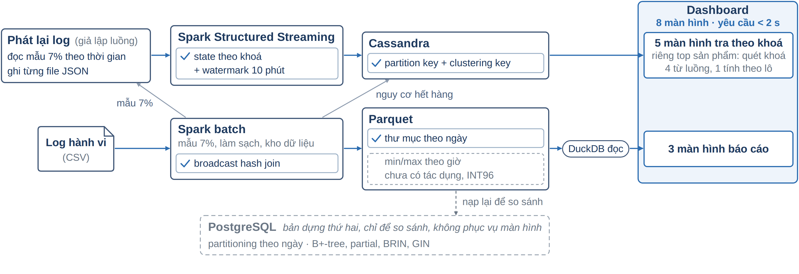

# ShopInsight: hướng dẫn cài đặt và chạy

<p class="subtitle">Nhóm 15 · Data Engineering (CO5173) · HCMUT, học kỳ 1 năm học 2026–2027 · Bản ngày 15/11/2026</p>

Tài liệu này hướng dẫn chạy ShopInsight từ mã nguồn trên một máy mới, dùng Windows, Linux hoặc macOS. Hệ thống đọc
tệp log hành vi `2019-Nov.csv` (67.5 triệu sự kiện view / cart / purchase, 9.0 GB) và lấy mẫu 7% khách hàng (4.77
triệu sự kiện). Từ mẫu đó, hệ thống dựng kho dữ liệu dạng star schema và tính các bảng gold. Kết quả hiện trên một
dashboard 8 màn hình, mỗi màn hình trả lời một yêu cầu nghiệp vụ (BR1–BR8).



## 1. Tổng quan các bước

| Bước | Việc cần làm | Thời gian |
|---|---|---|
| 1 | Cài phần mềm nền: Python 3.14, Java 21, Docker, Node.js (mục 2) | 20–40 phút (ước tính) |
| 2 | Clone mã nguồn từ GitHub, cài thư viện Python và web (mục 3) | 5–10 phút |
| 3 | Tải dữ liệu gốc: 2.9 GB nén, 9.0 GB sau khi giải nén (mục 4) | tuỳ tốc độ mạng |
| 4 | Khởi động Cassandra và PostgreSQL bằng Docker (mục 5) | 1–2 phút |
| 5 | Chạy pipeline batch một lần, gồm 7 script Spark (mục 6) | khoảng 7 phút trên máy của nhóm |
| 6 | Chạy streaming job, API, web và mở dashboard (mục 7, 8) | khoảng 2 phút |

Khi toàn bộ hệ thống đang chạy, máy có 2 container và 4 tiến trình:

| Thành phần | Dịch vụ hoặc lệnh | Cổng |
|---|---|---|
| Cassandra 4.1.12 | container `shopinsight-cassandra` | 9042 |
| PostgreSQL 16.15 | container `shopinsight-postgres` | 5432 |
| Streaming job (Spark Structured Streaming) | `python processing/streaming_gold.py` | Spark UI 4040 |
| Replayer, phát lại log thành luồng sự kiện | `python ingestion/replayer.py` | Spark UI 4041 |
| API (FastAPI) | `uvicorn serving.api.main:app` | 8000 |
| Web (React + Vite) | `npm run dev` trong thư mục `web/` | 5173 |

> [!NOTE]
> Nhóm phát triển, chạy và đo hệ thống trên Ubuntu 26.04 trong WSL2 (Windows 11), máy có 20 luồng CPU. Các bước cho
> Windows (WSL2) là đúng quy trình nhóm dùng; các bước cho Linux dùng chung các lệnh đó, trừ phần cài Docker. Các bước
> cho macOS được soạn theo tài liệu chính thức. Nhóm đã xác nhận mọi thư viện Python và image Docker đều có bản cho Mac
> chip Apple lẫn chip Intel, nhưng chưa chạy thử toàn bộ hệ thống trên máy Mac thật.

## 2. Cài phần mềm nền

Yêu cầu chung cho máy:

- RAM tối thiểu 16 GB. Khi toàn bộ hệ thống đang chạy, tiến trình Spark chiếm khoảng 7 GB (6 GB heap), Cassandra
  khoảng 3 GB (2 GB heap) và PostgreSQL khoảng 1 GB, tổng cộng khoảng 11 GB.
- Ổ đĩa trống ít nhất 20 GB. Trên Windows nên để 25 GB, vì đĩa ảo của WSL và Docker chỉ tăng chứ không tự thu nhỏ.
- Có kết nối Internet để tải gói cài đặt và dữ liệu.
- Các cổng 5173, 8000, 9042 và 5432 chưa bị chương trình khác chiếm. Trên Windows, cổng có thể bị chiếm bởi cả chương
  trình chạy ngoài WSL, ví dụ PostgreSQL cài trên Windows. Kiểm tra trong PowerShell bằng
  `netstat -ano | findstr ":5432 :9042 :8000 :5173"`: không có dòng `LISTENING` nào là được.

| Phần mềm | Phiên bản | Ghi chú |
|---|---|---|
| Python | 3.14.x | Bắt buộc 3.14. Mọi thư viện được ghim phiên bản chính xác trong `requirements.txt`, trong đó có `pyspark==4.1.3` |
| Java (OpenJDK) | 21 | Spark 4 cần Java 17 trở lên; nhóm dùng 21 |
| Docker | Docker Desktop (Windows, macOS) hoặc Docker Engine có plugin `docker compose` (Linux) | Chạy Cassandra và PostgreSQL. Spark không chạy trong Docker |
| Node.js | 22.12 trở lên (nhóm dùng 24) | Cho web React (Vite 8.3) |
| git, curl, unzip | bản bất kỳ | Lấy mã nguồn, tải và giải nén dữ liệu |

### 2.1 Windows 10/11: chạy trong WSL2 với Ubuntu 26.04

Trên Windows, hệ thống chạy bên trong WSL2 (một máy Linux chạy trên Windows), không chạy trực tiếp trên Windows. Có ba
lý do:

- Spark cần thêm `winutils.exe` mới ghi được Parquet trên Windows.
- Thư viện `uvloop` của API không có bản cho Windows.
- Streaming job gọi hàm `time.tzset()`, hàm này chỉ có trên Unix.

Mọi lệnh từ mục 2.2 trở đi được gõ trong terminal của Ubuntu, không gõ trong PowerShell.

1. Mở PowerShell với quyền Administrator và chạy:

   ```powershell
   wsl --update
   wsl --install -d Ubuntu-26.04
   ```

   Nếu Windows yêu cầu khởi động lại, khởi động lại máy rồi chạy lại lệnh thứ hai. Cài xong, Ubuntu tự mở ngay trong
   cửa sổ đó và hỏi tên người dùng Linux (chữ thường, không dấu cách) cùng mật khẩu; các lệnh `sudo` ở mục sau sẽ hỏi
   lại mật khẩu này. Chạy `wsl -l -v` trong PowerShell: dòng `Ubuntu-26.04` phải có VERSION là `2`. Nếu máy đã có bản
   phân phối WSL khác, chạy thêm `wsl --set-default Ubuntu-26.04`. Từ đây, mở Ubuntu bằng mục "Ubuntu 26.04 LTS"
   trong Start menu. Cần gõ đúng tên `Ubuntu-26.04`: tên `Ubuntu` có thể ứng với một bản Ubuntu khác đã cài sẵn.

2. Nếu máy có 16 GB RAM, cần nâng giới hạn RAM cho WSL, vì mặc định WSL chỉ nhận một nửa RAM (8 GB), không đủ cho hệ
   thống. Trong PowerShell, chạy:

   ```powershell
   notepad "$env:USERPROFILE\.wslconfig"
   ```

   Nếu Notepad hỏi có tạo tệp mới không, chọn Yes. Dán nội dung dưới đây rồi bấm Ctrl+S. Nếu tệp đã có mục `[wsl2]`,
   chỉ thêm dòng `memory=12GB` vào mục đó.

   ```text
   [wsl2]
   memory=12GB
   ```

   Sau đó chạy `wsl --shutdown` trong PowerShell và mở lại Ubuntu. Kiểm tra bằng lệnh `free -g` trong Ubuntu: cột
   `total` của dòng `Mem` phải khoảng 11–12. Máy từ 32 GB RAM trở lên không cần bước này.

3. Cài Docker Desktop for Windows (<https://www.docker.com/products/docker-desktop/>) và giữ backend WSL2 mặc định.
   Lần đầu mở Docker Desktop, bấm Accept ở Docker Subscription Service Agreement; không cần đăng nhập (chọn bỏ qua).
   Vào Settings → Resources → WSL Integration (bản mới có thể đặt mục này trong VM resources), bật `Ubuntu-26.04` rồi
   bấm Apply & Restart. Mở một terminal Ubuntu **mới** và chạy `docker version`: kết quả phải có cả khối Client và khối
   Server. Không cài thêm gói `docker.io` bên trong Ubuntu.

4. Trong terminal Ubuntu, cài Java, Python và Node.js như mục 2.2, bỏ qua phần cài Docker của mục đó.

> [!IMPORTANT]
> Đặt mã nguồn và dữ liệu trong thư mục home của Linux (`~`), không đặt dưới `/mnt/c/...`: đọc tệp 9 GB qua `/mnt/c`
> chậm hơn nhiều lần. Khi tài liệu nói "mở terminal", trên Windows là mở một tab Ubuntu: trong cửa sổ Ubuntu, bấm
> Ctrl+Shift+D để nhân đôi tab, hoặc bấm mũi tên ▾ cạnh dấu + và chọn Ubuntu 26.04 LTS. Tab mở bằng dấu + thường là
> PowerShell. Trình duyệt trên Windows vẫn mở được `http://localhost:5173` và `http://localhost:8000`, vì WSL2 tự
> chuyển tiếp localhost sang Windows.

### 2.2 Linux (Ubuntu)

Nhóm dùng Ubuntu 26.04. Trên Ubuntu 22.04 hoặc 24.04, kho mặc định chưa có Python 3.14, nên chạy trước hai lệnh sau
để thêm PPA deadsnakes. Ubuntu 26.04 (kể cả trong WSL2) bỏ qua bước này.

```bash
sudo apt install -y software-properties-common
sudo add-apt-repository -y ppa:deadsnakes/ppa
```

Sau đó, trên mọi bản Ubuntu, cài Java 21 và Python 3.14 bằng apt, đặt `JAVA_HOME`, rồi cài Node.js 24 qua nvm (giống
máy của nhóm; Node.js trong kho apt của Ubuntu 22.04 và 24.04 quá cũ):

```bash
sudo apt update
sudo apt install -y openjdk-21-jdk-headless python3.14-venv git unzip curl
echo "export JAVA_HOME=/usr/lib/jvm/java-21-openjdk-$(dpkg --print-architecture)" >> ~/.bashrc
curl -o- https://raw.githubusercontent.com/nvm-sh/nvm/v0.40.7/install.sh | bash
source ~/.bashrc
nvm install 24
java -version
python3.14 --version
node --version
```

Kết quả mong đợi là `openjdk version "21...`, `Python 3.14.x` và `v24.x`.

Cài Docker (chỉ khi chạy Linux trực tiếp; trên WSL2 đã có Docker Desktop từ mục 2.1). Nên dùng kho apt của chính
Docker, vì kho này có sẵn plugin `docker compose` mà mọi lệnh trong tài liệu dùng:

```bash
curl -fsSL https://get.docker.com | sudo sh
sudo usermod -aG docker $USER
```

Đăng xuất rồi đăng nhập lại để quyền nhóm `docker` có hiệu lực (qua SSH thì kết nối lại; nếu vẫn báo
`permission denied`, khởi động lại máy). Sau đó chạy `docker run --rm hello-world`: lệnh phải in ra
`Hello from Docker!`. Nếu máy đã có Docker từ gói `docker.io` của Ubuntu, cài thêm plugin compose bằng
`sudo apt install -y docker-compose-v2`.

**Bản phân phối khác.** Nhóm chỉ chạy trên Ubuntu. Với bản phân phối khác, cần cài được đủ Python 3.14, JDK 21,
Node.js 22.12 trở lên và Docker Engine có plugin `docker compose`. Nếu bản phân phối chưa có Python 3.14, cách đơn
giản nhất là dùng Ubuntu 26.04 (máy ảo hoặc WSL2).

### 2.3 macOS

**Mac chip Apple (M1 trở lên) chạy macOS 15 trở lên**, dùng Homebrew (<https://brew.sh>):

```bash
brew install python@3.14 openjdk@21 node
sudo ln -sfn "$(brew --prefix)/opt/openjdk@21/libexec/openjdk.jdk" \
  /Library/Java/JavaVirtualMachines/openjdk-21.jdk
echo 'export JAVA_HOME="$(/usr/libexec/java_home -v 21)"' >> ~/.zshrc
source ~/.zshrc
java -version
python3.14 --version
node --version
```

**Mac chip Intel, hoặc Mac chip Apple chạy macOS 14 trở xuống.** Homebrew chỉ có bản dựng sẵn của các gói trên cho Mac
chip Apple chạy macOS 15 trở lên. Trên các máy còn lại, Homebrew phải biên dịch từ mã nguồn (riêng `openjdk@21` cần
cài đủ ứng dụng Xcode) và mất rất lâu. Thay vào đó, dùng các bộ cài chính thức, có bản cho cả hai loại chip:

- Python 3.14: bộ cài macOS tại <https://www.python.org/downloads/macos/>
- Java 21: Eclipse Temurin 21 (.pkg) tại <https://adoptium.net/temurin/releases/?version=21>
- Node.js: bản LTS (.pkg) tại <https://nodejs.org>
- Git: có trong Xcode Command Line Tools, cài bằng lệnh `xcode-select --install`

Rồi đặt `JAVA_HOME` và kiểm tra phiên bản:

```bash
echo 'export JAVA_HOME="$(/usr/libexec/java_home -v 21)"' >> ~/.zshrc
source ~/.zshrc
java -version
python3.14 --version
node --version
```

**Docker Desktop for Mac** (<https://www.docker.com/products/docker-desktop/>): chọn đúng bản Apple chip hoặc Intel
chip; bản hiện tại cần macOS 14 trở lên. Vào Settings → Resources (bản mới gọi là VM resources), kiểm tra giới hạn
Memory ít nhất 6 GB.

Một số lưu ý riêng cho macOS:

- Trong mỗi cửa sổ Terminal dùng để chạy script Spark, chạy `ulimit -n 10240` trước. Mặc định macOS chỉ cho mở 256
  tệp cùng lúc; giới hạn này có thể khiến Spark báo lỗi `Too many open files` khi ghi Parquet.
- Luôn kích hoạt venv (mục 3) trước khi chạy script. Nếu quên, mọi lệnh `python ...` sẽ báo
  `zsh: command not found: python`, vì macOS không có lệnh `python` ngoài venv.
- Script `run_demo.sh` (mục 7) cần bash 5, trong khi macOS đi kèm bash 3.2. Trên macOS nên chạy các lệnh gõ tay ở
  mục 5–7. Trên Mac chip Apple có Homebrew, có thể chạy `brew install bash` rồi gọi `bash run_demo.sh ...` từ một
  Terminal mới.
- Nếu máy đã có PostgreSQL riêng (Postgres.app hoặc Homebrew) đang chiếm cổng 5432, tắt nó trong lúc chạy, hoặc đổi
  cổng như hướng dẫn ở mục 10.

## 3. Lấy mã nguồn và cài thư viện

Mã nguồn nằm trên GitHub: <https://github.com/Dat-TG/shop-insight>. Repo không chứa dữ liệu; thư mục `data/` chỉ có
các thư mục con rỗng.

Clone repo vào thư mục home rồi cài thư viện. Các lệnh giống nhau trên Linux, WSL2 và macOS:

```bash
cd ~
git clone https://github.com/Dat-TG/shop-insight.git
cd ~/shop-insight
python3.14 -m venv .venv
source .venv/bin/activate
pip install -r requirements.txt
python -c "import pyspark; print(pyspark.__version__)"
cd web
npm ci
cd ..
```

Lệnh `python -c ...` phải in ra `4.1.3`. Lệnh `pip install` mất vài phút (nhóm đo được khoảng 4 phút) vì `pyspark` là
gói mã nguồn nặng 455 MB.

> [!IMPORTANT]
> Mọi lệnh `python ...` trong các mục sau chạy từ thư mục gốc `~/shop-insight`, với venv đã kích hoạt. Mỗi terminal mở
> thêm đều phải chạy lại `cd ~/shop-insight` và `source .venv/bin/activate`.

<!-- two separate callouts -->

> [!WARNING]
> Trên Windows, hãy clone trong terminal Ubuntu như trên, không clone bằng Git for Windows rồi chép sang. Git for
> Windows mặc định đổi ký tự xuống dòng sang kiểu Windows và làm hỏng `run_demo.sh`; mã nguồn đặt dưới `/mnt/c` cũng
> chạy chậm hơn nhiều.

Các thư mục chính của mã nguồn:

| Thư mục | Nội dung |
|---|---|
| `ingestion/` | Nạp dữ liệu vào tầng bronze, sinh danh mục sản phẩm và tồn kho, replayer phát lại log |
| `processing/` | Các job Spark batch và streaming: silver, star schema, gold |
| `warehouse/ddl.sql` | Star schema trên PostgreSQL |
| `serving/` | Schema Cassandra, script kiểm tra hạ tầng, API FastAPI (`serving/api/`) |
| `web/` | Dashboard React + TypeScript |
| `conf/spark-defaults.conf` | Cấu hình Spark: driver 6 GB, múi giờ UTC |
| `SYSTEM_DESIGN.md`, `docs/` | Thiết kế chi tiết, báo cáo, bằng chứng đo đạc |

## 4. Tải dữ liệu gốc

Hệ thống cần đúng tệp `data/raw/2019-Nov.csv`, có kích thước 9,006,762,395 byte, thuộc bộ dữ liệu "eCommerce
behavior data from multi category store" của REES46 trên Kaggle. `load_bronze.py` dừng và báo lỗi nếu chưa có tệp
hoặc tệp mới tải được một phần. Cách A và cách B dưới đây đều không cần tài khoản Kaggle.

Các lệnh ở mục 4–6 chạy trong terminal của mục 3, đang ở `~/shop-insight` với venv đã kích hoạt. Nếu mở terminal mới,
chạy trước:

```bash
cd ~/shop-insight
source .venv/bin/activate
```

**Cách A (khuyến nghị):** tải bản zip 2.9 GB qua API công khai của Kaggle, rồi giải nén:

```bash
DS=mkechinov/ecommerce-behavior-data-from-multi-category-store
curl -L -o data/raw/2019-Nov.csv.zip \
  "https://www.kaggle.com/api/v1/datasets/download/$DS/2019-Nov.csv"
unzip data/raw/2019-Nov.csv.zip -d data/raw/
rm data/raw/2019-Nov.csv.zip
```

**Cách B:** tải bản gzip 2.9 GB từ máy chủ của REES46 (trang Kaggle của bộ dữ liệu có liệt kê đường dẫn này). Tệp
được giải nén ngay trong lúc tải, nên không cần thêm chỗ trống cho tệp nén:

```bash
curl -L https://data.rees46.com/datasets/marketplace/2019-Nov.csv.gz \
  | gunzip > data/raw/2019-Nov.csv
```

**Cách C:** tải bằng trình duyệt từ trang Kaggle (cần đăng nhập):
<https://www.kaggle.com/datasets/mkechinov/ecommerce-behavior-data-from-multi-category-store>. Chọn tệp `2019-Nov.csv`;
trình duyệt tải về tệp `2019-Nov.csv.zip`. Giải nén vào `data/raw/`: trên Linux và macOS dùng
`unzip ~/Downloads/2019-Nov.csv.zip -d data/raw/`. Trên Windows, trình duyệt lưu tệp vào thư mục Downloads của Windows;
giải nén từ Ubuntu bằng hai lệnh dưới đây (lệnh đầu tìm thư mục người dùng Windows, kể cả khi tên có dấu cách):

```bash
WINHOME="$(wslpath "$(cmd.exe /c 'echo %USERPROFILE%' 2>/dev/null | tr -d '\r')")"
unzip "$WINHOME/Downloads/2019-Nov.csv.zip" -d data/raw/
```

Kiểm tra kích thước tệp. Lệnh phải in ra `9006762395` (trên macOS có thêm một dấu cách phía trước):

```bash
wc -c < data/raw/2019-Nov.csv
```

Có thể kiểm tra nhanh Spark với dữ liệu vừa tải. Bước này không bắt buộc và mất từ 10 giây đến khoảng 1 phút:

```bash
python processing/kata.py
```

Script in ra phiên bản Python, Spark và Java, các dòng cho biết heap của driver là `6.0 GiB` và múi giờ là `UTC`, rồi
số sự kiện theo từng loại. Dòng cuối phải là `KATA OK`.

## 5. Khởi động Cassandra và PostgreSQL

Trên Windows và macOS, Docker Desktop phải đang chạy. Từ `~/shop-insight`:

```bash
docker compose up -d --wait
python serving/check_infra.py
python serving/apply_schema.py
docker compose exec -T postgres psql -U shopinsight -d shopinsight -v ON_ERROR_STOP=1 \
  < warehouse/ddl.sql
```

| Lệnh | Kết quả mong đợi |
|---|---|
| `docker compose up -d --wait` | Lần đầu tải khoảng 1.2 GB image. Lệnh xong khi cả hai container báo `Healthy`, sau khoảng 1–2 phút |
| `python serving/check_infra.py` | `INFRA OK` |
| `python serving/apply_schema.py` | `APPLY_SCHEMA OK`: đã tạo keyspace và 5 bảng của Cassandra |
| `psql ... < warehouse/ddl.sql` | Các dòng `CREATE TABLE`, `CREATE INDEX`, kết thúc bằng `COMMIT` |

`ddl.sql` chỉ chạy một lần, trên cơ sở dữ liệu rỗng; chạy lại sẽ báo lỗi `already exists` (xem mục 10). Cassandra phục
vụ 5 màn hình: BR1, BR3, BR5, BR6 và BR8. PostgreSQL chứa bản thứ hai của star schema (bản chính là Parquet), dùng làm
giải pháp thay thế để so sánh hiệu năng trong báo cáo; không màn hình nào đọc từ PostgreSQL.

## 6. Chạy pipeline batch (một lần)

Chạy lần lượt bảy script sau. Mỗi script là một job Spark độc lập và in một dòng `... OK` khi xong:

```bash
python ingestion/load_bronze.py
python processing/batch_silver.py
python ingestion/gen_catalog.py
python ingestion/gen_inventory.py
python processing/batch_warehouse.py
python processing/batch_gold.py
python processing/gold_br7.py
```

| Script | Việc làm | Dòng cuối | Thời gian đo |
|---|---|---|---|
| `load_bronze.py` | Đọc CSV, lấy mẫu 7% khách theo hàm băm `pmod(hash(user_id), 100) < 7`, ghi tầng bronze (Parquet) | `BRONZE OK` | 35 giây |
| `batch_silver.py` | Áp dụng 7 quy tắc làm sạch, đổi giờ sang UTC+7, ghi tầng silver | `SILVER OK` | 18 giây |
| `gen_catalog.py` | Sinh thuộc tính sản phẩm (dữ liệu giả lập) | `CATALOG OK` | 9 giây |
| `gen_inventory.py` | Sinh dữ liệu tồn kho giả lập theo ngày cho 5 kho | `INVENTORY OK` | 20 giây |
| `batch_warehouse.py` | Dựng star schema gồm 5 dimension (2 bảng SCD loại 2) và 3 fact, ghi Parquet và nạp vào PostgreSQL | `WAREHOUSE OK` | 4 phút 33 giây |
| `batch_gold.py` | Tính gold cho BR2, BR4 (Parquet) và BR6 (ghi vào Cassandra) | `GOLD OK` | 57 giây |
| `gold_br7.py` | Tính gold cho BR7 (ma trận đồng xuất hiện) | `BR7 OK` | 15 giây |

Các thời gian trên được đo ngày 3/11/2026 trên máy của nhóm (WSL2, 20 luồng CPU, 15 GB RAM cho WSL), tổng cộng 7 phút
7 giây. Máy có ít luồng CPU hơn sẽ chạy lâu hơn.

**Kiểm tra tính đúng đắn.** Mẫu được lấy theo hàm băm cố định, không dùng số ngẫu nhiên, nên máy nào cũng cho ra đúng
các con số dưới đây. Phần lớn các dòng kiểm tra mà script in ra có kèm giá trị mong đợi `(expect ...)`; các số còn lại
so với bảng này. Nếu thiếu bước trước, script dừng với thông báo nêu rõ cần chạy script nào.

| Tầng hoặc bảng | Kết quả mong đợi |
|---|---|
| bronze | 4,767,012 dòng; 258,390 khách; 129,899 sản phẩm; 30 thư mục ngày |
| silver | 4,754,015 dòng; 31 thư mục ngày, từ 2019-11-01 đến 2019-12-01 theo giờ Việt Nam |
| `fact_event` | 4,754,015 dòng |
| `fact_session_funnel` | 970,797 dòng, mỗi phiên một dòng |
| `fact_inventory_daily` | 1,909,650 dòng = 12,731 SKU × 5 kho × 30 ngày |
| `dim_product` / `dim_user` | 210,454 / 319,426 phiên bản SCD loại 2 |
| `rfm_segments` (BR4) | 258,330 khách, 7 phân khúc |
| `funnel_daily` (BR2) | 465 dòng |
| `stockout_risk` (BR6, Cassandra) | 12,731 dòng cho mỗi kho, 5 kho |

> [!TIP]
> Với máy 16 GB RAM, có thể tạm dừng hai container bằng `docker compose stop` trong lúc chạy `load_bronze.py`,
> `batch_silver.py`, `gen_catalog.py` và `gen_inventory.py`: các job này không cần cơ sở dữ liệu. Trước khi chạy
> `batch_warehouse.py`, bật lại container bằng `docker compose up -d --wait`. Nếu quên, `batch_warehouse.py` in dòng
> `postgres ... SKIPPED` mà vẫn kết thúc bằng `WAREHOUSE OK`; khi đó bật lại container rồi chạy lại script này. Không
> giảm giá trị `spark.driver.memory 6g` trong `conf/spark-defaults.conf`.

## 7. Chạy streaming job, API và web

Phần này cần 4 terminal chạy cùng lúc. Trong mỗi terminal, chạy `cd ~/shop-insight` trước. Với terminal 1–3, chạy thêm
`source .venv/bin/activate`; trên macOS, chạy thêm `ulimit -n 10240` cho terminal 1 và 2.

**Terminal 1: streaming job, chạy trước.**

```bash
python processing/streaming_gold.py --fresh
```

Đợi đến khi thấy dòng `READY: 4 of 4 jobs running`, mất khoảng 10 giây. Dòng READY tiếp theo gợi ý lệnh replayer
không có `--start`; hãy dùng đúng lệnh ở terminal 2 dưới đây. Job đọc thư mục `data/stream_landing/` theo từng
micro-batch 5 giây. Mỗi micro-batch được làm sạch bằng 7 quy tắc của silver, rồi job tính BR1, BR3, BR5 và BR8 và ghi
kết quả vào Cassandra. Cờ `--fresh` xoá checkpoint, các tệp JSON cũ trong `data/stream_landing/` và toàn bộ dữ liệu
của bốn bảng streaming, để mỗi lần chạy đều bắt đầu từ trạng thái trống.

**Terminal 2: replayer, chạy sau khi thấy READY.**

```bash
python ingestion/replayer.py --speed 60 --start "2019-11-17 08:00:00"
```

Replayer phát lại tầng bronze theo thứ tự thời gian, nhanh gấp 60 lần (một giờ dữ liệu trong một phút). Cứ 5 giây,
replayer ghi một tệp JSON chứa 5 phút sự kiện. Mốc 2019-11-17 08:00 UTC là 15:00 giờ Việt Nam, nằm trong ngày mà các
màn hình thời gian thực mặc định hiển thị. Replayer chạy cho tới khi nhấn Ctrl+C.

> [!WARNING]
> Phải chạy streaming job trước rồi mới chạy replayer. Nếu làm ngược lại, `--fresh` xoá những tệp replayer đã ghi,
> nên mất đoạn đầu của lần phát lại; còn nếu chạy không có `--fresh`, các tệp này dồn thành một micro-batch khổng lồ.
> Khi đó nhấn Ctrl+C ở cả hai terminal và chạy lại theo đúng thứ tự.

**Terminal 3: API.**

```bash
uvicorn serving.api.main:app --port 8000
```

Mở <http://localhost:8000/health>: kết quả phải là `{"status":"ok"}`. Tài liệu API (Swagger) nằm ở
<http://localhost:8000/docs>.

**Terminal 4: web.**

```bash
cd web
npm run dev
```

Mở <http://localhost:5173> trên trình duyệt. Nếu cổng 5173 bận, Vite tự chuyển sang 5174 và in địa chỉ mới.

### Cách thay thế trên Linux và WSL2: script `run_demo.sh`

Có thể dùng script `run_demo.sh` thay cho các lệnh gõ tay ở mục 5 và mục 7; script không chạy pipeline batch ở mục 6.
Nếu đã làm theo các bước gõ tay ở trên, bỏ qua phần này. Sau khi xong mục 3 và mục 4, chạy:

```bash
./run_demo.sh infra
```

Chạy pipeline batch ở mục 6 nếu chưa chạy, rồi chạy tiếp:

```bash
./run_demo.sh stream
./run_demo.sh app
```

- `infra` làm các việc ở mục 5, và bỏ qua `ddl.sql` nếu schema đã có. Lần đầu, script in vài dòng
  `[WARN] Postgres fact_event is empty` kèm danh sách lệnh: đó là pipeline batch, chạy theo mục 6.
- `stream` chạy streaming job với `--fresh`, đợi READY, rồi chạy replayer từ 2019-11-17 08:00.
- `app` chạy API và web ở chế độ nền.

Log nằm trong thư mục `logs/`. Lệnh `./run_demo.sh stop` dừng streaming job, replayer, API và web; hai container vẫn
chạy cho tới khi gọi `docker compose stop`.

## 8. Kiểm tra 8 màn hình

Dashboard có 8 tab, chia theo 4 nhóm người dùng. Bốn màn hình batch (BR2, BR4, BR6, BR7) có dữ liệu ngay, vì đã được
tính ở mục 6. Bốn màn hình thời gian thực (BR1, BR3, BR5, BR8) có dữ liệu sau vài chục giây kể từ khi replayer chạy, và
tự làm mới mỗi 10 giây.

| Tab (nhóm người dùng) | BR | Câu hỏi nghiệp vụ | Nguồn dữ liệu | Có dữ liệu sau |
|---|---|---|---|---|
| Real-time Ops (Executives) | BR1 | GMV và số đơn mỗi phút, theo ngành hàng | Cassandra `gmv_by_minute` | khoảng 25 giây |
| Conversion Funnel (Marketing) | BR2 | Phễu chuyển đổi view → cart → purchase theo phiên | Parquet `funnel_daily`, đọc bằng DuckDB | ngay |
| RFM Segments (Marketing) | BR4 | Phân khúc khách hàng theo RFM | Parquet `rfm_segments` | ngay |
| Abandoned Carts (Marketing) | BR5 | Phiên có thêm vào giỏ nhưng không mua trong 30 phút | Cassandra `abandoned_carts` | khoảng 1 phút |
| Trending Products (Merchandising) | BR3 | Top 20 sản phẩm trong cửa sổ trượt 15 phút | Cassandra `trending_products` | khoảng 35 giây |
| Product Affinity (Merchandising) | BR7 | Sản phẩm thường được mua cùng nhau | Parquet `product_affinity` | ngay, sau khi nhập mã sản phẩm hoặc chọn một mã gợi ý |
| Stockout Risk (Operations & Risk) | BR6 | Nguy cơ hết hàng theo SKU và kho | Cassandra `stockout_risk` (batch) | ngay |
| Order Velocity (Operations & Risk) | BR8 | Tốc độ đặt hàng bất thường của khách | Cassandra `order_velocity_alerts` | khoảng 25 giây |

Thời gian ở cột cuối tính từ lúc replayer khởi động, đo trên máy của nhóm.

Chân mỗi màn hình có một dòng QueryMeta dạng `<thời gian> ms / <nơi lưu trữ> / <số> partitions / <số> rows`. Dòng này
cho biết thời gian truy vấn phía server và số partition đã đọc. Đây là bằng chứng cho yêu cầu mỗi màn hình trả lời
dưới 2 giây.

Một số lưu ý khi xem:

- BR1, BR5 và BR8 có ô chọn ngày, mặc định là 2019-11-17, khớp với `--start` ở mục 7. Replayer bắt đầu lúc 15:00 giờ
  Việt Nam, nên sau khoảng 9 phút dữ liệu phát lại sang ngày 2019-11-18. Từ lúc đó, ba màn hình này vẫn giữ dữ liệu
  ngày 17 nhưng ngừng cập nhật; đổi ô chọn ngày sang 2019-11-18 để xem dữ liệu mới.
- BR8 mặc định lọc mức Medium + High, và mức High chỉ xuất hiện sau khoảng 1.5 phút. Chọn "All Severities" để xem cả
  mức Low.
- BR6 không tự làm mới; bấm nút Refresh để tải lại.

## 9. Dừng và dọn dẹp

- Nhấn Ctrl+C ở từng terminal. Streaming job đợi tối đa 10 giây để xong micro-batch đang chạy. Các dòng lỗi như
  `Connection reset by peer` hay `Broken pipe` xuất hiện lúc dừng là bình thường.
- `docker compose stop` dừng hai container nhưng giữ dữ liệu. Bật lại bằng `docker compose up -d --wait`.
- Muốn chạy lại phần streaming từ đầu, chỉ cần làm lại mục 7, vì `--fresh` tự dọn trạng thái cũ. Không cần chạy lại
  pipeline batch.
- Muốn xoá dữ liệu của Cassandra và PostgreSQL, chạy `docker compose down -v`. Để dùng tiếp sau lệnh này, làm lại mục 5,
  rồi chạy `python processing/batch_warehouse.py` và `python processing/batch_gold.py` để nạp lại PostgreSQL và bảng
  của BR6.
- Muốn gỡ hoàn toàn, chạy `docker compose down -v` rồi xoá thư mục `~/shop-insight`.

## 10. Xử lý sự cố

| Hiện tượng | Nguyên nhân | Cách xử lý |
|---|---|---|
| `ensurepip is not available` khi tạo venv | Thiếu gói `python3.14-venv` | `sudo apt install -y python3.14-venv`, xoá thư mục `.venv` rồi tạo lại |
| `JAVA_HOME is not set` hoặc `Java gateway process exited before sending its port number` | Chưa cài Java 21, hoặc terminal chưa nạp `JAVA_HOME` | Cài Java 21 theo mục 2, mở terminal mới, kiểm tra `java -version` |
| `UnsupportedClassVersionError` | Máy đang ưu tiên một bản Java cũ hơn bản 21 | Linux: `echo $JAVA_HOME` phải in `/usr/lib/jvm/java-21-openjdk-amd64`; nếu không, sửa dòng `export JAVA_HOME=` cuối `~/.bashrc` rồi mở terminal mới. macOS: kiểm tra dòng `JAVA_HOME` trong `~/.zshrc` |
| `Segmentation fault` hoặc `Fatal Python error` | Chạy ngoài venv, hoặc cài sai phiên bản pyspark | `source .venv/bin/activate`, rồi `pip install -r requirements.txt` |
| macOS: `command not found: python` | Chưa kích hoạt venv trong terminal này | `cd ~/shop-insight && source .venv/bin/activate` |
| `Cannot connect to the Docker daemon` | Docker chưa chạy | Mở Docker Desktop và đợi khởi động xong. Linux: `sudo systemctl start docker` |
| `Command 'docker' not found` hoặc `The command 'docker' could not be found in this WSL 2 distro` | Chưa bật WSL Integration | Docker Desktop → Settings → Resources → WSL Integration → bật `Ubuntu-26.04` → Apply & Restart, rồi mở terminal mới |
| `unknown shorthand flag: 'd' in -d` hoặc `'compose' is not a docker command` | Docker cài từ gói `docker.io`, thiếu plugin compose | `sudo apt install -y docker-compose-v2` |
| `permission denied ... docker.sock` | Phiên làm việc mở trước khi người dùng được thêm vào nhóm `docker` | Đăng xuất rồi đăng nhập lại. Với WSL2: `wsl --shutdown` trong PowerShell, mở lại Ubuntu, rồi mở lại Docker Desktop (lệnh này cũng tắt Docker) |
| `INFRA CHECK FAILED` kèm `Connection refused` | Cassandra cần 30–60 giây để mở cổng 9042 | Dùng `docker compose up -d --wait` (có `--wait`), đợi rồi chạy lại |
| Cassandra `exited (137)`, `OutOfMemoryError`, hoặc WSL tự đóng | Thiếu RAM | Đặt `memory=12GB` trong `.wslconfig` (mục 2.1); dừng container khi chạy các job đầu của mục 6; đóng bớt ứng dụng |
| `Ports are not available`, `port is already allocated` hoặc `Address already in use` | Chương trình khác đang chiếm cổng 5432, 9042, 8000 (trên Windows có thể là chương trình ngoài WSL) | Tắt chương trình đó. Với cổng cơ sở dữ liệu, có thể chạy `cp .env.example .env` rồi đổi `POSTGRES_PORT` hoặc `CASSANDRA_PORT` trong `.env` |
| `relation "dim_date" already exists` khi chạy `ddl.sql` | Schema PostgreSQL đã có từ lần trước | Không cần làm gì. Muốn tạo lại từ đầu, xem lệnh ngay dưới bảng này |
| `... not found. Download it first` hoặc `... is N bytes, not 9,006,762,395: a partial download` | Thiếu tệp CSV, hoặc tệp chưa tải xong | Tải lại theo mục 4 và kiểm tra kích thước |
| Màn hình thời gian thực trống hoặc không cập nhật | Chưa đủ thời gian (25–65 giây); ô chọn ngày khác ngày đang phát lại; hoặc khởi động lại streaming job mà không có `--fresh` | Đợi thêm; đặt ô chọn ngày về 2019-11-17 (hoặc 2019-11-18 nếu replayer đã chạy quá 9 phút); nếu vẫn trống, chạy lại mục 7 theo đúng thứ tự |
| Streaming job cảnh báo `files already in ... stream_landing` | Replayer chạy trước streaming job, và streaming job chạy không có `--fresh` | Nhấn Ctrl+C ở cả hai terminal; chạy `streaming_gold.py --fresh`, đợi READY, rồi chạy replayer |
| `Service 'sparkDriver' could not bind on a random free port` | Mạng ảo, VPN | `export SPARK_LOCAL_IP=127.0.0.1` rồi chạy lại |
| `$'\r': command not found` hoặc `bash\r` khi chạy `run_demo.sh` | Tệp bị đổi ký tự xuống dòng khi giải nén trên Windows | Giải nén lại trong Ubuntu (mục 3), hoặc chạy `sed -i 's/\r$//' run_demo.sh`; gọi bằng `bash run_demo.sh ...` |
| macOS: `Too many open files` | Giới hạn mặc định 256 tệp mở | `ulimit -n 10240` trong terminal đó, rồi chạy lại |
| macOS: `... when fork() was called` hoặc `Python worker exited unexpectedly` | Cơ chế an toàn khi fork của macOS chặn worker Python của Spark | `export OBJC_DISABLE_INITIALIZE_FORK_SAFETY=YES` rồi chạy lại |

Để xoá schema PostgreSQL và tạo lại từ đầu, chạy lệnh dưới đây, rồi chạy lại lệnh `ddl.sql` ở mục 5 và
`python processing/batch_warehouse.py` để nạp lại dữ liệu:

```bash
docker compose exec -T postgres psql -U shopinsight -d shopinsight \
  -c 'DROP SCHEMA public CASCADE; CREATE SCHEMA public;'
```

Các cảnh báo sau xuất hiện cả trong những lần chạy thành công và có thể bỏ qua: `Unable to load native-hadoop library`,
`Your hostname ... resolves to a loopback address`, `SparkUI could not bind on port 4040` (streaming job và replayer là
hai tiến trình Spark riêng, nên tiến trình sau dùng cổng 4041).

Tài liệu chi tiết hơn có trong mã nguồn: `README.md`, `SYSTEM_DESIGN.md`, `docs/SETUP_SPARK.md` (cài đặt và bảng lỗi
đầy đủ, tiếng Anh) và `docs/SPARK_GUIDE_VI.md` (giải thích từng bước bằng tiếng Việt).

<div class="page-break"></div>

## Phụ lục: toàn bộ lệnh trên Linux và WSL2

Các lệnh dưới đây giả định phần mềm nền ở mục 2 đã cài xong. Chạy lần lượt trong một terminal; lệnh `wc -c` phải in
ra `9006762395`.

```bash
cd ~
git clone https://github.com/Dat-TG/shop-insight.git
cd ~/shop-insight
python3.14 -m venv .venv
source .venv/bin/activate
pip install -r requirements.txt
(cd web && npm ci)
DS=mkechinov/ecommerce-behavior-data-from-multi-category-store
curl -L -o data/raw/2019-Nov.csv.zip \
  "https://www.kaggle.com/api/v1/datasets/download/$DS/2019-Nov.csv"
unzip data/raw/2019-Nov.csv.zip -d data/raw/
rm data/raw/2019-Nov.csv.zip
wc -c < data/raw/2019-Nov.csv
docker compose up -d --wait
python serving/check_infra.py
python serving/apply_schema.py
docker compose exec -T postgres psql -U shopinsight -d shopinsight -v ON_ERROR_STOP=1 \
  < warehouse/ddl.sql
python ingestion/load_bronze.py
python processing/batch_silver.py
python ingestion/gen_catalog.py
python ingestion/gen_inventory.py
python processing/batch_warehouse.py
python processing/batch_gold.py
python processing/gold_br7.py
```

Sau đó mở bốn terminal, mỗi dòng dưới đây chạy trong một terminal riêng và để cả bốn cùng chạy. Khởi động theo thứ tự
từ trên xuống; chỉ chạy dòng thứ hai sau khi terminal 1 in `READY: 4 of 4 jobs running`. Ở terminal 1–3, chạy trước
`cd ~/shop-insight && source .venv/bin/activate`.

```bash
python processing/streaming_gold.py --fresh
python ingestion/replayer.py --speed 60 --start "2019-11-17 08:00:00"
uvicorn serving.api.main:app --port 8000
cd ~/shop-insight/web && npm run dev
```

Cuối cùng mở <http://localhost:5173>.
